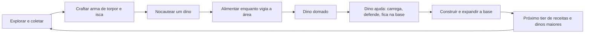
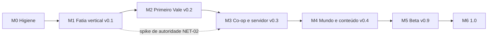

# Dino Vale: planejamento de desenvolvimento

Versão 1.0 do plano, 05/11/2026. Autor: `SHIKAMARU`. Documento vivo: atualize ao fechar cada marco.

**Como ler.** Fato = veio do brief, do `game/README.md` ou do repositório. Tudo marcado **[premissa]** é suposição minha e deve ser confirmada ou corrigida pelo dono.

**Já decidido pelo dono (fora de discussão):** código em **MIT** (`LICENSE` na raiz); repositório **rotteny/dinovale**, **público** (ainda sem commit); Godot 4.7 + GDScript; arquitetura de lógica separada da apresentação, composição e saves em Dictionary/JSON.
**Em aberto:** licença dos **assets** (arte e som). A MIT do código não cobre isso por si só (seção 9).

Estado de partida (fato): 127 verificações headless passando (Health, Torpor, Stamina, Hunger, Taming, máquina de estados do dino, Player com input); cerca de 1,2 mil linhas de GDScript, testes incluídos; `SORA` entregando Inventory, InteractableArea, ataque de torpor, HUD e inventário compartilhado; `BULMA` na landing em `html/`. Sem commit, sem CI, sem arte, sem som.

---

## 1. Visão, pilares e o que o jogo não será

**Visão.** Um vale pré-histórico para sobreviver, construir uma base e criar um rebanho de dinossauros que você aprendeu a domar. Gratuito, aberto, e que qualquer pessoa consiga hospedar para os amigos com um comando.

**Pilares** (cada um serve de filtro para cortar escopo):

1. **O vínculo é o centro.** Domar não é só desbloquear estatística: o dino domado tem papel e precisa de cuidado. Se uma feature não reforça o laço jogador-dino, base ou sobrevivência, ela é candidata a corte.
2. **Risco legível e justo.** O perigo se anuncia (som, sombra, barra) e a morte custa algo, mas não destrói horas de jogo (itens recuperáveis).
3. **Base com propósito.** Construir protege, guarda e produz. Nada de construção só estética no começo.
4. **Fácil de hospedar.** Uma imagem Docker, um volume, uma porta UDP. Servidor pequeno, sem conta, sem telemetria.
5. **Aberto e moddável por dados.** Espécies, itens e receitas são dados, não código espalhado.

**O jogo não será** (decisão de escopo, vale até a 1.0):

- MMO, servidor persistente oficial 24/7 ou PvP competitivo/raid. [premissa: sem servidor oficial até depois da 1.0]
- Jogo com monetização, loja ou pay-to-win. (Coerente com "gratuito".)
- 3D, mobile ou web. [premissa]
- Grind de estatísticas por nível ao estilo RPG pesado. A progressão é por tecnologia (receitas) e relacionamento com os dinos.
- Reprodução do conteúdo, nomes, arte ou som de qualquer jogo existente. Mecânicas de gênero são livres; vocabulário e identidade visual são nossos (ver R12).

---

## 2. Core loop e o primeiro lançamento público

- **Minuto a minuto (2 a 5 min):** coletar, craftar, enfrentar ou fugir.
- **Sessão (30 a 60 min) [premissa]:** sobreviver ao dia, domar um dino, ter um abrigo e voltar ao jogo com o save.
- **Longo prazo:** base e rebanho crescem; regiões perigosas pedem dinos melhores.

**Hipóteses de diversão a validar** (o playtest existe para derrubá-las):

- H1: a janela de domar (vigiar o nocauteado alimentando-o enquanto algo ameaça) gera tensão, não espera chata.
- H2: o dino domado dá retorno perceptível em minutos (segue, carrega, defende).
- H3: construir um abrigo tem motivo claro (noite, predador, armazenar).

**Crítica ao design atual.** O loop "nocautear, alimentar, domar" é a mecânica de gênero mais reconhecível. É legal reutilizar, mas sozinha não dá identidade ao jogo. Ver decisão D5 (diferencial do vínculo).

### Primeiro lançamento público: v0.2 "Primeiro Vale"

Um jogador, mundo fixo e pequeno, loop completo de ponta a ponta. **Co-op não é Must da 0.2**, mas a arquitetura nasce preparada e é validada por spike já no fim do M1 (seção 3).

| MoSCoW | Escopo da 0.2 |
|---|---|
| **Must** | Mundo fixo com 2 a 3 biomas pequenos, colisão e limites. Coleta de madeira, pedra, fibra e baga. Inventário e HUD. Crafting com 8 a 10 receitas e 2 tiers. Arma de torpor e domar 3 a 4 espécies (herbívoro dócil, carnívoro pequeno, 1 maior). Dino domado: seguir, ficar, comer, carregar e defender. Construção: fundação, parede, porta, baú. Fome. Morte, respawn e recuperação de itens. Ameaça real (carnívoro que persegue). Save/load em arquivo com versão. Menu e pausa. Tutorial contextual. Arte coesa e legível (CC0 + própria), SFX mínimos. Builds Linux e Windows. |
| **Should** | Ciclo dia/noite. Configurações (volume, remap, tela cheia). Música em loop. Teste de rede do spike repetido com construção e crafting (NET-03). |
| **Could** | Fogueira e cozinhar. Montaria. Sede. Build macOS não assinado. Página no itch.io. |
| **Won't (0.2)** | Multiplayer. Mundo procedural e chunking. Mods. Web e mobile. Localização. Boss. |

**Critério de "realmente divertido" (testável, 0.2):** playtest observado com 5 pessoas fora do círculo do dono [premissa de tamanho e metas abaixo]:

- pelo menos 4 domam um dino sem ajuda;
- pelo menos 3 constroem um abrigo sem ajuda;
- a sessão observada dura em média 30 min ou mais sem o facilitador pedir para continuar;
- pelo menos 3 respondem "sim" a "jogaria de novo amanhã?";
- zero perda de save e zero erro de script no log.

Se H1 ou H2 falharem, o próximo ciclo ajusta o loop antes de qualquer conteúdo novo.

---

## 3. Fases e marcos até a 1.0

### Onde discordo do roadmap do README

| # | README | Problema | Proposta |
|---|---|---|---|
| 1 | Multiplayer só na Fase 3 | Retrofit de autoridade em inventário, crafting, construção e domar custa mais do que o resto do jogo junto | Regras "pronto para rede" desde o M0, camada de autoridade no M1, **spike de rede no fim do M1**, co-op no M3 (antes de chunking e conteúdo) |
| 2 | Grid de construção antes de save | Save é barato agora e disciplina todo `to_dict`; construção sem save não é testável | Ordem: inventário, HUD, **save**, depois construção |
| 3 | Chunking e geração na Fase 2, antes de rede | Depende de como a rede replica (interesse por chunk). Para a fatia basta mapa fixo | Mapa fixo até o M3; chunking no M4. Mas o grid de construção já usa `Vector2i` global em Dictionary, que é amigável a chunk |
| 4 | Morte e respawn na Fase 2 | Survival sem consequência não gera tensão (H1) | Mínimo no M1, completo no M2 |
| 5 | Ordens "seguir e ficar" na Fase 2 | Sem elas domar não tem retorno (H2) | Entram no M1 |
| 6 | Arte e som definitivos na Fase 2 | Arte é o maior gargalo e o mais demorado; decidir tarde trava tudo | Guia de arte no M1, kit v0 no M2, arte final no M5 |
| 7 | Sem CI, sem teste de cena, sem política de agentes | 127 checagens de lógica não pegam quebra de cena; agentes em paralelo sobrescrevem trabalho | M0 inteiro: commit, `check.sh`, testes de arquitetura, `AGENTS.md` |
| 8 | Licença "a definir" | Já decidida (MIT). Falta a licença dos assets | D1 |

### M0: Higiene do repositório
- **Objetivo:** ninguém perde trabalho e toda mudança é verificada do mesmo jeito.
- **Entregáveis:** primeiro commit e push para rotteny/dinovale; `tools/check.sh`; testes de arquitetura; ADR-001 a 003; `AGENTS.md`; SPDX e `CREDITS.md`.
- **Saída verificável:** `tools/check.sh` verde local e no CI; testes de arquitetura falham quando uma violação é introduzida de propósito; varredura de segredos limpa antes do push; LICENSE e `assets/CREDITS.md` presentes; ADRs aprovados pelo dono.

### M1: Fatia vertical, v0.1 "pré-alpha"
- **Objetivo:** provar o loop em um build exportado: coletar, craftar, domar, o dino segue, salvar, fechar, carregar.
- **Entregáveis:** o que está em andamento com `SORA`, mapa fixo, recursos, itens e espécies como dados, comportamentos Flee/Chase/Attack, ordens seguir/ficar, morte mínima, save v1, menu, smoke test de cena, export, CI, **spike S0 de autoridade**, guia de arte.
- **Saída verificável:**
  1. Build Linux e Windows executa o roteiro: novo jogo, coletar, craftar arma, nocautear herbívoro, domar, ele segue, salvar, sair, continuar, e o dino domado volta com estado idêntico.
  2. O mesmo roteiro roda como smoke test headless no CI.
  3. S0: servidor headless e 1 cliente; jogador e dino sincronizam; o servidor rejeita 3 intents inválidas (fora de alcance, item que não existe, velocidade impossível).
  4. 3 de 5 testadores externos completam o fluxo em até 20 min sem ajuda [premissa de meta].
  5. Zero erro de script no log; CI verde.
- **Se S0 falhar:** parar e reavaliar o modelo (ver R1) antes de começar o M2.

### M2: Primeiro Vale, v0.2 (primeiro lançamento público)
- **Objetivo:** loop completo e divertido para uma pessoa (seção 2).
- **Entregáveis:** escopo Must e Should da seção 2.
- **Saída verificável:** critérios de diversão da seção 2; 100 ciclos automatizados de save/load sem divergência; fixture de save v1 migra para v2; release no GitHub com binários e checksums gerados por tag; nenhum bug P0 aberto; build roda a 60 fps estáveis em máquina de referência [premissa: a definir, ex. notebook com gráficos integrados de 2020].

### M3: Co-op e servidor dedicado, v0.3
- **Objetivo:** 2 a 8 jogadores [premissa] num servidor que qualquer um sobe com Docker.
- **Entregáveis:** rede (lobby, spawn, replicação de jogadores, dinos, inventário, construção), servidor headless configurável, validação de entrada, imagem Docker e guia de auto-hospedagem, testes de rede no CI.
- **Saída verificável:** `docker run` sobe o servidor; 4 clientes jogam 30 min sem desync; teste de soak de 2 h sem crescimento de memória [premissa de meta]; `kill -9` perde no máximo o intervalo de autosave; suíte de entrada inválida passa; revisão de `NEZUKO` sem achado Alto ou Crítico aberto; guia de hospedagem executado com sucesso por pessoa de fora em máquina limpa; handshake recusa cliente de versão de protocolo incompatível.

### M4: Mundo e conteúdo, v0.4
- **Objetivo:** mundo grande, variado, com progressão.
- **Entregáveis:** chunking e streaming, geração por seed, persistência por chunk, interesse por chunk na rede, 8 espécies no total, ameaças e dificuldade, 3 a 5 tiers, clima.
- **Saída verificável:** mesmo seed gera o mesmo mapa (hash igual); mundo de pelo menos 512x512 tiles [premissa]; sem queda abaixo de 60 fps ao cruzar chunks na máquina de referência; servidor com 8 jogadores dentro do orçamento de CPU definido no M3; saves 0.3 migram.

### M5: Beta, v0.9
- **Objetivo:** cara e som finais, polimento, beta público.
- **Entregáveis:** arte final do conteúdo Must, som e música, tutorial completo, localização en e pt-BR, acessibilidade básica, documentação final.
- **Saída verificável:** script confirma que todo arquivo em `assets/` está coberto por `CREDITS.md` com licença compatível; beta público de pelo menos 2 semanas com relatos triados [premissa]; todos os saves das versões 0.x migram nas fixtures.

### M6: 1.0
- **Objetivo:** estabilidade, não features.
- **Saída verificável:** zero bug de perda de dados aberto; 2 semanas seguidas de release candidate sem P0 ou P1 [premissa]; docs completas; roadmap pós-1.0 publicado.

---

## 4. Backlog por épico

**Épicos:** MUN mundo e mapa, SOB sobrevivência, CRI criaturas, CON construção, PRO progressão e crafting, SAV save, NET multiplayer e servidor, UIX UI/UX, ART arte e som, INF infra e CI, COM comunidade e open source, ARQ arquitetura, QA testes e balanceamento.

**Colunas.** Estimativa em *sessões* (O/R/P = otimista/realista/pessimista; definição na seção 5). Prioridade MoSCoW. "Quem" é o agente sugerido; o dono integra tudo. **Regra para toda tarefa de gameplay:** só vale pronta se passa pela camada de autoridade (NET-01) e tem `to_dict`/`from_dict` com roundtrip testado.

### M0 (nível de tarefa)

| ID | Tarefa | Dep | O/R/P | Pri | Quem |
|---|---|---|---|---|---|
| INF-01 | Commit inicial separado por pasta (`game/`, `html/`), `.gitignore` revisado, push para rotteny/dinovale, 1 branch ou worktree por agente | agentes terminarem a rodada atual | 1/1/2 | Must | dono + `SAITAMA` |
| COM-01 | SPDX MIT nos `.gd`, `assets/CREDITS.md` (formato), `ASSETS-LICENSE` provisório, checklist pré-push (segredos, nome verificado) | D1, D6 | 1/1/2 | Must | `SAITAMA` |
| INF-02 | `tools/check.sh`: import, testes, gdlint/gdformat, testes de arquitetura; mesmo comando local e no CI | INF-01 | 1/2/3 | Must | `SAITAMA` + `SORA` |
| ARQ-01 | ADR-001 autoridade e regras "pronto para rede"; ADR-002 formato e versão de save; ADR-003 IDs estáveis e registries de dados | | 2/3/5 | Must | `KURAMA` |
| INF-03 | Testes de arquitetura: componentes não herdam `CanvasItem`; `Input` só em corpos; todo saveable tem `to_dict`/`from_dict` com roundtrip | ARQ-01 | 1/2/3 | Must | `LEVI` |
| INF-04 | `AGENTS.md` do projeto: convenções, tipagem estática, comandos, definição de pronto, limite de escopo por tarefa | | 1/1/2 | Must | `SHIKAMARU` / dono |
| | **Total M0** | | **7/10/17** | | |

### M1 (nível de tarefa)

| ID | Tarefa | Dep | O/R/P | Pri | Quem |
|---|---|---|---|---|---|
| PRO-01 | InventoryComponent (em andamento; estimativa do que resta) | | 1/2/3 | Must | `SORA` |
| PRO-02 | InteractableArea (em andamento) | | 1/1/2 | Must | `SORA` |
| CRI-01 | Ataque de torpor (em andamento) | | 1/2/4 | Must | `SORA` |
| UIX-01 | HUD (em andamento) | PRO-01 | 2/3/5 | Must | `SORA` |
| CRI-02 | Inventário compartilhado com dino inconsciente (em andamento) | PRO-01 | 1/2/4 | Must | `SORA` |
| NET-01 | **Camada de autoridade**: toda ação (coletar, atacar, alimentar, ordenar) é um `request_*` validado; o single-player passa pelo mesmo caminho (host local) | ARQ-01, bloco em andamento | 4/6/10 | Must | `KURAMA` desenha, `SORA` implementa |
| MUN-01 | Mapa fixo v0: TileMapLayer, tileset CC0 provisório, colisão, limites | ART-01 | 3/4/6 | Must | `SORA` |
| MUN-02 | Nós de recurso (árvore, pedra, arbusto de baga) com respawn | PRO-01, PRO-02, MUN-01 | 2/3/5 | Must | `SORA` |
| PRO-03 | Registro de itens por dados (`ItemDef`) com 6 itens iniciais | ARQ-01 | 2/3/4 | Must | `SORA` |
| CRI-03 | Espécies por dados (`SpeciesDef`); refatorar `Dino` para ler a definição; 2 espécies | ARQ-01 | 4/6/9 | Must | `SORA` |
| CRI-04 | Comportamentos Flee (herbívoro), Chase e Attack (carnívoro) | CRI-03 | 3/5/8 | Must | `SORA` |
| SOB-01 | Morte e respawn mínimos do jogador | CRI-04 | 2/3/5 | Must | `SORA` |
| CRI-05 | Dino domado: ordens seguir e ficar | CRI-03, NET-01 | 3/4/6 | Must | `SORA` |
| UIX-02 | Feedback do fluxo de domar: barras de torpor e domesticação, avisos | UIX-01, CRI-01 | 2/3/5 | Must | `SORA` |
| SAV-01 | SaveManager v1: `user://`, escrita atômica (tmp + rename), `.bak`, `format_version`, roundtrip, fixture v1 | ARQ-01 | 4/6/10 | Must | `SORA` |
| UIX-03 | Menu principal e pausa (novo, continuar, sair) | SAV-01 | 2/3/4 | Must | `SORA` |
| INF-05 | Smoke test de cena: carrega `Main`, simula N s, executa o roteiro de domar por script | CRI-05, SAV-01 | 2/3/5 | Must | `LEVI` |
| NET-02 | **Spike S0** (limite de tempo: 10 sessões): servidor e cliente headless; jogador e dino replicados; 3 intents inválidas rejeitadas; verificar `OfflineMultiplayerPeer` e SIGTERM em headless | NET-01 | 4/6/10 | Must | `SORA` + `KURAMA` |
| INF-06 | Export Linux e Windows por script; presets versionados | INF-02 | 1/2/4 | Must | `SAITAMA` |
| INF-07 | CI remoto (Actions): import, testes, lint, smoke em PR. Repo público: minutos gratuitos [premissa] | INF-02 | 1/2/3 | Must | `SAITAMA` |
| ART-01 | Guia de arte em `docs/arte.md`: tamanho de tile, paleta, escala de sprites, direções por animação | D2 | 2/3/4 | Must | dono + `YATORA` (consultiva) |
| COM-02 | Playtest 0.1: roteiro, formulário, 3 a 5 pessoas | INF-06 | 1/2/3 | Must | dono |
| | **Total M1** | | **48/74/119** | | |

### M2 (nível de tarefa)

| ID | Tarefa | Dep | O/R/P | Pri | Quem |
|---|---|---|---|---|---|
| MUN-03 | Mapa v1: 2 a 3 biomas, mais recursos e pontos de spawn | MUN-01 | 4/6/10 | Must | `SORA` |
| CON-01 | `BuildGrid`: dados em Dictionary por `Vector2i`, validação, `to_dict` | NET-01, SAV-01 | 5/7/11 | Must | `SORA` |
| CON-02 | Peças: fundação, parede, porta, baú; remoção e drop | CON-01 | 3/4/6 | Must | `SORA` |
| CON-03 | UI e modo de construção (ghost, menu de peças) | CON-01 | 4/6/9 | Must | `SORA` |
| PRO-04 | Crafting por dados (`RecipeDef`) e estação | PRO-03 | 4/6/9 | Must | `SORA` |
| PRO-05 | 8 a 10 receitas, 2 tiers | PRO-04 | 2/3/5 | Must | `SORA` |
| PRO-06 | Container (baú) reutilizando InventoryComponent e UI | CON-02 | 2/3/4 | Must | `SORA` |
| SOB-02 | Morte completa: corpo com itens recuperáveis; estado Dead do dino | SOB-01 | 4/6/9 | Must | `SORA` |
| SOB-03 | Ciclo dia/noite | MUN-03 | 3/4/6 | Should | `SORA` |
| CRI-06 | Espécies 3 e 4 | CRI-03 | 4/7/11 | Must | `SORA` |
| CRI-07 | Cuidado do dino domado: fome, alimentar, consequência de negligenciar | CRI-05 | 3/4/6 | Must | `SORA` |
| CRI-08 | Utilidade na base: carregar e defender (aplica o diferencial D5) | CRI-07, D5 | 4/6/10 | Must | `SORA` |
| UIX-04 | HUD v1 final, hotbar, tooltips | UIX-01 | 3/5/8 | Must | `SORA` |
| UIX-05 | Tutorial contextual | PRO-05, CON-03 | 3/5/8 | Must | `SORA` |
| UIX-06 | Configurações: volume, remap, tela cheia | | 2/3/4 | Should | `SORA` |
| ART-02 | Kit visual v0: tileset, jogador, 3 dinos, itens e UI coesos | ART-01, D2, D3 | 5/8/15 | Must | dono + (artista, se D3) |
| ART-03 | SFX e música mínimos CC0, com proveniência | D1 | 2/3/5 | Must (SFX), Should (música) | dono |
| SAV-02 | Save v2 (estruturas, crafting, mundo) e migração v1 para v2 com fixture | CON-01 | 3/4/6 | Must | `SORA` |
| NET-03 | Repetir o spike S0 com construção e crafting | CON-02, PRO-04 | 2/3/5 | Should | `SORA` |
| INF-08 | Release por tag: binários, checksums, changelog automático | INF-06, INF-07 | 2/3/5 | Must | `SAITAMA` |
| COM-03 | README para jogador, CHANGELOG, link de download na landing | INF-08 | 1/2/3 | Must | `BULMA` + dono |
| QA-01 | Balanceamento e 2 rodadas de playtest | tudo acima | 4/6/10 | Must | dono + `LEVI` |
| | **Total M2** | | **69/104/165** | | |

Orçamento exclui Could e custo financeiro de arte externa.

### M3 a M6 (nível de épico)

| ID | Item | Dep | O/R/P | Pri | Marco |
|---|---|---|---|---|---|
| NET-10 | Camada de rede: conexão, spawn, replicação de jogadores, dinos, inventários | M2, S0 | 15/22/35 | Must | M3 |
| NET-11 | Servidor headless: export dedicado, CLI e config, autosave, shutdown limpo | NET-10 | 6/9/14 | Must | M3 |
| NET-12 | Validação e anti-abuso: limite de taxa, limites de valor, schema do save; revisão `NEZUKO` | NET-10 | 6/9/14 | Must | M3 |
| UIX-10 | UI de conectar e lobby | NET-10 | 4/6/10 | Must | M3 |
| INF-10 | Imagem Docker, compose, guia de auto-hospedagem | NET-11 | 4/6/9 | Must | M3 |
| INF-11 | Testes de rede multiprocesso no CI | NET-10 | 6/9/14 | Must | M3 |
| NET-13 | Replicar construção, crafting e baús | NET-10 | 6/9/14 | Must | M3 |
| NET-14 | Desconexão, reconexão e dados de jogador persistentes | NET-10 | 4/6/10 | Must | M3 |
| NET-15 | Teste com latência e perda de pacote induzidas; ajuste | NET-10 | 2/3/5 | Should | M3 |
| MUN-10 | Chunking e streaming | M3 | 8/12/20 | Must | M4 |
| MUN-11 | Geração por seed: biomas, rios, recursos | MUN-10 | 10/15/25 | Must | M4 |
| SAV-10 | Persistência por chunk e migração | MUN-10 | 5/8/12 | Must | M4 |
| CRI-10 | 4 a 5 espécies a mais | M2 | 15/22/35 | Must | M4 |
| SOB-10 | Ameaças, predadores e dificuldade | CRI-10 | 6/9/14 | Must | M4 |
| PRO-10 | Progressão em 3 a 5 tiers | PRO-05 | 8/12/20 | Must | M4 |
| SOB-11 | Clima e ambiente | MUN-11 | 5/8/12 | Should | M4 |
| NET-20 | Interesse por chunk na replicação | MUN-10, NET-10 | 6/9/15 | Must | M4 |
| INF-20 | Perfil e orçamento de desempenho | MUN-10 | 4/6/10 | Must | M4 |
| ART-10 | Arte final: coordenação, revisão, integração | D3 | 20/35/60 | Must | M5 |
| ART-11 | Som e música finais | | 6/10/16 | Must | M5 |
| UIX-20 | Polimento de UI e acessibilidade | | 8/12/18 | Must | M5 |
| UIX-21 | Tutorial completo | | 5/8/12 | Must | M5 |
| UIX-22 | Localização en e pt-BR | | 4/6/10 | Should | M5 |
| QA-10 | Balanceamento e beta | | 8/12/20 | Must | M5 |
| COM-10 | Docs finais: jogador, anfitrião, dados e mods | | 6/9/14 | Must | M5 |
| QA-20 | Estabilização e bug bash | M5 | 10/16/30 | Must | M6 |
| INF-30 | Engenharia de release 1.0 | | 4/6/10 | Must | M6 |
| COM-20 | Lançamento 1.0 | | 6/9/14 | Must | M6 |

Cortes automáticos se o prazo apertar: SOB-11, UIX-22, NET-15, ART-11 música e a metade das espécies do CRI-10. Pilar 1 (vínculo) e o servidor estável nunca saem.

---

## 5. Estimativas

**Premissas (todas [premissa]; corrija e o calendário recalcula):**

- P1. **Unidade = sessão**: uma tarefa delimitada entregue por agente, da especificação ao merge. Custo ao dono: cerca de 1 h (briefing, revisão, playtest). Logo, 1 sessão ≈ 1 hora do dono, com variação de 0,75 a 1,5 h.
- P2. **O gargalo é a atenção do dono, não a geração de código.** Agentes em paralelo não aceleram além do que o dono consegue revisar e integrar.
- P3. O pessimista já embute retrabalho e rejeição de entrega de agente (cerca de 1,5 a 2x o realista).
- P4. Não inclui: custo em dinheiro de artista, tempo de recrutar testadores, nem tarefas Could.
- P5. A capacidade do dono é desconhecida. Três cenários: **5, 10 ou 20 h/semana** dedicadas ao Dino Vale.
- P6. O estado atual do código em andamento não foi inspecionado por mim; os blocos "em andamento" são estimativa do que resta.

| Marco | Sessões O/R/P | Semanas (R) a 5 h | a 10 h | a 20 h |
|---|---|---|---|---|
| M0 Higiene | 7 / 10 / 17 | 2,0 | 1,0 | 0,5 |
| M1 Fatia vertical | 48 / 74 / 119 | 14,8 | 7,4 | 3,7 |
| M2 Primeiro Vale | 69 / 104 / 165 | 20,8 | 10,4 | 5,2 |
| M3 Co-op e servidor | 53 / 79 / 125 | 15,8 | 7,9 | 4,0 |
| M4 Mundo e conteúdo | 67 / 101 / 163 | 20,2 | 10,1 | 5,0 |
| M5 Beta | 57 / 92 / 150 | 18,4 | 9,2 | 4,6 |
| M6 1.0 | 20 / 31 / 54 | 6,2 | 3,1 | 1,6 |
| **Acumulado até a 0.2** | **124 / 188 / 301** | 38 | 19 | 9 |
| **Acumulado até a 1.0** | **321 / 491 / 793** | 98 | 49 | 25 |

**Leitura honesta.** A 10 h/semana, a 0.2 sai em 12 a 30 semanas (realista 19) e a 1.0 em 32 a 79 (realista 49). A 5 h/semana, a 1.0 passa de 2 anos no realista. Isso para um projeto que não é o único do dono. Se a capacidade real for 5 h, a 1.0 deste plano não é uma meta razoável; use a 0.4 como "versão completa" e trate o resto como evolução contínua. Faixas de arte (ART-02, ART-10) estão subestimadas se a arte for toda do dono: sem artista, some o dobro.

---

## 6. Riscos

### 6.1 Avaliação crítica dos pontos pedidos

**R1. Multiplayer na Fase 3 (retrofit).** Concordo que o jogo deve ser feito single-player primeiro, mas discordo de "rede depois" sem disciplina. O que encarece o retrofit não é o código de rede: é ter lógica que muda estado direto a partir de input local, sem IDs estáveis e sem ação validável. O repo já ajuda (`apply_input(direction, ...)` recebe a direção pronta; componentes sem `CanvasItem`). Proposta:
- Regras R-A a R-F no ADR-001: toda mudança de estado passa por `request_*` validável; entidades com ID estável; RNG com seed por mundo; simulação em passo fixo; componentes nunca leem `Input`; a UI só observa sinais.
- Single-player = host local pelo mesmo caminho (verificar `OfflineMultiplayerPeer` [premissa: existe na 4.x; confirmar no spike]).
- **Spike S0 no fim do M1** (limite de 10 sessões): é o ponto em que a autoridade é validada, quando ainda há pouco código para refazer. Repetir em NET-03 (M2) com construção e crafting. Co-op de verdade só no M3, mas antes de chunking e conteúdo, porque conteúdo novo nasce replicado.
- Gatilho de reavaliação: se o S0 estourar 15 sessões ou exigir reescrever mais de 30% de `Player`/`Dino`/componentes [premissa de limiar].

**R2. Escopo excessivo para dev solo.** O roadmap do README é "survival com domesticação, construção, mundo procedural, multiplayer, servidor Docker e arte própria". Cada item sozinho é um projeto de meses. Mitigações:
- 0.2 como primeiro lançamento e jogo completo em si; a 1.0 só avança se a 0.2 passar no teste de diversão.
- Corte por pilares; lista de cortes automáticos (seção 4); "Won't" explícito.
- Apetite fixo por marco (Shape Up): estourou o pessimista de um marco, corta escopo, não estende.
- Dado antes de código: espécies, itens e receitas por dados, para que conteúdo seja barato e a comunidade possa ajudar.

**R3. Gargalo de arte pixel.** É o maior risco de calendário e de qualidade. Contas [premissa]: 8 dinos com 3 direções (cima, baixo, lado espelhado) e cerca de 20 a 40 frames cada são 150 a 300 frames; mais jogador, ~60 a 100 tiles, estruturas, itens e UI. Mitigações:
- Guia de arte e escala no M1 antes de qualquer sprite (ART-01); 3 direções com espelhamento em vez de 4; paleta curta.
- M1 e M2 com CC0 coeso mais formas simples próprias; arte final só no M5, via artista pago ou voluntário(s) (D3).
- Pedir orçamento a 2 ou 3 artistas durante o M2, com o kit v0 como briefing.
- Placeholder de cores e silhuetas legíveis vale para o playtest da 0.1; para a 0.2 a arte precisa ser coesa, mesmo que genérica.

**R4. Autoria e licença dos assets.** A MIT do código não diz nada sobre arte e som. Riscos: pack CC0 que na verdade não é; "grátis para uso" sem licença; arte gerada por IA com status autoral incerto e rejeição na comunidade; contribuidor que submete arte copiada.
- Todo arquivo em `assets/` tem linha em `CREDITS.md` (origem, autor, licença, URL, data). Script no CI falha se faltar (ativo a partir do M2, obrigatório no M5).
- Só entram CC0, CC-BY e licenças próprias; nada "NC" nem "ND".
- Licença da arte própria: decisão D1. Recomendo CC-BY 4.0 (reuso livre com crédito), separada da MIT em `assets/LICENSE`.
- Nada de arte ou som gerado por IA no repositório sem política explícita do dono (D3).
- Referência a jogos existentes só em conversa, nunca em arquivos de dados ou nomes.

**R5. Licença do código (MIT).** Decidida pelo dono; registro só as consequências para que seja uma escolha consciente. MIT permite que alguém pegue o jogo, feche e venda sem devolver nada, e permite operar servidor modificado fechado. Para um jogo "gratuito, comunitário" isso é um risco de apropriação, não técnico. Alternativas (GPL ou AGPL) estavam em aberto e foram descartadas pelo dono. Efeitos práticos:
- Mantém contribuição fácil e compatibilidade com assets CC.
- Relicenciar depois exige consentimento de todos os autores. Com MIT isso importa menos (já é permissivo), mas torna impossível endurecer para copyleft sem CLA. Se a intenção nunca é endurecer, não é problema.
- A proteção real vira marca e comunidade: registrar o nome, escrever uma política de marca simples (o código é livre, o nome "Dino Vale" é do projeto) [premissa]. D6.

**R6. Segurança de servidor público.** Servidor expõe UDP à internet e processa entrada de estranhos. Ameaças principais e controles (revisão obrigatória por `NEZUKO` no M3):
- Toda RPC do cliente é "intenção", nunca "fato". O servidor valida alcance, posse, custo, taxa e limites numéricos. O servidor nunca confia em posição, dano ou itens vindos do cliente.
- Nunca carregar `.tres`, `.res` ou `.pck` vindos da rede ou de pasta de save: recursos Godot podem embutir scripts e isso é execução remota de código. Dados externos só como JSON validado por schema; nunca `bytes_to_var_with_objects`.
- Limite de taxa por conexão e por tipo de mensagem; limite de jogadores; senha opcional; banimento por ID/IP; tamanho máximo de mensagem.
- Container sem root, sistema de arquivos somente leitura exceto `/data`, limites de CPU e memória, só a porta UDP exposta.
- Handshake com versão de protocolo; desconectar incompatíveis.
- `SECURITY.md` com canal privado de relato (GitHub Security Advisories).
- Sem servidor oficial público até a 1.0 [premissa]: cada anfitrião responde pelo seu.

**R7. Qualidade do código gerado por agentes.** Riscos: deriva de arquitetura, duplicação, testes que só confirmam o próprio código, conflitos entre agentes em paralelo, regressões silenciosas, e direitos autorais incertos de código 100% gerado [premissa: status jurídico incerto; vale conferir com advogado antes da 1.0, mas não bloqueia agora]. Mitigações:
- **Regras como testes executáveis** (INF-03): o CI quebra se um componente herdar `CanvasItem`, se `Input` vazar para fora dos corpos ou se um saveable não fizer roundtrip.
- Tipagem estática com avisos de GDScript promovidos a erro; gdlint e gdformat no `check.sh`.
- Tarefas pequenas (diff de até cerca de 400 linhas [premissa]), com especificação, arquivos permitidos e critérios de aceite; um agente por conjunto de arquivos; branch ou worktree por agente.
- Revisão antes de merge por `LEVI` em Opus (conforme regra do squad) e ADRs por `KURAMA`; dono é o integrador e a única autoridade de merge.
- Smoke test de cena e fixtures de save: protegem o que o teste unitário de lógica não vê.
- Todo commit gerado por agente registra a ferramenta; contribuições externas com IA exigem divulgação.

### 6.2 Registro de riscos

| ID | Risco | Prob. | Impacto | Gatilho | Mitigação |
|---|---|---|---|---|---|
| R1 | Retrofit de rede caro | Alta | Alto | S0 estoura ou falha | 6.1 |
| R2 | Escopo | Alta | Alto | marco passa do pessimista | 6.1; cortes |
| R3 | Arte | Alta | Alto | sem artista até M2 | 6.1 |
| R4 | Licença de assets | Média | Alto | arquivo sem proveniência | 6.1 |
| R5 | Apropriação (MIT) | Baixa | Médio | fork fechado comercial | 6.1; política de marca |
| R6 | Segurança do servidor | Média | Alto | primeiro servidor público | 6.1 |
| R7 | Qualidade de código de agente | Alta | Médio | CI verde mas bugs em jogo | 6.1 |
| R8 | Capacidade do dono e abandono (vários projetos) | Alta | Alto | 2 semanas sem commit | apetite fixo; marcos pequenos; `docs/ESTADO.md` com próximo passo; abrir contribuição externa no M3 |
| R9 | O loop não é divertido | Média | Alto | playtest 0.2 reprova | testar H1 a H3 cedo (M1); ajustar loop antes de conteúdo |
| R10 | Falta de identidade (mecânica idêntica à de outro jogo) | Média | Médio | feedback "é cópia de X" | D5; vocabulário próprio; arte original |
| R11 | Perda ou corrupção de save | Média | Alto | relato de jogador | escrita atômica, `.bak`, fixtures, migrações testadas |
| R12 | Nome e marca (`Dino Vale`; termos do README como "torpor" e "taming" são palavras comuns mas associadas a um jogo específico) | Média | Médio | conflito de marca | busca de marca, domínio e repositórios antes do push público (D6); glossário próprio no M2 |
| R13 | Poucos testadores / comunidade não aparece | Média | Médio | menos de 5 testadores | recrutar no M1; divulgação só na 0.2 |
| R14 | Conflito entre agentes em paralelo e repo sem commit | Alta | Médio | sobrescrita | INF-01 agora; worktrees |
| R15 | Desempenho com muitos dinos e chunks em GDScript | Média | Médio | queda de fps | orçamento no M2, INF-20 no M4, otimizar com dados |
| R16 | Dependência de Godot 4.7 (versão nova) e do `Logger` nos testes | Baixa | Médio | regressão de engine | fixar versão no CI; atualizar por ADR |
| R17 | Crítica da comunidade a código ou arte de IA | Média | Baixo | issues e comentários | política pública de IA (D3), transparência |

---

## 7. Estratégia técnica transversal

### 7.1 Testes e CI

- **Pirâmide:** (1) lógica headless (existe: 127 checagens em `tests/run_tests.gd`); (2) testes de arquitetura; (3) fixtures de save por versão; (4) smoke de cena (carrega `Main`, roda N segundos, executa o roteiro de domar); (5) a partir do M3, testes multiprocesso (1 servidor + N clientes headless); (6) playtest humano por marco.
- Quando o runner caseiro ficar pesado (guia: cerca de 500 checagens ou necessidade de mocks), avaliar GdUnit4 ou GUT [premissa]; decidir no M2. Até lá, dividir em `tests/unit/*.gd` com descoberta automática.
- Determinismo: `rng.seed` fixo e helper `simulate(seconds)` com passo fixo; nenhum teste depende de relógio real.
- **CI (GitHub Actions)**, em PR: importar o projeto com a versão de Godot fixada e verificada por checksum; testes; gdlint e gdformat; arquitetura; smoke. Em tag: exports e imagem Docker. Repo público tende a ter minutos gratuitos [premissa; no gtsystem do dono as Actions de repo privado ficaram sem minutos].
- **Definição de pronto (toda tarefa):** `tools/check.sh` verde; teste novo para a regra nova; passa pela camada de autoridade; `to_dict`/`from_dict` com roundtrip se persiste; sem `Input` fora do corpo; sem recurso de rede carregado como `.tres`; `CREDITS.md` atualizado se entrou asset; revisão de `LEVI` aprovada; changelog atualizado.

### 7.2 Versionamento de save

- Envelope: `{ "format_version": 1, "game_version": "0.1.0", "saved_at": ..., "world": {...}, "player": {...}, "entities": [...] }`. Versão do formato e versão do jogo são coisas diferentes.
- Migrações como funções puras encadeadas (`v1_to_v2`, `v2_to_v3`), cada uma com fixture em `tests/fixtures/saves/vN.json` que **nunca é removida**.
- Escrita atômica (arquivo temporário, depois rename), `.bak` da versão anterior, recusa explícita de arquivo de versão maior que a do jogo.
- IDs de itens e espécies são strings estáveis; renomear exige alias de legado. Enums por nome (já é regra do README).
- Layout já pensado para chunk: `world.json` mais `chunks/x_y.json` a partir do M4; estruturas já endereçadas por célula global.
- Servidor: autosave em intervalo configurável com cópia do estado antes de gravar, para não travar o laço principal [premissa: suficiente para o tamanho de mundo planejado].

### 7.3 Versões, releases e exports

- Versão 0.x semântica; tag `vX.Y.Z`; versão do jogo em uma única fonte (setting do projeto); **versão de protocolo de rede** como inteiro separado, checada no handshake.
- Plataformas: **Must** Linux x86_64 e Windows x86_64; **Could** macOS sem assinatura (assinar exige conta paga e Mac [premissa]); **Won't** web e mobile.
- Artefatos: zip por plataforma e checksums SHA256 em GitHub Releases; presets de export versionados, sem segredos; `CHANGELOG.md` no formato Keep a Changelog.
- Itch.io: Could, depois da 0.2.

### 7.4 Imagem Docker do servidor (M3)

- Multi-stage: estágio 1 baixa Godot e templates com checksum e exporta o servidor dedicado (modo de export dedicado existe a partir da 4.4 [premissa; confirmar]); estágio 2 em imagem mínima.
- Usuário sem root, volume `/data` (saves e config), porta `7777/udp` [premissa], configuração por variáveis de ambiente e CLI (`--port`, `--max-players`, `--password`, `--world`, `--autosave`).
- Healthcheck por arquivo de heartbeat (UDP não se presta a sonda simples); encerramento limpo com gravação ao receber SIGTERM (verificar no S0).
- Publicar em `ghcr.io`; tags por versão; `latest` só em release estável; `docker-compose.yml` de exemplo no guia; arm64 é Could [premissa].
- Logs em stdout; métricas são Could.

### 7.5 Dados e extensibilidade

- `SpeciesDef`, `ItemDef`, `RecipeDef` como Resource em `res://` (conteúdo confiável do próprio jogo). Mods de terceiros, se vierem, serão JSON validado, nunca recurso executável.

### 7.6 Fluxo com agentes

- Modelo do squad: `SORA` implementa; `SHIRO` (game design) para loop, balanceamento e o diferencial D5 (CRI-07, CRI-08, QA-01); `YATORA` (arte e SFX) para ART-01 a ART-03, **sujeito à política D3**: se a produção dela for gerada por IA, a regra "sem arte de IA no repo" precisa ser revista antes de ela entrar; `LEVI` revisa em Opus antes do merge; `KURAMA` para ADRs; `NEZUKO` no gate de segurança do M3; `SAITAMA` em CI, Docker e releases; `BULMA` só na landing (não na UI do jogo).
- Cada briefing: contexto, arquivos permitidos, interfaces, critérios de aceite, testes exigidos, não-objetivos.

---

## 8. Plano de abertura do projeto

O repositório é público por decisão do dono. O plano ajusta o **que** se promete e **quando**, para a abertura não virar passivo.

| Gate | Quando | Condições (checklist) |
|---|---|---|
| A. Primeiro push (repo público) | Fim do M0 | LICENSE MIT presente; varredura de segredos (ex. gitleaks) limpa em todo o histórico; `CREDITS.md`; nenhum asset de origem desconhecida; README honesto sobre o estado ("pré-alpha, sem build jogável"); nome verificado (D6); `SECURITY.md` e `CODE_OF_CONDUCT.md` (Contributor Covenant 2.1) |
| B. Pré-alpha 0.1 | Fim do M1 | build em Releases; `CONTRIBUTING.md`, templates de issue e PR, roadmap público (GitHub Project espelhando este documento); rótulos `good first issue` e `rfc` |
| C. Lançamento 0.2 | Fim do M2 | landing com download, changelog público, Discussions ativas, divulgação (ex. comunidades de Godot e de jogos indie [premissa]) |
| D. Servidor 0.3 | Fim do M3 | guia de auto-hospedagem testado por terceiros |

- **Contribuição em duas fases.** 0.1 e 0.2: aceitar issues, relatos de playtest, correções de bug, docs e traduções; PR de feature só com issue aprovada antes. Motivo: a arquitetura ainda está em movimento (ADRs) e a capacidade de revisão é de uma pessoa. A partir da 0.3: aberto a features alinhadas ao roadmap.
- **Contribuições e direitos:** DCO (`Signed-off-by`) em vez de CLA. Com MIT já permissivo, o CLA agrega pouco e afasta contribuidores. Divulgação obrigatória de uso de IA e de proveniência de assets em PR.
- **Governança:** BDFL (o dono decide). `GOVERNANCE.md` de uma página; decisões estruturais por ADR e issues `rfc`; manutenção compartilhada por convite após contribuições consistentes (por exemplo, 5 PRs aceitos [premissa]).
- **Canais:** GitHub Issues e Discussions desde o gate A. **Discord só depois do gate C**, quando houver demanda (por exemplo, 20 pessoas pedindo [premissa]); moderação custa tempo e exige pelo menos 2 moderadores. Devlog e changelog na landing.
- **Servidores comunitários:** sem lista nem servidor oficial até a 1.0; docs de anfitrião e aviso de segurança bastam.

---

## 9. Decisões pendentes do dono

Já decidido e portanto fora desta lista: licença do código (MIT), repositório público rotteny/dinovale.

| ID | Decisão | Recomendação | Bloqueia |
|---|---|---|---|
| **D1** | Licença dos assets (arte e som próprios) | CC-BY 4.0 em `assets/LICENSE`, separada da MIT; terceiros só CC0 ou CC-BY | COM-01, ART-02, gate A |
| **D2** | Formato visual: tamanho de tile, escala de sprites, direções | Tile 16 px, jogador 16x24, dinos 24 a 48 px, 3 direções com espelhamento [premissas] | ART-01, MUN-01 |
| **D3** | Política de arte: quem produz e se IA entra | CC0 coeso no M1 e M2; artista pago ou voluntário para a arte final; nada de arte gerada por IA no repo; orçamento definido até o meio do M2 | ART-02, ART-10, M5 |
| **D4** | Escopo do primeiro lançamento | 0.2 single-player; co-op na 0.3 (com S0 no M1) | M2 |
| **D5** | Diferencial do vínculo (identidade além do loop de domar) | Cuidado e "ofícios": dino domado tem fome, humor e função na base (carregar, defender). Reusa Hunger e inventário compartilhado; custa menos que ecossistema simulado | CRI-07, CRI-08 |
| **D6** | Nome e marca: busca de marca, domínio e repositórios; política de marca | Fazer a busca antes do gate A; política de uma página (código livre, nome do projeto) | gate A, landing |
| **D7** | Capacidade em h/semana e meta de data | Definir 5, 10 ou 20; recalcular a seção 5. Abaixo de 10 h, tratar 0.4 como "versão completa" | calendário |
| **D8** | Modelo de autoridade (ADR-001): servidor autoritativo, single-player como host local | Aprovar | NET-01, tudo de gameplay |
| **D9** | Plataformas | Linux e Windows Must; macOS Could; web e mobile Won't | INF-06, INF-08 |
| **D10** | Discord | Só após a 0.2 e com demanda | comunidade |
| **D11** | Servidor oficial | Nenhum até a 1.0 | custo e segurança |

---

## 10. Próximos passos

1. **Dono:** responder D1, D2, D6, D7 e D8 (são os que desbloqueiam o M0 e o M1).
2. **Quando `SORA` e `BULMA` fecharem a rodada atual:** INF-01, o primeiro commit separado por pasta, com varredura de segredos antes do push (nada de commit enquanto os agentes ainda editam `game/` e `html/`).
3. **Pedir a `KURAMA` o ARQ-01** (ADR-001 a 003). Enquanto isso, `SORA` termina o bloco em andamento seguindo duas regras novas no briefing: ações como `request_*` e `to_dict`/`from_dict` com roundtrip.
4. **`SAITAMA`:** INF-02 e INF-07; **`LEVI`:** INF-03; **`SHIKAMARU`/dono:** INF-04.
5. **Dono com `YATORA` consultiva:** ART-01 (guia de arte) e busca de nomes e marca (D6).
6. **Recrutar de 3 a 5 testadores** para o playtest da 0.1 (COM-02), mesmo que o build só exista daqui a algumas semanas.
7. **Atualizar o README** para apontar para este documento e refletir a nova ordem de roadmap (o README está sendo editado em paralelo; não toquei nele).
8. **Próximo briefing de `SORA` após o bloco em andamento:** NET-01, depois PRO-03 e CRI-03, nesta ordem.
