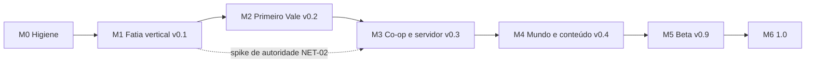

# Dino Vale: planejamento de desenvolvimento

Versão 2.4 do plano, 06/11/2026 (escopo fechado e decisões finais do dono: GDD 5.8 a 5.21 e 6.11 a 6.13, `receitas.md`, `catalogo.md`). Autor: `SHIKAMARU`. Documento vivo: atualize ao fechar cada marco. A versão 1.0 (05/11) foi feita antes do GDD; esta incorpora `docs/design/GDD.md`, `docs/design/racao.md` e `docs/design/arte/ESTILO.md`.

**Como ler.** Fato = veio do brief, do `game/README.md`, do repositório ou de decisão registrada do dono. Tudo marcado **[premissa]** é suposição minha e deve ser confirmada ou corrigida pelo dono.

**Já decidido pelo dono (fora de discussão):** código em **MIT**; repositório **rotteny/dinovale**, **público** (push ainda não confirmado); Godot 4.7 + GDScript; lógica separada da apresentação, composição, saves em Dictionary/JSON.
**Decidido em 05/11 (seção 9):** D1 (assets em CC-BY 4.0), D3 (arte de IA só como placeholder identificado, trocada antes do lançamento público), D8 (servidor autoritativo, single-player como host local). D2 foi **revisto pela decisão de arte**: base Ninja Adventure (CC0), tile 16 px, **4 direções**, adulto 32x32, filhote 16x16 (`ESTILO.md`).
**Decidido em 06/11:** todas as recomendações V1 a V18 do GDD; propostas de domesticação 1, 3 e 10 na 0.2, 6, 7 e 9 no M4, 8 adiada, 2 e 5 rejeitadas, 4 como opção de servidor desligada; Ração na **bancada comum**; Lança na 0.2 (cortável); morte permanente de dino só como opção de servidor; elenco do MVP (ver abaixo); artrópodes só em cavernas, depois do MVP; **D15** (pontos de nível e XP na versão enxuta na 0.2) e **D16** (corte de camada 1, tarefas movidas para depois da 0.2, nada apagado); Peso, Parassaurolofo, batismo do dino e barra de atalhos mantidos. **Também decidido em 06/11 (GDD 5.1 a 5.7):** dardo com torpor contínuo, fruta-do-sono que força o dino (e preparado com carne podre vinda de Carniça ou de carcaça velha), carcaça e sacolinha, armas de fogo e pólvora fora até da 1.0, sem sede, HUD com vida, XP e fome e sem barra de stamina, número de dano também no jogador. A pausa de torpor da faixa 3 já está implementada (feita, sem custo novo).
**Elenco do MVP (fechado em 06/11):** **5 espécies na 0.2**: Paquicéfalo e Utahraptor (M1; o Utahraptor é só ameaça), **Dodo** (presa Curiosa, sem domar, **início do M2**, decisão do dono), Triceratops (spawn **L18 a L24, decidido**) e Parassaurolofo (M2). **M4:** Oviraptor e **Listro**. Gallimimus fora do catálogo do MVP.
**Escopo fechado e decisões finais do dono (06/11; GDD 5.8 a 5.19, `receitas.md`, `catalogo.md`; custos e conferência na 4.10):** entram na 0.2 Lança de madeira, Dodo, **19 receitas (20 Saber de 24 no L20)**, durabilidade e inventário individual, validade por pilha, fome a 0,2/s, torpor do jogador por fome, Cocho para domados, dano em construções (recorte mínimo), Stamina em golpes e coleta, fatores de domar por espécie, **tetos de nível** e **Pilão e Preparado de sono**. O Bastão nasce no inventário no M1, sem receita. **Arco, flechas e Boleadeira no M4, Besta no M5; Forja com carvão no M4 a M5; Slot de Oferta depois do playtest (M4b); o Traje de fibra foi removido (substituído pelas peças de equipamento).** **Fora, sem marco:** Rifle, Dardo, fósforo, pólvora e sílex, Carniça, presa abatida, temperatura, Cama, Bastão reforçado, construções de metal e Isca. **D18 aplicada (corte leve);** o corte maior fica para depois do QA-01a. **Aceito depois (06/11):** vagas de equipamento (M1 só a Arma visível; peças no M4, **substituem o Traje de fibra de 8 h**), Mochila e limite de slots (M4), menu do domado com Seguir/Ficar todos e permissão (M2), Ir até aqui e Postura (depois do playtest), Montaria e Sela (depois do playtest, **M4b**); a 1.0 passa a **57 receitas e 82 Saber (L69)** e a v0.2 mantém 19 e 20; **teste de arte de dino com IA como placeholder** no M1 e **artista só depois do playtest**.
**Usadas como premissa, ainda sem decisão do dono (V37 a V41):** Saber como moeda separada, 19 receitas na 0.2, armadura (couro) no M4, mobílias com função e pergaminho que ensina sem Saber.
**Ainda em aberto (não são decisão deste plano):** artista para os dinos (D12), horas por semana (D7), e-mail do histórico do git (D13), consulta de marca no INPI e USPTO (D6) e publicação (D14). Por isso as estimativas são em **horas de trabalho, sem datas**.

Estado de partida (fato): testes headless passando (Health, Torpor, Stamina, Hunger, Taming, Inventory, máquina de estados, Player; 635 linhas de teste de nível e Eficiência já existem); cerca de 3,5 mil linhas de GDScript incluindo testes; ciclo de domar jogável com HUD e inventário compartilhado; landing em `html/`; pacote Ninja Adventure já importado em `game/assets/third_party/`. **Em working tree sem commit (06/11):** PRO-15 em grande parte (pilha e item individual, Bastão em mãos, barra por `iid`, save v2 com migração; 768 linhas inseridas). **Entregue na branch `feat/nivel-eficiencia-sprites` (commits 6901b80, 683c391 e 40bc81b; sem merge na `main`, sem revisão do `LEVI`):** nível, Eficiência, dano no dino, faixas de torpor, Bastão-de-sono, barras do dino, HUD nova, barra de atalhos (por tipo), consumo de comida, número de dano e estado ofegante (CRI-01, CRI-09, CRI-11, CRI-16, UIX-01, UIX-02, UIX-07, UIX-11, UIX-13, UIX-14); mapa do vale e pacote de arte importados. Sem CI e `tools/check.sh` ainda em criação.

---

## 1. Visão, pilares e o que o jogo não será

**Visão.** Um vale pré-histórico para sobreviver, construir uma base e criar um rebanho de dinossauros que você aprendeu a domar. Gratuito, aberto, e que qualquer pessoa consiga hospedar para os amigos com um comando.

**Pilares** (cada um serve de filtro para cortar escopo):

1. **O vínculo é o centro.** Domar não é só desbloquear estatística: o dino domado tem papel e precisa de cuidado. Se uma feature não reforça o laço jogador-dino, base ou sobrevivência, ela é candidata a corte.
2. **Risco legível e justo.** O perigo se anuncia (som, sombra, barra) e a morte custa algo, mas não destrói horas de jogo (itens recuperáveis).
3. **Base com propósito.** Construir protege, guarda e produz. Nada de construção só estética no começo.
4. **Fácil de hospedar.** Uma imagem Docker, um volume, uma porta UDP. Servidor pequeno, sem conta, sem telemetria.
5. **Aberto e moddável por dados.** Espécies, itens e receitas são dados, não código espalhado.

**O jogo não será** (decisão de escopo, vale até a 1.0):

- MMO, servidor persistente oficial 24/7 ou PvP competitivo/raid. [premissa: sem servidor oficial até depois da 1.0]
- Jogo com monetização, loja ou pay-to-win. (Coerente com "gratuito".)
- 3D, mobile ou web. [premissa]
- Grind pesado de estatísticas ao estilo RPG. A progressão é por tecnologia (receitas), relacionamento com os dinos e, **por decisão D15 (06/11), uma camada enxuta de pontos de nível**: XP de poucas fontes (domar e coletar), 3 atributos por entidade (jogador e dino), sem reiniciar pontos, sem árvore de talentos. O nível do dino segue por fórmula (nível selvagem e Eficiência); os pontos não alteram o nível final nem a Eficiência [premissa a confirmar com a `SHIRO`]. O GDD seção 9 ("sem nível de personagem") precisa ser atualizado pela `SHIRO`.
- Reprodução do conteúdo, nomes, arte ou som de qualquer jogo existente. Mecânicas de gênero são livres; vocabulário e identidade visual são nossos (ver R12).

---

## 2. Core loop e o primeiro lançamento público

- **Minuto a minuto (2 a 5 min):** coletar, craftar, enfrentar ou fugir.
- **Sessão (30 a 60 min) [premissa]:** sobreviver ao dia, domar um dino, ter um abrigo e voltar ao jogo com o save.
- **Longo prazo:** base e rebanho crescem; regiões perigosas pedem dinos melhores.

**Hipóteses de diversão a validar** (o playtest existe para derrubá-las):

- H1: a janela de domar (vigiar o nocauteado alimentando-o enquanto algo ameaça) gera tensão, não espera chata.
- H2: o dino domado dá retorno perceptível em minutos (segue, carrega, defende).
- H3: construir um abrigo tem motivo claro (noite, predador, armazenar).

**Crítica ao design atual.** O loop "nocautear, alimentar, domar" é a mecânica de gênero mais reconhecível. É legal reutilizar, mas sozinha não dá identidade ao jogo. Ver decisão D5 (diferencial do vínculo).

### Primeiro lançamento público: v0.2 "Primeiro Vale"

Um jogador, mundo fixo e pequeno, loop completo de ponta a ponta com a **domesticação como experiência central** (nocautear, alimentar vigiando, proteger o dino, ver o nível final, criar vínculo). **Co-op não é Must da 0.2**, mas a arquitetura nasce preparada e é validada pelo spike S0 no fim do M1.

| MoSCoW | Escopo da 0.2 |
|---|---|
| **Must** | Mundo fixo de 128x128 tiles com 3 biomas (Campina, Mata-baixa, Pedreira), colisão, limites e **navegação dos dinos**. Coleta, inventário, HUD. Crafting na **bancada comum** com **19 receitas** (4 conhecidas; 20 Saber de 24 no L20) (a Ração é um template por perfil e nível). **Ração C, B, A** (perfis Verde e Rubra), comida crua, cozida e podre; exigência de Ração mínima por espécie e regressão sem comida. **Domesticação completa:** Bastão-de-sono, torpor com faixas legíveis, nível e vida do dino, Eficiência e nível final, painel de 3 barras com nível previsto, ação Observar com prévia (tabelas em JSON de leitura). **Barra de atalhos 1 a 9 e batismo do dino (M1).** **5 espécies:** Paquicéfalo (Passivo), Utahraptor (Agressivo), Triceratops (Semi-agressivo, spawn L18 a L24), Parassaurolofo (Medroso) e **Dodo** (presa Curiosa, sem domar). Carnívoro ataca o dino dormindo; curral; grupo chama grupo. Dino domado: Afeto e obediência, seguir, ficar, guardar base, atacar alvo; ofícios **Carregar** e **Defender**; ferido (some 5 min). Construção: fundação, parede, porta, baú, estaca. **Peso** (capacidade de carga de jogador e dinos, atributos simples; definido pela `SHIRO` no GDD, ver PRO-09) e **XP, nível do jogador e pontos de nível na versão enxuta** (D15; ver 4.6). Fome do jogador a 0,2/s com **torpor por fome** (5.10). Morte do jogador com corpo recuperável. Save/load com versão, `map_id` reservado. Menu, pausa, tutorial contextual. Arte coesa (Ninja Adventure + dinos de artista, gate C), SFX. **Armas e torpor:** Soco e Bastão (M1, já no inventário, sem receita) e **Lança de madeira**; fruta-do-sono (torpor contínuo, teto de 3 efeitos) que força o dino dormindo, com sinais de torpor no jogador. **Carcaça e sacolinha** (recorte mínimo: só carne, couro como dado). **Durabilidade e inventário individual**, **validade por pilha**, Fogueira que assa, **Cocho** do rebanho, **dano em construções só madeira (recorte mínimo)**, Stamina em golpes e coleta, **tetos de nível** e **Pilão e Preparado** (GDD 5.8 a 5.21, 6.11), **vagas de equipamento (só a Arma visível)** e **menu do domado com Seguir/Ficar para todos e permissão**. **Saber e 19 receitas** (premissa V37 a V41) com a tela do Personagem (tecla P). **HUD:** vida, fome, XP e atalhos, sem barra de stamina (o fôlego aparece por comportamento) e sem sede; número de dano também no jogador. Builds Linux e Windows. |
| **Movido para depois da 0.2 (D16, camada 1; nada apagado, ver 4.3a)** | Ração S com Mel-de-cipó, Temperamento do carnívoro domado, ciclo dia/noite, configurações, música em loop, teste de rede NET-03 (M3), vocalizações por limiar. |
| **Cortável (novos desta rodada)** | Pilão e Preparado de sono (3 h). Carniça, Cama e Bastão reforçado saíram; o Cocho é Must (decisão do dono). |
| **Could** | Montaria. Sede. Build macOS não assinado. Página no itch.io. |
| **Won't (0.2)** | Itens movidos pela D16 (linha acima). Multiplayer. Mundo procedural e chunking. Mods. Web e mobile. Localização. Boss. Criação de filhote, domar sem nocaute, Ração S+ e Orvalho (M4). Conduta Curioso (M4). Artrópodes e cavernas (pós-MVP). Isca. Rifle, dardo, fósforo, pólvora e sílex (sem marco), Arco, flechas e Boleadeira (M4), Besta (M5), temperatura (fora), armadura (couro M4, metal M5, fibra depois do playtest), Slot de Oferta e domar passivo, Mochila, Postura, Ir até aqui, Montaria e Sela (depois do playtest, M4 e M4b), Listro (M4), Espada e sono do jogador (M4), construções de metal (fora), sede. |

**Critério de "realmente divertido" (testável, 0.2):** playtest observado com 5 pessoas fora do círculo do dono [premissa de tamanho e metas abaixo]:

- pelo menos 4 domam um dino sem ajuda;
- pelo menos 3 constroem um abrigo sem ajuda;
- pelo menos 3 explicam, sem ajuda, o que o "nível previsto" e a Eficiência significam (GDD 19);
- a sessão observada dura em média 30 min ou mais sem o facilitador pedir para continuar;
- pelo menos 3 respondem "sim" a "jogaria de novo amanhã?";
- zero perda de save e zero erro de script no log.

**H1 (a vigília gera tensão) só é testável depois do CRI-12** (carnívoro ataca o dormindo, decisão V12), por isso há um playtest curto de H1 no meio do M2 (QA-01a), antes de gastar horas em construção e ofícios. Se H1 ou H2 falharem, o próximo ciclo ajusta o loop antes de qualquer conteúdo novo.

---

## 3. Fases e marcos até a 1.0

### Onde discordo do roadmap do README

| # | README | Problema | Proposta |
|---|---|---|---|
| 1 | Multiplayer só na Fase 3 | Retrofit de autoridade em inventário, crafting, construção e domar custa mais do que o resto do jogo junto | Regras "pronto para rede" desde o M0, camada de autoridade no M1, **spike de rede no fim do M1**, co-op no M3 (antes de chunking e conteúdo) |
| 2 | Grid de construção antes de save | Save é barato agora e disciplina todo `to_dict`; construção sem save não é testável | Ordem: inventário, HUD, **save**, depois construção |
| 3 | Chunking e geração na Fase 2, antes de rede | Depende de como a rede replica (interesse por chunk). Para a fatia basta mapa fixo | Mapa fixo até o M3; chunking no M4. Mas o grid de construção já usa `Vector2i` global em Dictionary, que é amigável a chunk |
| 4 | Morte e respawn na Fase 2 | Survival sem consequência não gera tensão (H1) | Mínimo no M1, completo no M2 |
| 5 | Ordens "seguir e ficar" na Fase 2 | Sem elas domar não tem retorno (H2) | Entram no M1 |
| 6 | Arte e som definitivos na Fase 2 | Arte é o maior gargalo e o mais demorado; decidir tarde trava tudo | Guia de arte no M1, kit v0 no M2, arte final no M5 |
| 7 | Sem CI, sem teste de cena, sem política de agentes | 235 checagens de lógica não pegam quebra de cena; agentes em paralelo sobrescrevem trabalho | M0 inteiro: commit, `check.sh`, testes de arquitetura, `AGENTS.md` |
| 8 | Licença "a definir" | Já decidida (MIT); assets em CC-BY 4.0 | D1 (decidido) |

### M0: Higiene do repositório
- **Objetivo:** ninguém perde trabalho e toda mudança é verificada do mesmo jeito.
- **Entregáveis:** primeiro commit e push para rotteny/dinovale; `tools/check.sh`; testes de arquitetura; ADR-001 a 003; `AGENTS.md`; SPDX e `CREDITS.md`.
- **Saída verificável:** `tools/check.sh` verde local e no CI; testes de arquitetura falham quando uma violação é introduzida de propósito; varredura de segredos limpa antes do push; LICENSE e `assets/CREDITS.md` presentes; ADRs aprovados pelo dono.

### M1: Fatia vertical, v0.1 "pré-alpha"
- **Objetivo:** provar o loop em um build exportado: coletar baga, pegar o Bastão (nasce no inventário, sem receita), nocautear, domar com baga crua, o dino segue, salvar, fechar, carregar.
- **Entregáveis:** barra de atalhos 1 a 9 e batismo do dino (4.5a); o que está em andamento com o `SORA` (Bastão, nível, Eficiência, dano no dino, faixas de torpor, barras; fechados aqui por já estarem no forno, o GDD os previa no M2), mapa fixo da Campina, recursos, itens e espécies como dados, **Conduta orientada a dados** com Passivo e Agressivo, ordens seguir/ficar, morte mínima, fome a 0,2/s, **modelo de inventário individual (PRO-15)**, save v1, menu, smoke test de cena, export, CI, spike S0, ADR-004, integração do Ninja Adventure e dinos placeholder.
- **Fora do M1 (decisão V12):** carnívoro atacando o dormindo; Ração com receita (M1 usa baga crua, 10 refeições de 6 s); construção.
- **Saída verificável:**
  1. Build Linux e Windows executa o roteiro: novo jogo, coletar baga, usar o Bastão do inventário, nocautear o Paquicéfalo (L5 a L8 no tutorial; 4 golpes no L10), alimentar com baga, ver o painel de 3 barras, domar, ele segue, salvar, sair, continuar, e o dino volta com estado idêntico (nível e Eficiência incluídos).
  2. O mesmo roteiro roda como smoke test headless no CI.
  3. S0: servidor headless e 1 cliente; jogador e dino sincronizam; o servidor rejeita 3 intents inválidas e **nunca replica o valor do torpor nem da Eficiência** (só a faixa 0 a 3).
  4. 3 de 5 testadores externos completam o fluxo em até 20 min sem ajuda [premissa de meta], e o facilitador anota se entenderam o nível previsto.
  5. Zero erro de script no log; CI verde.
- **Se S0 falhar:** parar e reavaliar o modelo (ver R1) antes de começar o M2.

### M2: Primeiro Vale, v0.2 (primeiro lançamento público)
- **Objetivo:** loop completo e divertido para uma pessoa (seção 2), com a domesticação como centro.
- **Entregáveis:** escopo Must e Should da seção 2 (inclui Peso, pontos de nível enxutos e batismo e atalhos do M1; tudo Must depois da D16); sequência interna **ameaça primeiro** (CRI-12, QA-01a), depois construção, Ração e vínculo.
- **Saída verificável:** critérios de diversão da seção 2; 100 ciclos automatizados de save/load sem divergência; fixture de save v1 migra para v2; release no GitHub com binários e checksums gerados por tag; nenhum bug P0 aberto; 60 fps estáveis em máquina de referência [premissa: notebook com gráficos integrados de 2020] com 8 dinos e percepção a cada 0,5 s (INF-09); **nenhum placeholder de IA e nenhum bicho do pacote usado como dino final** (gate C, depende do artista, R18).

### M3: Co-op e servidor dedicado, v0.3
- **Objetivo:** 2 a 8 jogadores [premissa] num servidor que qualquer um sobe com Docker.
- **Entregáveis:** configurações (UIX-06) e NET-03 vindos da 0.2; rede (lobby, spawn, replicação de jogadores, dinos, inventário, construção), replicação de Conduta (id do estado e alvo), faixa de torpor e nível; **vínculo compartilhado com ordem de grupo (V7)**; replicação e validação de XP, pontos e atributos; arquivo de regras do servidor com as chaves do GDD 13; servidor headless configurável, validação de entrada, imagem Docker e guia de auto-hospedagem, testes de rede no CI.
- **Saída verificável:** `docker run` sobe o servidor; 4 clientes jogam 30 min sem desync; soak de 2 h sem crescimento de memória [premissa]; `kill -9` perde no máximo o intervalo de autosave; suíte de entrada inválida passa (inclui dano e Eficiência forjados); revisão de `NEZUKO` sem achado Alto ou Crítico aberto; guia executado com sucesso por pessoa de fora; handshake recusa protocolo incompatível; vários jogadores no mesmo dino: o último golpe não zera o progresso de domar.

### M4: Mundo e conteúdo, v0.4
- **Objetivo:** mundo grande, variado, com progressão e a identidade do vínculo (Criação).
- **Entregáveis:** itens vindos da 0.2 (Ração S, Temperamento, dia/noite); Forja com carvão e metal, Arco, flechas e Boleadeira, palha e pedra, **peças de equipamento (fibra e couro) e Mochila**, ícones de equipamento; Slot de Oferta, Montaria, Sela, Ir até aqui e Postura ficam no **M4b**; ADR do mapa interior (`map_id`), chunking e streaming, geração por seed, persistência por chunk, interesse por chunk, **6 espécies no total** (Oviraptor e Listro entram; a lista de "8 espécies" do plano 1.0 cai), Conduta Curioso, **Criação** (ninho, filhote), **domar sem nocaute** (Curioso e Medroso), **Ração S+ com Orvalho-de-casco** produzido por dino, ameaças e dificuldade, 3 a 5 tiers, clima.
- **Saída verificável:** mesmo seed gera o mesmo mapa (hash igual); mundo de pelo menos 512x512 tiles [premissa]; sem queda abaixo de 60 fps ao cruzar chunks; servidor com 8 jogadores dentro do orçamento de CPU; saves 0.3 migram; filhote criado chega a adulto com Afeto `round(E/5)` e ofício escolhido.

### M4b: Rebanho e montaria (depois do playtest da 0.2)
- **Objetivo:** dar ao rebanho comando, montaria e carga, **só se o playtest pedir**. Foi separado do M4 (R34, R36) para o M4 não passar de 211 h realistas.
- **Entregáveis:** Montaria (32 h; recorte 26 h), Sela (17 h; recorte 10 h), Ir até aqui e Postura (13 h), Slot de Oferta e domar passivo (13 h). Total **48/75/120**.
- **Entrada:** decisão do dono depois do playtest 3, com o resultado do QA-01. **Saída verificável:** montar e desmontar em co-op sem divergência; a Stamina do dino passa a valer; sela de couro aumenta a carga do alforje como na conta de 6.13.

### M5: Beta, v0.9
- **Objetivo:** cara e som finais, polimento, beta público.
- **Entregáveis:** Besta, ferramentas de ferro e Traje de metal; música em loop e vocalizações por limiar (vindas da 0.2); arte final do conteúdo Must (6 espécies adulto e filhote), som e música, tutorial completo, localização en e pt-BR, acessibilidade básica, documentação final.
- **Saída verificável:** script confirma que todo arquivo em `assets/` está coberto por `CREDITS.md` com licença compatível; beta público de pelo menos 2 semanas com relatos triados [premissa]; todos os saves das versões 0.x migram nas fixtures.

### M6: 1.0
- **Objetivo:** estabilidade, não features.
- **Saída verificável:** zero bug de perda de dados aberto; 2 semanas seguidas de release candidate sem P0 ou P1 [premissa]; docs completas; roadmap pós-1.0 publicado (artrópodes e cavernas, receitas achadas no mundo).

---

## 4. Backlog por épico

**Épicos:** MUN mundo e mapa, SOB sobrevivência, CRI criaturas, CON construção, PRO progressão e crafting, SAV save, NET multiplayer e servidor, UIX UI/UX, ART arte e som, INF infra e CI, COM comunidade e open source, ARQ arquitetura, QA testes e balanceamento.

**Colunas.** Estimativa em *horas de trabalho* (O/R/P = otimista/realista/pessimista; definição na seção 5). Pri: **Must**, **Should** ou **Cortável** (o GDD o marca Essencial, mas é o primeiro a sair se o escopo apertar; ver 4.7). "Quem" é o agente sugerido; o dono integra tudo. **Regra para toda tarefa de gameplay:** só vale pronta se passa pela camada de autoridade (NET-01), tem `to_dict`/`from_dict` com roundtrip testado, valores de balanceamento em dados e a revisão do `LEVI`. As estimativas são do trabalho total da tarefa, não do que resta: o crédito esperado pelo que o `SORA` já fez está na seção 5.

### 4.0 Conflitos da seção 17 do GDD, resolvidos

| # | Conflito | Resolução no plano |
|---|---|---|
| 1 | D5 | **Decidido:** Afeto e obediência e dois ofícios na 0.2 (CRI-07, CRI-08); Temperamento cortável (CRI-17); Criação no M4 (CRI-20). D5 na seção 9 atualizado. CRI-07 deixa de ser "fome e negligência" e vira Afeto (3/4/6 passa a 5/8/12). |
| 2 | Fome 0,5/s | Ajuste de dado para 0,1/s, mais aviso de fome no HUD: SOB-04 (M1). |
| 3 | Landing x tom | Tarefa COM-04 (`BULMA`, M2, Must): trocar "parceiro" por promessa honesta antes do gate C. Não editei `html/`. |
| 4 | Crafting é M2 | Mantido. M1 usa baga crua (10 refeições de 6 s) sem receita; Ração só no M2 (PRO-07). |
| 5 | Espécies | A 0.2 tem 4 espécies Must (Paquicéfalo, Utahraptor, Triceratops, Parassaurolofo) e o Gallimimus, **movido para depois da 0.2 (D16)**. CRI-03 passa a 2 espécies do M1; CRI-06 é só o Triceratops; Parassaurolofo em CRI-26; Gallimimus em CRI-06b (M4). **v2.3:** o Gallimimus saiu do catálogo do MVP; a 0.2 tem **5 espécies** com o Dodo (4.10). |
| 6 | Cozinhar Could | Resolvido: a Ração usa a **bancada comum** (PRO-04); não há estação extra. Fogueira e cozinhar seguem Could, sem relação com a Ração. |
| 7 | Golpe no dormindo | CRI-11: golpe debita Eficiência e vida; o dardo é a manutenção barata de torpor. Muda `Dino.apply_torpor` e `Player`. |
| 8 | Criação | Novo escopo no M4: CRI-20. |
| 9 | Nível, Eficiência, vida | Novas tarefas CRI-09 (nível, vida, Eficiência), UIX-02 (painel de 3 barras), UIX-07 (barra de vida), CRI-03 maior (SpeciesDef com os campos novos). Reestimado. |
| 10 | Combate com dano | CRI-01 (Bastão por `WeaponDef`), CRI-11 (dano no dino) e CRI-13 (Lança de madeira, de volta à 0.2). |
| 11 | Carnívoro ataca o dormindo | CRI-12 (M2, depois do CRI-04, que no M1 só persegue o jogador). |
| 12 | Morte do dino | Dino em domesticação com vida 0 morre e a domesticação falha (CRI-11). Dino domado fica ferido e some 5 min (SOB-05). Morte permanente só por `dino_ferido_minutos = -1` no `ServerRules` (ARQ-05); SOB-02 passa a tratar só o jogador. |
| 13 | CRI-04 e seis Condutas | CRI-04 vira máquina de estados genérica orientada a dados (`ConductDef` e tabela de transições por tipo); M1 entrega Passivo e Agressivo; Semi-agressivo no CRI-06; Medroso no CRI-26; Covarde no CRI-06b (M4); Curioso no M4. Reestimado de 3/5/8 para 7/11/17. |
| 14 | Seis tipos x poucas espécies | A 0.2 mostra 4 tipos (Passivo, Agressivo, Semi-agressivo, Medroso); Curioso no M4. Variantes por indivíduo (`pesos_conduta`) ficam como contingência CRI-25, **fora das horas**, só se o playtest acusar falta de variedade. |
| 15 | Isca | **Retirada do plano e do core loop.** Não há tarefa: a Ração, o dardo, o curral e a corrida cobrem a vigília. Gatilho para reabrir (CRI-24, contingência de 3/4/6 h, fora do total): menos de 3 de 5 testadores nocautearem o Parassaurolofo sem ajuda. |
| 16 | Grupo e percepção por raio | CRI-18 (M2). Orçamento de CPU medido em INF-09 (M2) e repassado ao M3: percepção a cada 0,5 s, replica só o id do estado e o alvo (ADR-004). NET-10 +3/4/6 e NET-12 +1/2/3. |
| 17 | Domesticar quem corre | MUN-04 (navegação com obstáculos do `BuildGrid`) e INF-09 (teste de cena determinístico de perseguição, caso Covarde 85 px/s e curral). Sem isso só o playtest pegaria. |

### 4.0a Conflitos 18 a 25 do GDD, resolvidos

| # | Conflito | Resolução no plano |
|---|---|---|
| 18 | Carne podre pede estragar, e `racao.md` cortou a validade | Carniça como nó de mundo, sem apodrecer (V31): CRI-30, cortável. Carne que apodrece no inventário fica no M4, sem horas. **v2.3:** a Carniça foi cortada; a carne podre vem da validade por pilha (PRO-17). |
| 19 | V6 revisto: fruta e preparado mantêm o dormindo; o dardo é de dino acordado | CRI-28 (dardo) e CRI-29 (fruta). O `use_dart` instantâneo do CRI-11 é substituído pelo CRI-28. |
| 20 | Torpor do jogador | Sinais (faixas 1 a 3) dentro do CRI-29; o sono do jogador vai ao M4 (CRI-32, cortável). |
| 21 | Dose do dardo: 50 em 5 s | CRI-28. |
| 22 | Carcaça e sacolinha | SOB-06 (recorte mínimo). O alforje do dino morto vai para a sacolinha. SOB-02 fica só com o corpo do jogador. R25 resolvido pela Lança e pelo Dodo (4.10). |
| 23 | Receitas por Saber | PRO-13 (Saber, aprender, tela de receitas); PRO-05 vira 19 receitas por dados e o gate "por ter feito" é substituído. PRO-10 (M4) usa o mesmo Saber. V37 a V41 são premissa. **v2.3:** são 20 receitas (4 conhecidas), 22 Saber de 24 no L20. |
| 24 | HUD sem barra de stamina, com XP e aviso de ponto | UIX-13 (ofegante, M1), UIX-12 (XP e selo, M2); UIX-01 perde a barra de stamina. |
| 25 | Durabilidade | Sem conflito: `ItemDef` não ganha campo de durabilidade. |

### 4.1 M0 (restante)

Feitos em 05/11: ARQ-01 (ADR-001 a 003) e INF-04 (`AGENTS.md`).

| ID | Tarefa | Dep | O/R/P | Pri | Quem | Aceite |
|---|---|---|---|---|---|---|
| INF-01 | Commit inicial separado por pasta, `.gitignore` revisado, push, 1 branch ou worktree por agente. Inclui o pacote Ninja Adventure | D13, D14, rodada do `SORA` fechar | 1/1/2 | Must | dono + `SAITAMA` | varredura de segredos limpa em todo o histórico; push só após D6 e D13 |
| COM-01 | SPDX nos `.gd`, `CREDITS.md` cobrindo o pacote importado (autor, licença CC0, URL, data), `ASSETS-LICENSE`, marcar a arte antiga (`gerar_arte.gd`, mocks) como histórico | D1, D6 | 1/1/2 | Must | `SAITAMA` | todo arquivo de `game/assets/` tem linha no `CREDITS.md` |
| INF-02 | `tools/check.sh`: import, testes, lint, arquitetura; igual local e no CI | INF-01 | 1/2/3 | Must | `SAITAMA` + `SORA` | falha ao introduzir violação de propósito |
| INF-03 | Testes de arquitetura (componentes sem `CanvasItem`, `Input` só no corpo e na UI, roundtrip de saveable) | INF-02 | 1/2/3 | Must | `LEVI` | teste quebra com a violação |
| | **Restante M0** | | **4/6/10** | | | total do marco 7/10/17 |

### 4.2 M1 (nível de tarefa)

| ID | Tarefa | Dep | O/R/P | Pri | Quem | Aceite |
|---|---|---|---|---|---|---|
| PRO-01 | InventoryComponent (em andamento) | | 1/2/3 | Must | `SORA` | empilha, respeita limite, roundtrip |
| PRO-02 | InteractableArea (em andamento) | | 1/1/2 | Must | `SORA` | interage só no alcance |
| CRI-01 | *Entregue na branch (revisão e merge pendentes).* Soco (sem item: dano 1, torpor 10, 0,6 s) e Bastão-de-sono por `WeaponDef`: 30 de torpor, dano 2, 0,7 s (em andamento; troca os 3 golpes de 40) | ARQ-01 | 1/1/2 | Must | `SORA` | 4 golpes nocauteiam o Paquicéfalo L10; valores só em `.tres` |
| UIX-01 | *Entregue na branch (revisão e merge pendentes).* HUD (em andamento): vida e fome; **sem barra de stamina** (decisão do dono) | PRO-01 | 1/1/2 | Must | `SORA` | HUD mostra vida e fome |
| CRI-02 | Inventário compartilhado com dino inconsciente (em andamento) | PRO-01 | 1/2/4 | Must | `SORA` | troca de itens com o dormindo, roundtrip |
| NET-01 | **Camada de autoridade**: todo ato (coletar, atacar, dardo, alimentar, ordenar) é `request_*` validado; single-player usa o mesmo caminho | ARQ-01, bloco em andamento | 4/6/10 | Must | `KURAMA` desenha, `SORA` implementa | 3 intents inválidas rejeitadas em teste |
| ARQ-04 | **ADR-004**: Conduta e domesticação em dados; o que replica (id do estado, alvo, faixa de torpor) e o que nunca replica (valor do torpor, Eficiência); percepção a cada 0,5 s | ARQ-01 | 2/3/5 | Must | `KURAMA` | ADR aceito pelo dono |
| MUN-01 | Mapa fixo v0 (Campina): TileMapLayer com tileset do pacote, colisão, limites; hitbox por dado | ART-04 | 3/4/6 | Must | `SORA` | jogador e dino não atravessam colisão nem saem do mapa |
| MUN-02 | Nós de recurso (árvore, pedra, baga, fibra) com respawn [no M1 só a baga tem consumidor; madeira, pedra e fibra existem como dado, sem receita até o M2; sem desconto de horas] | PRO-01, PRO-02, MUN-01 | 2/3/5 | Must | `SORA` | coleta e respawn por dado |
| PRO-03 | Registro de itens por dados (`ItemDef`): baga, madeira, pedra, fibra, carne e Bastão (sem `dardo_sono`: o dardo saiu do jogo) | ARQ-01 | 2/3/4 | Must | `SORA` | nenhum item hardcoded; IDs estáveis |
| PRO-15 | *Em grande parte feito no working tree, sem commit* (modelo de pilha e item individual, Bastão em mãos, barra por `iid`, save v2 com migração e `inventory_model_tests.gd`); resta revisão, `LEVI`, commit e o que falta (validação de servidor). **Inventário individual e hotbar por slot** (GDD 5.9): item vira `{id, count, expira_em?}` (empilhável) ou `{id, iid, durab, durab_max}` (equipamento, não empilha); a barra de atalhos guarda o slot ou o `iid`, não o tipo (**refaz o `HotbarComponent` já entregue, sem crédito**); slot de "item na mão"; save com versão nova; uso validado no servidor. **Só o modelo**: durabilidade, validade e reparo entram no M2 (PRO-16 a PRO-18). Entra antes do SAV-01 e do S0 para a fixture v1 e o contrato de `request_use_item` já nascerem no formato novo (ADR curto do `KURAMA`) | PRO-01, PRO-03, UIX-11 | 2/4/6 | Must | `SORA` + `KURAMA` | empilháveis e equipamentos coexistem; atalho por slot sobrevive a mover item; roundtrip; testes do hotbar atualizados |
| PRO-22 | **Vagas de equipamento** (GDD 5.20): modelo de 6 vagas (Arma, Capacete, Camisa, Luva, Calça, Bota; `slot` no item, `{vaga: iid}` no save), `equipar` e `desequipar` validados no servidor, tela com a coluna de vagas ao lado da grade com **só a Arma visível e ativa** (arrastar, duplo clique, silhueta, troca, "Inventário cheio"), barra de atalhos ligada à vaga Arma; as 5 de roupa aparecem com `slot_visivel` no M4. 7 h da `SHIRO` **menos 2 h**: o item em mãos (`equipped`) e a barra por `iid` já existem no PRO-15 | PRO-15, UIX-11 | 3/5/8 | Must (decisão do dono) | `SORA` | só a Arma aparece; vaga errada recusa; troca devolve o item à grade; roundtrip de `{vaga: iid}` |
| CRI-03 | Espécies por dados (`SpeciesDef`): Paquicéfalo e Utahraptor com vida, dano, dificuldade, torpor máximo, queda, `aceita_crua`, tamanho e âncora (placeholder 16x16 hoje, adulto 32x32 depois); refatora `Dino`. **Valores do Utahraptor vêm da `SHIRO`** | ARQ-01, ARQ-04 | 5/7/11 | Must | `SORA` | trocar sprite e tamanho só muda o dado; spawn por id |
| CRI-04 | **Conduta orientada a dados**: `ConductDef`, máquina de estados genérica por eventos, tabela de transições; Passivo (Paquicéfalo revida) e Agressivo (Utahraptor persegue e ataca o jogador; no M1 só o jogador é alvo) | CRI-03, ARQ-04 | 7/11/17 | Must | `SORA` | cada linha da tabela 6.7 do GDD para os 2 tipos é um teste; sem `if especie ==` |
| SOB-01 | Morte e respawn mínimos do jogador | CRI-04 | 2/3/5 | Must | `SORA` | vida 0 leva ao respawn |
| CRI-05 | Ordens seguir e ficar | CRI-03, NET-01 | 3/4/6 | Must | `SORA` | domado segue a até 3 tiles e fica por ordem; vai ao save |
| CRI-09 | *Entregue na branch (revisão e merge pendentes).* **Nível, vida e Eficiência** (em andamento, antecipado do M2): `DinoLevelRules`, nível selvagem por bioma, E de 0 a 100, nível final, Afeto inicial `round(E/5)` | CRI-03 | 2/4/5 | Must | `SORA` | tabelas 10.2 e 10.4 do `racao.md` como casos fixos ((20,100)=30; (7,60)=9); roundtrip com nível e E |
| CRI-11 | *Entregue na branch (revisão e merge pendentes).* **Dano no dino e Eficiência por ataque** (em andamento): `take_damage`, golpe no dormindo debita E e vida (4 jogador, 8 carnívoro), `use_dart` (+40 torpor, -2 E, sem dano), morte na domesticação falha, E 0% doma sem bônus; o golpe deixa de ser grátis | CRI-09, NET-01 | 2/2/4 | Must | `SORA` | ataques em sequência, dardo sem dano e morte que falha, todos testados |
| CRI-16 | *Entregue na branch (revisão e merge pendentes).* **Faixas de torpor** 0 a 3 com histerese (em andamento): visual (bocejo, cambaleio, respiração) e regra de servidor (velocidade x0,85/x0,65, cooldown x1,5). **Pausa de 0,8 s da faixa 3 já implementada: registrada como feita, sem custo novo** | CRI-01 | 1/1/2 | Must | `SORA` | fronteiras testadas; só a faixa vai à rede |
| UIX-02 | *Entregue na branch (revisão e merge pendentes).* Painel de domar com 3 barras (torpor, domesticação, Eficiência) e nível previsto; sem barra de torpor acordado (em andamento) | UIX-01, CRI-09 | 1/1/2 | Must | `SORA` | aparece só com o dino dormindo |
| UIX-07 | *Entregue na branch (revisão e merge pendentes).* Barra de vida do dino só após dano, no máximo 3, some em 5 s (em andamento) | CRI-11 | 1/1/1 | Must | `SORA` | a quarta barra tira a mais antiga |
| UIX-11 | *Entregue na branch (revisão e merge pendentes).* **Barra de atalhos 1 a 9** (custo em 4.5a): atalhos para comida, armas, ferramentas e dardos; a tecla é lida só no corpo do jogador e vira `request_use_item`; vínculo salvo | PRO-03, UIX-01, NET-01 | 1/1/2 | Must | `SORA` | tecla 1 a 9 usa o item (come, equipa o Bastão, atira o dardo) pelo caminho de autoridade; item gasto limpa o slot; roundtrip no save |
| UIX-13 | *Entregue na branch (revisão e merge pendentes).* **Estado ofegante** no lugar da barra de stamina (custo em 4.5b): ofegar abaixo de 25%, para de correr ao zerar e anda até recuperar 20; som e partícula de suor; 1 bit replicado | UIX-01 | 1/1/1 | Must | `SORA` + `YATORA` | sem barra, o jogador percebe o fim do fôlego; teste do estado |
| UIX-14 | *Entregue na branch (revisão e merge pendentes).* **Número de dano** flutuante no dino e no jogador (estimativa minha, 4.5b) | CRI-11 | 1/1/1 | Must | `SORA` | dano visível nos dois alvos |
| SOB-04 | **Fome do jogador a 0,2/s** (GDD 5.10; os 0,1/s são do dino domado) e aviso no HUD; no M1 o dano de fome atual continua (a troca por torpor é o SOB-07, M2) | UIX-01 | 1/2/3 | Must | `SORA` | barra cheia esvazia em 500 s (8,3 min); aviso antes do dano; `decay_per_second` em dado |
| SAV-01 | SaveManager v1: escrita atômica, `.bak`, `format_version`, roundtrip, fixture v1; já com nível, E, **item no formato do PRO-15** e **`map_id` reservado** | ARQ-01, PRO-15 | 5/7/11 | Must | `SORA` | fixture v1 carrega; versão maior é recusada |
| UIX-03 | Menu principal e pausa | SAV-01 | 2/3/4 | Must | `SORA` | novo, continuar, sair |
| INF-05 | Smoke test de cena: roteiro de domar completo por script | CRI-05, SAV-01 | 3/4/6 | Must | `LEVI` | roda no CI |
| NET-02 | **Spike S0** (limite 10 h): servidor e cliente headless; jogador e dino replicados; 3 intents inválidas e dano forjado rejeitados; torpor e E nunca replicados; verificar `OfflineMultiplayerPeer` e SIGTERM | NET-01, ARQ-04 | 4/7/11 | Must | `SORA` + `KURAMA` | critério 3 do M1 |
| INF-06 | Export Linux e Windows por script | INF-02 | 1/2/4 | Must | `SAITAMA` | build executa o roteiro |
| INF-07 | CI remoto: import, testes, lint, smoke | INF-02 | 1/2/3 | Must | `SAITAMA` | verde em PR |
| ART-01 | Fechar o guia de arte: `ESTILO.md` é o guia; falta aprovar o tom do mundo e o Caveman e registrar a mudança de D2 | | 1/1/2 | Must | dono + `YATORA` (consultiva) | decisões abertas 1, 2 e 4 respondidas |
| ART-04 | Integrar o Ninja Adventure: tileset, Caveman, tema 9-slice, emotes; **ouvir os sons** (ninguém ouviu) e mapear | ART-01 | 3/4/7 | Must | `YATORA` | arquivos no `CREDITS.md`; lista de sons ouvidos |
| ART-05 | Dinos placeholder com os bichos do pacote (16x16), herbívoro e carnívoro distinguíveis; marcados no `CREDITS.md` | ART-04 | 2/3/5 | Must | `YATORA` | legível a olho nu no mapa |
| ART-08 | **Teste de arte de dino com IA como placeholder** (D3 permite, só identificado): `YATORA` gera Paquicéfalo e Utahraptor 32x32 e 16x16 no `ESTILO.md`; roda o teste de aceitação do item 7 (dino ao lado do jogador e da árvore, real e ampliado) e entra no COM-02; marcado como placeholder de IA no `CREDITS.md`. **Sem custo do dono além de olhar o teste (1 h)**; sem orçamento de artista até depois do playtest | ART-04, ART-05 | 1/1/2 | Must | `YATORA` + dono | registro no `CREDITS.md` com ferramenta e data; veredito do dono sobre o estilo |
| COM-02 | Playtest 0.1: roteiro, formulário, 3 a 5 pessoas; anota o entendimento do nível previsto | INF-06 | 1/2/3 | Must | dono | critérios 4 e 5 do M1 |
| | **Total M1** | | **75/110/175** | | | antes 88/131/206 na v2.2 (+8/12/19 do PRO-15, +3/5/8 das vagas, +1/1/2 do teste de IA, -19/-31/-47 de crédito da branch, -6/-8/-13 de crédito do PRO-15) |

### 4.3 M2 (nível de tarefa)

Ordem interna: (1) navegação, ameaça e **SOB-08 (Stamina em golpes)**, (2) **QA-01a: playtest de H1**, (3) **sustento**: Saber e Bancada, Lança, Dodo, carcaça, Ração, durabilidade, validade e Fogueira, (4) construção e dano em construções, (5) vínculo, Cocho, fome-torpor e ofícios, (6) conteúdo, arte, som, release.

| ID | Tarefa | Dep | O/R/P | Pri | Quem | Aceite |
|---|---|---|---|---|---|---|
| MUN-03 | Mapa v1: Campina, Mata-baixa, Pedreira com `faixas_de_nivel` (1 a 12, 5 a 25, 15 a 35), pontos de recurso e spawn por seed do mundo | MUN-01 | 5/7/11 | Must | `SORA` | níveis sorteados dentro da faixa (teste); cruzar o mapa em cerca de 29 s |
| MUN-04 | **Navegação dos dinos**: `AStarGrid2D` em 16 px, obstáculos vindos do `BuildGrid`, desistir após 5 s sem caminho | MUN-03 | 4/7/11 | Must | `SORA` | Agressivo e Semi não atravessam parede, porta fechada nem curral |
| CRI-12 | **Carnívoro ataca o dormindo**: ronco de 8 tiles (+4 Rubra), checagem de 0,5 s, "!" de 1,5 s, alvo mais próximo, provocar muda o alvo | CRI-04, CRI-11, ARQ-05 | 5/8/12 | Must | `SORA` | Utahraptor sobre o Paquicéfalo dormindo gera as perdas da tabela 11.1; Semi só a 4 tiles |
| QA-01a | **Playtest curto de H1** (3 pessoas) com Bastão, baga, carnívoro e dormindo | CRI-12 | 2/3/5 | Must | dono + `SHIRO` | decisão registrada: a vigília tem tensão ou o loop muda antes de seguir |
| CON-01 | `BuildGrid` em Dictionary por `Vector2i`, validação, `to_dict` | NET-01, SAV-01 | 5/7/11 | Must | `SORA` | roundtrip; validação no servidor |
| CON-02 | Peças: fundação, parede, porta, baú, **estaca**; remoção e drop | CON-01 | 4/5/7 | Must | `SORA` | anel de 8 peças bloqueia o carnívoro |
| CON-03 | UI e modo de construção | CON-01 | 4/6/9 | Must | `SORA` | ghost e menu de peças |
| PRO-04 | `RecipeDef` e **bancada comum** única, 4 s por craft, sem espera | PRO-03 | 4/6/9 | Must | `SORA` | craft por dados |
| PRO-05 | **19 receitas** em 2 tiers por dados (4 conhecidas e 20 Saber de 24 no L20, sobram 4; o Bastão nasce no inventário e a receita é de reposição; premissa V38; Ração por template); gate por Saber, não "por ter feito" | PRO-04 | 3/5/8 | Must | `SORA` | todas por dados; ordem de aprendizado de `receitas.md` |
| PRO-06 | Container (baú) reutilizando o inventário | CON-02 | 2/3/4 | Must | `SORA` | guarda e devolve itens |
| PRO-07 | **Ração C, B, A** (Verde e Rubra) e crua: Tubérculo-lanoso e Sal-de-veio, qualidade por refeição (intervalo, progresso, agitação), `racao_minima` (abaixo rende 50%, crua isenta), perfil rejeitado + **fórmula de tempo de domar** da 5.14 (fator por espécie, bocado grande do Triceratops, `domar_velocidade` no `ServerRules`; `eficiencia_drena_tempo` 0,15) [+2 h, estimativa minha] | PRO-05, PRO-13, CRI-09, MUN-03 | 7/11/17 | Must | `SORA` | tabela 1.2 do `racao.md` como casos fixos |
| PRO-09 | **Peso** como atributo (GDD 5.1): `peso` no `ItemDef`, capacidade de 50 kg do jogador e por espécie, alforje do dino com o mesmo limite, **impedir pegar acima de 100%**, sem lentidão; slots só de exibição (era 8/12/20; ver 4.5) | PRO-03, CRI-08 | 6/9/16 | Must (mantido) | `SORA` | abrigo mínimo (38,05 kg) cabe em uma viagem; nó cheio mostra "peso máximo" sem gastar o nó |
| PRO-11 | **XP, nível do jogador e pontos, versão enxuta** (ver 4.6): curva, XP de coletar (+1), craftar (+2) e domar (`15 + 3 x nível final`), Saber por nível (1, mais 1 nos níveis 5, 10, 15 e 20), componente, pontos por nível, `to_dict`; regra da `SHIRO` | CRI-09, NET-01, PRO-09 | 4/6/10 | Must (D15) | `SORA` + `SHIRO` | ver 4.6 |
| PRO-12 | **Distribuição de pontos** no jogador e no dino por `request_spend_point` validado (saldo, teto, dono) e integração com `DinoLevelRules`; 3 atributos por entidade, sem reiniciar | PRO-11, CRI-07 | 3/4/7 | Must (D15) | `SORA` | ver 4.6 |
| UIX-09 | **Tela de atributos** única do jogador e do dino | PRO-12 | 2/3/5 | Must (D15) | `SORA` | ver 4.6 |
| SAV-03 | Acréscimo ao save v2: XP, nível, pontos gastos por jogador e por dino | PRO-11, SAV-02 | 1/1/2 | Must (D15) | `SORA` | fixture v1 migra com os campos novos |
| QA-02 | Validação e anti-abuso dos pontos, balanceamento da curva contra nível do dino e Eficiência, dica de tutorial | PRO-12 | 2/3/5 | Must (D15) | `LEVI` + `SHIRO` | pontos nunca excedem o saldo nem o teto em teste |
| ARQ-05 | `ServerRules` em dados com as chaves do GDD 13 (inclui `perde_estoque_ao_acordar` desligada e `dino_ferido_minutos`), lido pelo host local | NET-01 | 2/3/5 | Must | `KURAMA` desenha, `SORA` | nenhum número de regra em código; a opção testada nos dois estados |
| SOB-02 | Morte completa do jogador: corpo com itens recuperáveis | SOB-01 | 4/6/9 | Must | `SORA` | itens recuperados no corpo |
| CRI-27 | **Batismo do dino** (GDD V24, M2): nome de até 20 caracteres, filtro como opção de servidor (`ServerRules`), validado no servidor, exibido nas barras e no painel; vai ao save | CRI-05, SAV-02, ARQ-05 | 2/3/4 | Must | `SORA` | `request_rename_dino` rejeita nome vazio, longo ou inválido; só o dono renomeia; roundtrip |
| CRI-28 | **Motor de torpor contínuo** (era "dardo com torpor contínuo"; o dardo e o Rifle saíram do jogo, sem marco): efeito com dose por segundo, teto compartilhado de 3 por alvo (o 4º renova o mais antigo), save; sem arremesso. Serve à fruta e ao preparado. 4 h da `SHIRO` (as outras 4 h do dardo vão ao M5) | CRI-11, CRI-16 | 3/4/6 | Must | `SORA` | 3 efeitos simultâneos respeitam o teto; roundtrip do estado contínuo |
| CRI-29 | **Fruta-do-sono** (4.5b): arbusto na Mata-baixa (3 frutas, 4 s, respawn de 6 a 8 min), item de 0,1 kg (6/s por 5 s, não é comida), **forçar o dino dormindo** (interação ou tecla a 3 tiles, 1,5 s de ação, 3 s de espera por dino, sem custo de Eficiência), sinais de torpor no jogador (faixas 1 a 3, sem sono) [os sinais de torpor no jogador (2 h) passam ao SOB-07] | CRI-28, CRI-16, UIX-11 | 4/6/10 | Must | `SORA` | respeita o teto de 3; 6 frutas levam o jogador à faixa 3 sem dormir; sem alvo a tecla pede segundo aperto em 1,5 s |
| SOB-06 | **Carcaça e sacolinha, recorte mínimo** (4.5b): só carne (couro como dado, sem uso), coleta de uma vez em 1,5 s por carne, carcaça fresca por 10 min, sacolinha para excesso de Peso e para o alforje do dino morto (só do dono por 120 s), limites de 8 carcaças e 20 sacolinhas, `coletar_carcaca` e `pegar_sacolinha` validados | SOB-02, PRO-09, CRI-08 | 5/8/12 | Must | `SORA` | Triceratops L28 dá 22 de carne; o que não cabe no Peso fica na sacolinha; o servidor remove a unidade |
| PRO-13 | **Saber e tela de receitas** (4.5b; premissa V37 e V38): ganho de Saber, `aprender_receita` validado, `craftar` com bancada a 2 tiles, bloqueio na bancada, tela do Personagem (tecla P) com aba Receitas, efeito de coleta de Machado e Picareta; save **[D18 aplicada: Saber em lista plana, sem pré-requisito nem linhas; 7 h da `SHIRO` contra 11 h; inclui a receita de reposição do Bastão (Saber 1, Mãos)]** | PRO-04, PRO-11 | 3/5/8 | Must (premissa) | `SORA` | 24 Saber em L20 e 20 gastos pelas 19 receitas (teste); pré-requisitos sem ciclo; peça colocada qualquer um usa |
| PRO-14b | **Cocho** (5.12; Saber 2, 8 madeira, Bancada): nó com filtro de dieta e alcance de 6 tiles, 40 itens; dino domado "vai comer" com fome <= 50 (do alforje só <= 25 e nunca Ração); Ração não vence, vencido fica e não é comido; vários dinos dividem; fome 0 por mais de 2 min: Afeto -1/min e ofício pausado, sem morrer; tela reusa a do baú. 18 h da `SHIRO`, sem desconto | PRO-06, PRO-17, CRI-07 | 12/18/29 | Must (decisão do dono) | `SORA` | dino a 6 tiles come do cocho; herbívoro recusa carne; podre não é comida |
| CRI-43 | **Menu de interação do domado e comandos da v0.2** (GDD 6.11): menu (Seguir/Ficar e Alforje, com ganchos), **Seguir/Ficar para todos** (comando de rebanho), `dino_permissao` (quem manda no dino no co-op). 6 + 3 + 2 = 11 h da `SHIRO`; sem sobreposição relevante: o CRI-05 só tem a lógica da ordem e hoje o domado não abre nada | CRI-05, PRO-14b, CRI-07 | 7/11/18 | Must (decisão do dono) | `SORA` | menu abre no domado; ordem a todos; o alforje abre pelo menu; permissão validada |
| PRO-20 | **Tetos de nível** (GDD 5.16): teto efetivo `min(multiplicador x nível de doma, dino_nivel_max)` (50 no MVP) que vale para nascimento, evolução e bônus de Eficiência; `jogador_nivel_max` 20; XP que trava, barra cheia e selo "teto"; sorteio com poucos altos e faixas por espécie em dado; chaves de servidor; save acima do teto só trava; texto na tela do dino. 7 h da `SHIRO`, sem desconto | PRO-11, CRI-09, ARQ-05 | 5/7/11 | Must (decisão do dono) | `SORA` | dino e jogador param no teto; save acima do teto carrega parado; chaves lidas do `ServerRules` |
| PRO-21 | **Pilão e Preparado de sono** (5.18): Pilão portátil (Saber 1, 2 pedra + 1 madeira, 3,5 kg, 100 moagens, aba "Moer" do menu P); Preparado (3 fruta-do-sono + 1 carne podre rendem 3, 4 s, Stamina 3/s; 60 de torpor, só dino). 3 h da `SHIRO`; a receita do Preparado que estava nos dados do PRO-13 passa para cá sem desconto extra | PRO-13, PRO-17, CRI-29 | 2/3/5 | Cortável (os dois juntos) | `SORA` | moer gasta durabilidade e Stamina; preparado só funciona em dino dormindo |
| PRO-16 | **Durabilidade, quebra e reparo** (5.9): Lança 80, Bastão 120, Machado 150 (1 por segundo de coleta), Picareta 120; em zero fica "quebrada" sem sumir; reparo na Bancada por `ceil(50% do material x fração que falta)`, 1 s por 10%, sem reduzir o máximo; tooltip com barra e "x/y", aviso a 20% (texto e som) e som ao zerar; validado no servidor. 6 h + 3 h da `SHIRO` | PRO-15, PRO-13 | 6/9/14 | Must | `SORA` | primeira hora gasta ~2 reparos; item quebrado não age; reparo cobra o material certo |
| PRO-17 | **Validade por pilha** (5.9): `expira_em` por pilha (relógio do servidor, sem tique), juntar só pilhas a até 2 min usando a mais velha, dividir herda; carne crua 30 min, assada 90, baga 45; vencida vira carne podre (`ceil(n/4)`) ou some; aviso a 25% e "vence em N min" no painel de alimentar; vale em baú, cocho e alforje. **Substitui a Carniça como origem da carne podre** | PRO-15, PRO-03 | 3/5/8 | Must | `SORA` | pilha vencida converte; juntar e dividir testados; servidor desligado não conta |
| PRO-18 | **Fogueira que assa** (5.9, 5.10): 2 s por carne, 1 madeira para 4; cozida +35 de fome e +10 de vida em 10 s, vence em 90 min; podre -6 sem matar; serve ao jogador e ao dino domado, não à Ração nem ao domar | PRO-17, PRO-13 | 1/2/3 | Must | `SORA` | assar a 2 tiles; cozida vale no cocho |
| SOB-07 | **Fome e torpor do jogador** (5.10): `HungerComponent` sem dano periódico (sinal `hunger_zero`), fonte "fome" de +2/s líquido no torpor do jogador, estado inconsciente (8 s, 1,5 de dano/s, acorda a 50), comer corta a subida, sinais nas faixas 25/50/75 (inclui os da fruta, vindos do CRI-29). 14 h da `SHIRO` **menos 3 h do "alimentar o caído", que é co-op e vai ao NET-16** | SOB-04, CRI-16, PRO-17 | 7/11/18 | Must | `SORA` | sem comer: 1º colapso em 550 s do cheio e morte no 9º desmaio; comer na janela salva; save do ciclo |
| SOB-08 | **Stamina em golpes e coleta** (5.8): `stamina_cost` por arma e por segundo de coleta, estado exausto (cooldown x1,5, efeito x0,75, coleta x1,5; só o sprint bloqueia), regeneração com atraso de 0,5 s. 3 h da `SHIRO` **menos 1 h: o sinal de ofego já foi entregue (UIX-13)**. Entra **antes do QA-01a**: muda a luta (pós-sprint o nocaute do Utahraptor dobra o dano recebido) | UIX-13, CRI-01 | 1/2/3 | Must | `SORA` | Utahraptor L20 pós-sprint = 9 golpes (teste); coleta nunca bloqueia |
| CON-05 | **Dano em construções** (8.1), só madeira e só o Utahraptor: vida 30 por unidade de madeira; o Agressivo sem caminho por 2 s bate na peça mais próxima (substitui "desistir após 5 s" do MUN-04); regeneração em 60 s após 10 s sem dano; peça destruída some sem devolver; feedback em 3 estágios. 11 h da `SHIRO` menos 1 h (atualizar o caminho já está no MUN-04). **Recorte mínimo: 6 h** **[D18 aplicada: recorte mínimo, 6 h da `SHIRO` menos 1 h: só madeira, só Utahraptor, sem regeneração e sem estágios]** | CON-02, MUN-04, CRI-12 | 3/5/8 | Must | `SORA` | parede de madeira cede em 8 s ao Utahraptor L20 e a porta em 16 s; Passivo e domado nunca atacam peça |
| CRI-13 | **Lança de madeira** (volta à 0.2 por decisão do dono; era "Lança-de-pedra" no M4): `WeaponDef` dano 12, durabilidade 80 (1 por golpe e 1 por carcaça coletada), receita conhecida | CRI-11, PRO-15 | 2/3/5 | Must | `SORA` | Dodo morre em 2 golpes; a arma quebra em 80 usos |
| CRI-06c | **Dodo** (presa, Curioso): sem torpor e sem domar, vida 24, L3 a 10, vem até 3 tiles e ronda, foge sem revidar, carcaça com 2 carne e 1 couro, 12 por zona e respawn de 10 min. A `SHIRO` estimou 10 h para Dodo e Listro juntos; com o Listro no M4 o Dodo fica com ~7 h [divisão minha, a `SHIRO` confirma] | CRI-04, CRI-03, SOB-06, MUN-03 | 5/7/11 | Must | `SORA` | teste do Curioso (aproxima, ronda, foge); respawn por zona; 2 golpes de Lança o matam |
| UIX-12 | **HUD de nível** (4.5b): barra de XP fina com "Nv N", selo único de ponto ou Saber, linha de aviso de 3 s ao subir de nível | PRO-11 | 3/3/5 | Must | `SORA` | selo só aparece com algo a gastar; sem janela |
| UIX-15 | **Atalho em dino ao alcance** (Ração): alvo mais próximo a 3 tiles, razão do bloqueio, marcação visível (estimativa minha) | UIX-11, PRO-07 | 1/1/2 | Must | `SORA` | sem alvo a tecla não gasta item |
| SOB-05 | Dino domado ferido: some 5 min e volta à base; vida persiste; regenera | CRI-08, ARQ-05 | 3/4/6 | Must | `SORA` | timer persiste no save |
| CRI-06 | **Triceratops**: dados, Semi-agressivo (aviso 1,5 s, investida, desiste), estados Aviso e Fugindo; todo dino foge com menos de 25% de vida | CRI-04, CRI-09 | 5/8/12 | Must | `SORA` | linhas da tabela de Semi testadas |
| CRI-26 | **Parassaurolofo** (Medroso provisório): dados, conduta, arte e som (custo em 4.4) | CRI-06 | 8/13/20 | Must (mantido) | `SORA` + `YATORA` + dono | tabela de Medroso testada |
| CRI-18 | Grupo chama grupo (8 tiles, atraso de 0,5 s) | CRI-04 | 3/4/6 | Must | `SORA` | Passivo do grupo revida; Agressivo ataca |
| CRI-07 | **Afeto e obediência**: inicial `round(E/5)`; sobe +4 com Ração B ou melhor, +1 com simples; desce -1/min sem cuidado e -10 se ferido por você; obedece sempre acima de 25, falha 30% de 10 a 25, ignora abaixo de 10; fome do rebanho +1% por nível | CRI-09, CRI-05 | 5/8/12 | Must | `SORA` + `SHIRO` | limiares testados; `afeto_decai` no `ServerRules` |
| CRI-08 | **Ofícios Carregar e Defender** com fator de ofício; defensor protege o dormindo | CRI-07 | 5/7/11 | Must | `SORA` | carga e dano escalam com o nível |
| CRI-19 | Ordens atacar o alvo e guardar a base | CRI-08 | 3/4/6 | Must | `SORA` | executadas pelo dino acima do limiar de Afeto |
| UIX-08 | Lista de grupo no HUD (nível, vida, ordem) | CRI-07 | 2/3/4 | Must | `SORA` | atualiza por sinal |
| CRI-14 | **Observar** (2 s, 6 tiles) e prévia; tabelas de espécie e Ração em JSON de leitura versionado | CRI-09, PRO-07 | 3/5/8 | Must | `SORA` | números do painel iguais ao `TamingComponent`; JSON validado por schema |
| CRI-15 | Regressão sem comida (1%/s após 1 intervalo, configurável) | CRI-09 | 1/2/3 | Must | `SORA` | 10 s ausente perde 5% |
| UIX-04 | HUD v1 final e tooltips (a barra de atalhos saiu para o UIX-11 e o HUD de nível para o UIX-12; era 3/5/8) | UIX-01 | 1/2/3 | Must | `SORA` | |
| UIX-05 | Tutorial contextual (painel de 3 barras, nível previsto, dardo, ronco, curral, Observar) | PRO-05, CON-03 | 4/6/10 | Must | `SORA` | dicas por evento, sem tela de texto |
| ART-02 | Ícones e UI novos: barras de cor distinta (o pacote só tem vermelha; encomenda pequena), painel, ícones de Ração, dardo, ingredientes, curral, dormindo ferido, Saber, fruta, preparado, carcaça, sacolinha e selo de ponto (estimativa minha); **novos desta rodada:** ícones de Lança, Machado, Picareta com barra de durabilidade, carne crua, cozida e podre, Cocho (vazio, cheio, dino comendo), Fogueira acesa e apagada, sinais de fome (estômago, vinheta), jogador deitado, **Dodo placeholder** [+4/5/9, estimativa minha]; o ícone do dardo sai (M5) | ART-04 | 10/14/24 | Must | `YATORA` | `CREDITS.md` atualizado |
| ART-06 | **Dinos finais** (Paquicéfalo, Utahraptor, Triceratops, Parassaurolofo e Dodo; o Gallimimus saiu pela D16 e o Listro vai ao M4): adulto 32x32, 4 direções, andar/parado/dormir/ferido/ataque conforme `ESTILO.md`. **Horas do artista não estão aqui**; só briefing, orçamento, revisão e integração [Dodo entra no briefing: 5 espécies; +1/1/2] | D12 | 7/10/16 | Must | dono + `YATORA` (consultiva) + artista | teste de aceitação do item 7 do `ESTILO.md`; autor e licença no `CREDITS.md` |
| ART-03 | SFX de dino e de combate (rugido, ronco, mordida, farejar, gemido, bocejo, tique de E, fanfarra, ofegar, subir de nível, aprender e fabricar; vocalização por limiar movida para o M5 (ART-03b); novos: aviso de quebra, quebrou, ronco de fome, comer, assar [+1/1/2] | ART-04 | 5/8/13 | Must | `YATORA` | proveniência registrada |
| SAV-02 | Save v2 (estruturas, receitas, domados com nível, E, Afeto, ofício, timer de ferido) e migração v1 para v2 | CON-01 | 4/6/9 | Must | `SORA` | fixture v1 migra |
| INF-08 | Release por tag: binários, checksums, changelog | INF-06, INF-07 | 2/3/5 | Must | `SAITAMA` | |
| INF-09 | Teste de cena determinístico de perseguição (Medroso e curral) e **orçamento de CPU da percepção** (N dinos x raio a cada 0,5 s) | MUN-04, CRI-12 | 3/4/7 | Must | `LEVI` + `SORA` | 60 fps com 8 dinos |
| COM-03 | README do jogador, CHANGELOG, link de download | INF-08 | 1/2/3 | Must | `BULMA` + dono | |
| COM-04 | Landing honesta: trocar "parceiro" por "vale acolhedor, bicho perigoso" | | 1/2/3 | Must | `BULMA` | texto revisado pelo dono |
| COM-05 | Glossário próprio e varredura de nomes (R12) | | 1/2/3 | Must | dono + `SHIRO` | nenhum termo alheio nos arquivos |
| QA-01 | Balanceamento dos números [premissa] do GDD 19 e 2 rodadas de playtest [+3/4/6: durabilidade, validade, fome-torpor, Stamina e tempos de domar são números [premissa]] | tudo acima | 10/14/22 | Must | dono + `LEVI` | critérios da seção 2 |
| | **Total M2** (Must 229/344/544; cortáveis 2/3/5) | | **231/347/549** | | | antes 178/265/416 na v2.2 (+53/82/133) |

### 4.3a Movido para depois da 0.2 (D16, camada 1)

Tarefas preservadas com a estimativa original e entram no marco indicado, somadas na seção 5. Nenhuma foi apagada. A pausa de torpor da faixa 3 não está aqui: já está implementada (feita, sem custo novo).

| ID | Tarefa | Marco novo | O/R/P | Observação |
|---|---|---|---|---|
| PRO-08 | Ração S: Mel-de-cipó e marimbondos | M4 | 5/8/12 | junto da Ração S+ (CRI-22) |
| SOB-03 | Ciclo dia/noite | M4 | 3/4/6 | junto do clima (SOB-11) |
| UIX-06 | Configurações: volume, remap, tela cheia | M3 | 2/3/4 | antes do co-op |
| ART-07 | Música em loop | M5 | 1/2/3 | junto de ART-11 |
| NET-03 | Repetir o S0 com construção e crafting | M3 | 2/3/5 | natural no início do M3 |
| ART-03b | Vocalizações por limiar (75, 50 e 25% de vida), que saíram do ART-03 | M5 | 1/1/2 | junto de ART-11 |
| | **Total movido** | M3 4/6/9, M4 8/12/18, M5 2/3/5 | **14/21/32** | A Lança saiu desta lista (voltou à 0.2 como Lança de madeira, CRI-13) e o Gallimimus também (fora do catálogo do MVP, GDD 6.10) |

### 4.4 Quinta espécie: custo separado (CRI-26, já incluído no M2)

Inclui a troca do carnívoro por Utahraptor, que não tem custo de horas (é dado), mas exige recalibração da `SHIRO` (vida, mordida, dificuldade, `racao_minima`, bando) antes do CRI-03 e do PRO-07.

| Parte | O/R/P | Observação |
|---|---|---|
| Dados: `SpeciesDef`, perfil, `racao_minima`, faixa de nível por bioma, tamanho, grupo | 1/2/3 | valores a definir pela `SHIRO` |
| Conduta Medroso: susto de 0,8 s e fuga a 75 px/s, saída em 10 s ou 16 tiles | 2/3/4 | reusa a máquina do CRI-04; tipo ainda não confirmado |
| Teste de perseguição e nocaute (susto deixa os golpes caírem) | 1/1/2 | extensão do INF-09 |
| Arte: placeholder, briefing e integração do adulto 32x32 (horas do artista fora) | 2/3/5 | bloqueada por D12 para a versão final |
| Som: dor nos 3 limiares, bocejo, grito de susto | 1/2/3 | |
| Balanceamento e playtest | 1/2/3 | |
| **Total** | **8/13/20** | |

Efeito no M4: o Listro (Medroso) perde a estreia do tipo; CRI-10 cai 1/2/3. **O Listro e o Parassaurolofo repetem a Conduta**: a `SHIRO` precisa dizer se o Listro vira outro tipo ou sai.

### 4.5 Peso (PRO-09): custo separado (já incluído no M2)

Sistema novo do inventário: capacidade por peso em vez de por slots, para jogador e dinos. A regra exata (tabela de pesos, capacidade base e por nível, efeito de sobrecarga) está com a `SHIRO` no GDD; abaixo, a premissa de **atributos simples**: cada `ItemDef` tem `peso`, o jogador e cada espécie têm `capacidade`, o ofício Carregar escala por nível, e passar da capacidade reduz a velocidade em degraus.

| Parte | O/R/P | Observação |
|---|---|---|
| Dados: `peso` no `ItemDef`, capacidade no jogador e na `SpeciesDef`, regra de sobrecarga | 2/3/5 | tabela de pesos por item a calibrar |
| Refatorar `InventoryComponent`: de slots para peso, `to_dict`, roundtrip, inventário compartilhado com o dino, baú, validação em `request_*` | 3/4/7 | mexe em trabalho do `SORA` em andamento (PRO-01, CRI-02) |
| Integração com Carregar (carga por nível) e velocidade do jogador | 1/1/2 | |
| UI: barra de peso, tooltips e aviso de sobrecarga | 1/2/3 | |
| Balanceamento, testes e playtest | 1/2/3 | |
| **Total** | **8/12/20** | |

Premissa: o save v1 (SAV-01) é feito com slots; o salto para peso é migrado no SAV-02 (já contado). **Se o Peso entrasse no M1**, evitaria a migração e retrabalho do inventário (cerca de -2/-3/-4), mas incha o M1: não recomendo. Se a `SHIRO` mantiver o Peso mais complexo (por exemplo, peso por Ração ou efeito de lentidão por nível), o custo sobe para cerca de 12/18/28.

### 4.5a Barra de atalhos e batismo (UIX-11 no M1; CRI-27 no M2, GDD V24): custo separado

Duas tarefas pequenas pedidas depois do restante do plano. A barra de atalhos já existia no UIX-04 (M2); sobe para o M1 porque o roteiro do M1 usa comida, Bastão e dardo.

| Parte | ID | O/R/P |
|---|---|---|
| Barra de atalhos 1 a 9: slots ligados ao inventário, tecla lida só no corpo, `request_use_item` (comida, arma, ferramenta, dardo), UI e save | UIX-11 | 3/4/6 |
| Batismo do dino: campo de nome, diálogo após domar, `request_rename_dino` validado, exibição nas barras e painel, save | CRI-27 | 2/3/4 |
| **Total bruto** | | **5/7/10** |
| Menos a hotbar que saiu do UIX-04 no M2 | | -1/-2/-3 |
| **Efeito líquido na 0.2** | | **+4/+5/+7** |

Premissas: o inventário ainda é por slots no M1 (o Peso, se confirmado, mexe nele no M2, ver 4.5); o nome do dino é só texto livre curto [premissa: 20 caracteres], sem filtro de conteúdo além de caracteres inválidos; em servidor (M3) o nome entra na validação do NET-12 sem custo extra relevante. O Peso e os pontos de nível afetam a barra de atalhos (item pesado, tecla de gastar ponto): fora do escopo destas tarefas.

### 4.5b Conferência das estimativas da `SHIRO` (GDD 5.1 a 5.7 e `receitas.md`), sem contar em dobro

> **Atualizada na v2.3 (4.10):** o dardo (CRI-28) vira só o motor de torpor contínuo e o resto saiu do jogo (dardo e Rifle sem marco); a Carniça (CRI-30) saiu; o PRO-14 virou só a Cama e o Cocho é o PRO-14b; a armadura passou a Traje de couro (CRI-31). Vale a 4.10 onde houver conflito.

Os valores da `SHIRO` são pontuais; uso como realista e derivo O e P por 0,65 e 1,6 [premissa]. Correções por sobreposição com tarefas que já estavam no plano.

| Item | ID | `SHIRO` | Plano O/R/P | Correção |
|---|---|---|---|---|
| Dardo com torpor contínuo | CRI-28 | 8 h | 5/7/11 | -1: campos de `WeaponDef` já no CRI-01 |
| Fruta-do-sono (nó, forçar o dino, sinais no jogador) | CRI-29 | 7,5 h do recorte | 5/8/12 | confirmado; arredondei meia hora para cima |
| Carniça e preparado (cortáveis) | CRI-30 | 2 h | 1/1/2 | -1: a receita do preparado está nos dados do PRO-13 |
| Carcaça e sacolinha, recorte mínimo | SOB-06 | 9 h | 5/8/12 | -1: a entidade de corpo com itens é a mesma do SOB-02 |
| Bastão reforçado (cortável) | SOB-06b | 1 h | 1/1/2 | dentro das 14 h da versão completa |
| Saber e receitas | PRO-13 | 11 h, 9 além do PRO-04 | 6/8/13 | -1,5 (dados das 19 receitas já no PRO-05) -0,5 (moldura da tela do Personagem com o UIX-09) +1 (efeito de coleta de Machado e Picareta, fora das 11 h) |
| Cama e Cocho (cortáveis) | PRO-14 | não estimado | 3/4/6 | estimativa minha |
| HUD de nível e aviso | UIX-12 | parte de 5 h | 3/3/5 | confirmado |
| Estado ofegante | UIX-13 | parte de 5 h | 2/2/4 | confirmado; vai ao M1 porque a barra de stamina sai do HUD |
| HUD final | UIX-04 | | 1/2/3 | -1/-1/-2: sobreposição com UIX-12 |
| Atalho de Ração em dino | UIX-15 | não estimado | 1/1/2 | estimativa minha |
| Número de dano no dino e no jogador | UIX-14 | não estimado | 1/2/3 | estimativa minha |
| Pontos e XP, versão enxuta | PRO-11, PRO-12, UIX-09, SAV-03, QA-02 | 17 h | 12/17/29 | confirmado (17 h realistas) |
| Peso | PRO-09 | | 8/12/20 passa a 6/9/16 | -3: Peso virou atributo com ponto (PRO-12) e o limite é "impedir pegar", sem lentidão |
| Arte e som novos | ART-02, ART-03 | só lista | +2/3/5 e +1/2/3 | estimativa minha |
| Rede (M3): carcaça, sacolinha, torpor contínuo, Saber, pedidos novos | NET-10, NET-12, NET-13 | não estimado | +4/6/10 | estimativa minha |
| Armadura (M4) | CRI-31 | 5 h | 3/5/8 | confirmado |
| Sono do jogador (M4, cortável) | CRI-32 | 4 h | 3/4/6 | confirmado |

**Efeito líquido:** M1 +1/+1/+3 (batismo sai para o M2, entram ofegante e número de dano); M2 +32/+45/+71 (inclui o batismo que veio do M1 e 3/5/8 de arte e som); M3 +4/+6/+10; M4 +6/+9/+14. Arco, flechas e Espada (M4) ficam dentro do PRO-10 (receitas dos tiers 2 a 4), sem horas novas; se o PRO-10 estourar, é por aqui. Armas de fogo e pólvora saíram do jogo, sem custo.

### 4.6 Pontos de nível, XP e atributos, versão enxuta (D15): custo separado do Peso

**Decidido (D15, 06/11):** pontos de nível e XP entram na 0.2 na **versão enxuta**: 3 atributos por entidade (jogador e dino), XP só de domar e coletar, sem reiniciar pontos, tela única, validação no servidor. O pilar da seção 1 foi atualizado. As regras exatas estão com a `SHIRO`.

**Risco que permanece.** O dino já tem nível por fórmula (nível selvagem e Eficiência) e agora ganha pontos por cima: duas progressões sobre o mesmo número, e pontos de vida ou dano poderiam anular a proteção que a Eficiência dá. Premissa [a confirmar com a `SHIRO`]: o ponto altera o atributo, não o nível final nem a Eficiência. O GDD seção 9 ainda diz "sem nível de personagem" e precisa ser atualizado por ela.

| Parte | ID | Versão completa (descartada) | **Enxuta (valendo)** |
|---|---|---|---|
| Dados e regras mais XP, nível do jogador, componente | PRO-11 | 6/9/15 | **4/6/10** |
| Distribuição de pontos no jogador e no dino, `request_spend_point` validado (saldo, teto, dono) | PRO-12 | 4/6/10 | **3/4/7** |
| Tela de atributos | UIX-09 | 3/5/8 | **2/3/5** |
| Acréscimo ao save v2 | SAV-03 | 1/2/3 | **1/1/2** |
| Validação e anti-abuso, balanceamento da curva, dica de tutorial | QA-02 | 4/6/10 | **2/3/5** |
| **Total no M2** | | 18/28/46 | **12/17/29** |
| Efeito no M3 (NET-10, NET-12, NET-16) | | +3/5/8 | **+2/3/5** |

Economia da D15: **-6/-11/-17 h** no M2 e -1/-2/-3 no M3. **Sobreposição com o Peso:** se o Peso virar atributo distribuível, PRO-09 e PRO-12 dividem UI e validação, e o conjunto cai cerca de 2 a 3 h R. **Peso e pontos juntos: 20/29/49 h.** Se a `SHIRO` voltar com reinício de pontos, respec ou atributos de dino por ofício, a estimativa sobe para a faixa da versão completa.

### 4.7 Crescimento da v0.2 e cortes

| | O/R/P | vs plano 1.0 |
|---|---|---|
| Plano 1.0 (M0+M1+M2) | 124/188/301 | |
| Plano 2.1 (após D15 e D16) | 240/360/565 | +116/+172/+264 (+94%, +91%, +88%) |
| Plano 2.2 (GDD 5.1 a 5.7, `receitas.md`, V37 a V41) | 273/406/639 | +149/+218/+338 (+120%, +116%, +112%) |
| Plano 2.3 (escopo fechado, D18 leve) | 308/458/726 | +184/+270/+425 (+148%, +144%, +141%) |
| **Plano 2.4 (vagas, comandos, crédito do PRO-15, teste de IA)** | **313/467/741** | **+189/+279/+440 (+152%, +148%, +146%)** |
| dos quais Must | 311/464/736 | |
| novos desta rodada sobre a v2.3 | +5/+9/+15 | M1 -2/-2/-3, M2 +7/11/18 |

**Leitura crítica.** A 0.2 mal se mexeu (+5/+9/+15): as vagas (+3/5/8) e o menu do domado (+11 h) entram, mas o crédito de 8 h do PRO-15, que já está no working tree, quase os paga. **A pressão foi para depois da 0.2:** a 1.0 sobe +48/+75/+119 sobre a v2.3 (Montaria 32 h, Sela 17 h, Mochila 9 h, Ir até aqui e Postura 13 h, peças de equipamento 9 h, menos o Traje de fibra de 8 h e o Temperamento de 5 h). **O M4 já estava inchado (R34): propus a divisão M4 e M4b** (4.11): o M4 fica em 139/211/336 e o M4b, condicionado ao playtest, em 48/75/120. O padrão se repete: cada sistema é razoável sozinho e vários entram juntos; o que protege a 0.2 é que os novos estão **depois** do playtest.

**Camadas de corte** (4.10-E): **A, só sequência:** 60 h do escopo novo ficam depois do QA-01a. **B, aplicada** (D18 leve, -10 h R). **C, só depois do QA-01a e só com o dono:** fruta-do-sono e motor contínuo, Cocho, fome-torpor (**-39 h R**; 0.2 de 467 para 428 h R). **M4b inteiro é cortável** (75 h R). **Cortáveis que sobram na 0.2:** Pilão e Preparado (3 h), número de dano e atalho de Ração em dino (1 a 2 h cada); no M4, Boleadeira (2 h) e Besta (3 h, M5). **Não cortar:** carcaça, Lança e Dodo, Afeto, Carregar e Defender, Observar, regressão sem comida, `racao_minima`, curral, QA-01a, SOB-08 e o menu do domado (o alforje precisa dele).

### 4.8 Caminho crítico e o que bloqueia o M1

**Caminho crítico até a 0.2 (v2.3):** ARQ-04 -> CRI-03 -> CRI-04 -> CRI-09 -> CRI-11 -> NET-01 -> **PRO-15 (modelo de inventário) -> PRO-22 (vagas)** -> SAV-01 -> INF-05 -> NET-02 (S0) -> **COM-02 (playtest 1)** -> MUN-03 -> MUN-04 -> CRI-12 -> **SOB-08** -> **QA-01a (playtest 2)** -> PRO-11 (com PRO-20, tetos) -> PRO-13 (Saber, Bancada e Pilão) -> **PRO-16 (durabilidade) -> CRI-13 (Lança) -> CRI-06c (Dodo) -> SOB-06 (carcaça e Carne) -> PRO-17 (validade) -> PRO-18 (assar)** -> PRO-05/07 (Ração) -> CRI-07 -> **PRO-14b (Cocho) -> SOB-07 (fome-torpor)** -> CRI-08 -> CON-01/02 -> **CON-05** -> UIX-05 -> QA-01 -> INF-08. Paralelo bloqueante do lançamento: ART-06 (artista, D12) até o gate C.
1. **O modelo de item (PRO-15) é predecessor do SAV-01 e do S0.** Trocar `{id, count}` por item individual depois do S0 obriga a revalidar o contrato de `request_use_item` e a fixture v1; antes custa só o HotbarComponent, que precisa ser refeito de qualquer jeito (a entrega atual guarda o tipo).
2. **A cadeia da Carne é serial e fecha o R25:** Lança (3 h) -> Dodo (7 h) -> carcaça (8 h) -> carne crua -> Ração Rubra ou carne crua para o Utahraptor (L15 pede ~25 carne, 13 Dodos, ~6,5 min de caça). São 18 h R de quatro tarefas em série antes do primeiro Utahraptor domado; sem o Dodo o Utahraptor continua indomável.
3. **A validade (PRO-17) puxa o Cocho e o fome-torpor:** o Cocho guarda comida que vence; a carne podre (preparado de sono) e a cozida (fome-torpor) nascem dela. Sem PRO-17 os três ficam sem dado.
4. **Saber continua gate de Ração** (PRO-11 e PRO-13 antes do PRO-07): a Ração B custa 2 Saber, o curral 2, o Cocho 2.

**Bloqueia o M1:** (1) o dono e o `LEVI` revisarem e mergearem a branch já entregue (o crédito de 31 h depende disso); (2) ADR-004 e o ADR curto do formato de item (PRO-15); (3) INF-02 e INF-03; (4) ART-01 e ART-04; (5) valores do Utahraptor pela `SHIRO`; (6) o PRO-15 (modelo de inventário individual). **Não bloqueiam o M1:** artista, D7, Parassaurolofo, Peso, pontos, Saber, fruta, carcaça, batismo, Lança, Dodo, durabilidade, validade, fome-torpor, Cocho e dano em construções (todos M2). **Bloqueiam o primeiro push público (gate A), não o código:** D6, D13 e D14.

### 4.9 M3 a M6 (nível de épico)

| ID | Item | Dep | O/R/P | Pri | Marco |
|---|---|---|---|---|---|
| NET-10 | Camada de rede: conexão, spawn, replicação de jogadores, dinos, inventários, **estado de Conduta, alvo e faixa de torpor** (era 15/22/35; +1/1/2 por XP e atributos, +2/3/5 por carcaça, sacolinha e torpor contínuo por alvo) [+2/3/5 pelo inventário com `iid` e validade, Cocho e estado inconsciente: 4.10] | M2, S0 | 23/33/53 | Must | M3 |
| NET-11 | Servidor headless: export dedicado, CLI e config (lê `ServerRules`), autosave, shutdown limpo (era 6/9/14) | NET-10 | 7/10/16 | Must | M3 |
| NET-12 | Validação e anti-abuso: taxa, limites, schema do save, **dano, Eficiência, XP e pontos forjados**; revisão `NEZUKO` (era 6/9/14; +1/2/3 pelos pedidos novos: coletar carcaça, aprender receita, forçar dino) [+1/1/2: reparo, uso e alimentar] | NET-10 | 9/15/23 | Must | M3 |
| NET-16 | **Vínculo compartilhado com ordem de grupo (V7)** e domar em co-op (o último golpe não zera o progresso); pontos do dino compartilhado + **alimentar o jogador caído** (interação de 1 s que o acorda; 3 h do GDD 5.10 que vieram do SOB-07) | NET-10, CRI-07, PRO-12 | 7/10/17 | Must | M3 |
| UIX-10 | UI de conectar e lobby | NET-10 | 4/6/10 | Must | M3 |
| INF-10 | Imagem Docker, compose, guia de auto-hospedagem | NET-11 | 4/6/9 | Must | M3 |
| INF-11 | Testes de rede multiprocesso no CI | NET-10 | 6/9/14 | Must | M3 |
| NET-13 | Replicar construção, crafting (receita é por personagem) e baús | NET-10 | 7/10/16 | Must | M3 |
| NET-14 | Desconexão, reconexão e dados de jogador | NET-10 | 4/6/10 | Must | M3 |
| NET-15 | Latência e perda de pacote induzidas | NET-10 | 2/3/5 | Should | M3 |
| UIX-06 | Configurações: volume, remap, tela cheia (vinda da 0.2, D16) | | 2/3/4 | Should | M3 |
| NET-03 | Repetir o S0 com construção e crafting (vindo da 0.2, D16) | CON-02, PRO-04 | 2/3/5 | Should | M3 |
| ARQ-02 | **ADR do mapa interior**: `map_id`, entrada no mundo, save e replicação (pré-requisito para artrópodes, pós-MVP) | SAV-01 | 2/3/5 | Must | M4 |
| MUN-10 | Chunking e streaming | M3, ARQ-02 | 8/12/20 | Must | M4 |
| MUN-11 | Geração por seed: biomas, rios, recursos | MUN-10 | 10/15/25 | Must | M4 |
| SAV-10 | Persistência por chunk e migração | MUN-10 | 5/8/12 | Must | M4 |
| CRI-10 | **Oviraptor** (Curioso, perfil Mista) e **Listro** (Covarde, V25; era 4 a 5 espécies, 15/22/35) | M2 | 9/14/22 | Must | M4 |
| CRI-20 | **Criação**: ninho (mãe agressiva), filhote 16x16, crescimento de 20 min, E própria, nível adulto `round((nível+8) x (1+0,5 E/100))`, Afeto `round(E/5)`, ofício à escolha | CRI-07, MUN-11 | 12/18/28 | Cortável | M4 |
| CRI-21 | **Domar sem nocaute** (Curioso e Medroso): 3 estágios, confiança, teto de E 70 | CRI-10, CRI-26 | 10/15/24 | Must | M4 |
| CRI-22 | **Ofício Produzir e Orvalho-de-casco** (1 a cada 10 min, acúmulo de até 5, timer no save); Ração S+ pede 1 por receita | CRI-08, PRO-07 | 7/10/16 | Must | M4 |
| CRI-23 | Ofícios Colher e Aviso | CRI-08 | 4/6/10 | Cortável | M4 |
| CRI-31 | **Peças de equipamento** (5.11 e 5.20, substitui o Traje de couro e o Traje de fibra): redução somada das peças (teto 50%), Peso e desgaste por golpe em cada peça 3 h; reparo por peça e "Reparar tudo equipado" 3 h; 15 itens em dados (fibra, couro, metal) e as 5 vagas visíveis (`slot_visivel`) 2 h; save e co-op 1 h = **9 h da `SHIRO`**; fibra e couro aqui, metal no M5 (Forja); um nó de Saber por material (fibra 1, couro 2, metal 6) | PRO-22, PRO-16, PRO-09, CRI-35 | 6/9/14 | Must (decisão do dono) | M4 |
| CRI-32 | Sono do jogador (acordar com dano ou aliado, bloqueio de entrada) (reusa o estado inconsciente, o dano e o alimentar do SOB-07: era 3/4/6) | CRI-29 | 1/2/3 | Cortável | M4 |
| CRI-35 | **Forja com carvão e metal** (M4 a M5, GDD 5.17): nó de minério, Forja (Saber 4, 8 madeira + 20 pedra, 30 kg, feita na Bancada) como contêiner de 4 vagas que queima 3 madeira em 1 carvão (30 s) e converte 2 minério + 1 carvão em 1 barra (10 s), com catch-up; Espada de ferro (Saber 6, durabilidade 250). 4/6/10 meus + **9,5 h da `SHIRO`** (Forja de 4 vagas e catch-up 5 h, save 1,5, tela 2, itens carvão e minério 1) | PRO-16, PRO-13 | 10/16/25 | Should | M4 |
| CRI-36 | **Palha e pedra como material de peça** (8.1): palha 10 de vida por unidade, pedra imune, nó de palha, 3 a 4 pedra por peça, construção de 6 s na pedra [estimativa minha] | CON-05, PRO-10 | 3/4/6 | Should | M4 |
| CRI-37 | **Slot de Oferta e domar passivo** (5.13), **depois do playtest da 0.2**: slot e tecla O, IA "aproximar e comer", progresso e regressão, interrupções, Afeto +20, `owner_id` no co-op. 13 h da `SHIRO` (7 h no recorte só Paquicéfalo e baga); a IA reusa a do Cocho (-2 h possível, não descontado) [passa ao M4b] | PRO-14b, CRI-07 | 8/13/21 | Should | M4b |
| CRI-42 | **Mochila e limite de slots** (5.21; 7ª vaga "Mochila"): `inventario_slots_base` 24 e `mochila_slots` +16 (total 40, a grade que já existe), excesso na sacolinha, tirar a Mochila cheia recusa, save acima do limite só trava; receita couro + fibra (Mãos, Saber 2). 9 h da `SHIRO` (limite 4, vaga 2, tela 2, dados 1) | PRO-22, PRO-17, SOB-06 | 6/9/14 | Must (decisão do dono) | M4 |
| CRI-44 | **Ir até aqui e Postura** (6.11; Calma, Guarda, Ataque; **substitui o Temperamento do domado**, CRI-17 removido): comando de ponto 6 h e Postura de 3 modos 7 h, **depois do playtest**. 13 h da `SHIRO` | CRI-43, CRI-19 | 8/13/21 | Should | M4b |
| CRI-45 | **Montaria** (6.12, depois do playtest): controle e câmera 8, velocidade x1,3 e colisão 3, montar e desmontar 4, dano ao montado 3, ataque montado 5, HUD 2, rede 6, offsets 1 = **32 h da `SHIRO`** (recorte 26 h: sem ataque montado e só Utahraptor e Parassaurolofo); a Stamina do dino passa a valer aqui | CRI-08, CRI-43, NET-10 | 21/32/51 | Should | M4b |
| CRI-46 | **Sela** (6.13, junto da montaria): item e 3 receitas (fibra 1, couro 2, metal 4) 2 h, vaga de sela e tela 5 h, defesa e durabilidade 2 h, extra de Peso e trava 3 h, sacolinha com item individual 2 h, save e rede 3 h = **17 h da `SHIRO`** (recorte 10 h sem metal) | CRI-45, PRO-17 | 11/17/27 | Should | M4b |
| ART-12 | **Ícones de equipamento e montaria** (YATORA): 15 peças, 6 silhuetas de vaga, Mochila, 3 selas, marcador de destino; **sem sprite de corpo** (V70, V73) [estimativa minha] | CRI-31, CRI-42 | 3/5/8 | Should | M4 |
| CRI-39 | **Arco e flechas** (5.4, M4): Arco (Saber 2), flecha comum e flecha de sono (esta usa o Preparado), alcance e dano por dado, Stamina 4, não está na barra de atalhos da 0.2; Corda (Saber 1). 8 h da `SHIRO` | PRO-16, PRO-21, CRI-28 | 5/8/13 | Should | M4 |
| CRI-40 | **Boleadeira** (5.4, M4): 2 corda + 2 pedra à mão, 1 uso por arremesso, 6 tiles, prende (velocidade x0,4 por 5 s), dano 0; resposta ao Medroso sem Arco. 2 h da `SHIRO`, **cortável** | CRI-39 | 1/2/3 | Cortável | M4 |
| SOB-10 | Ameaças, predadores e dificuldade | CRI-10 | 6/9/14 | Must | M4 |
| PRO-10 | Progressão em 3 a 5 tiers [-1/-2/-3: Arco, flechas e Espada deixam de ser "sem horas novas" e viram CRI-39 e CRI-35] | PRO-05 | 7/10/17 | Must | M4 |
| SOB-11 | Clima e ambiente | MUN-11 | 5/8/12 | Should | M4 |
| PRO-08 | Ração S: Mel-de-cipó e marimbondos (vinda da 0.2, D16) | PRO-07 | 5/8/12 | Cortável | M4 |
| SOB-03 | Ciclo dia/noite (vindo da 0.2, D16) | MUN-03 | 3/4/6 | Should | M4 |
| NET-20 | Interesse por chunk (inclui replicar Conduta por interesse; era 6/9/15) | MUN-10, NET-10 | 7/10/17 | Must | M4 |
| INF-20 | Perfil e orçamento de desempenho | MUN-10 | 4/6/10 | Must | M4 |
| ART-10 | Arte final: 6 espécies adulto e filhote, coordenação e revisão (era 20/35/60) | D3, D12 | 22/38/65 | Must | M5 |
| ART-11 | Som e música finais | | 6/10/16 | Must | M5 |
| ART-07 | Música em loop (vinda da 0.2, D16) | ART-04 | 1/2/3 | Should | M5 |
| ART-03b | Vocalizações por limiar (vindas da 0.2, D16) | ART-03 | 1/1/2 | Cortável | M5 |
| CRI-34 | **Besta** (5.4, M5, Bancada, metal): 5 madeira + 2 barra + 2 corda, dano 22, 14 tiles, 2,0 s, mesma flecha; **cortável sem efeito no resto**. 3 h da `SHIRO` | CRI-39, CRI-35 | 2/3/5 | Should | M5 |
| PRO-19 | **Metal, segundo tier** (receitas.md 6): Machado e Picareta de ferro (300 de durabilidade); as peças de metal já estão no CRI-31 (sem dobra) [estimativa minha] | CRI-35, CRI-31 | 1/2/3 | Should | M5 |
| UIX-20 | Polimento de UI e acessibilidade | | 8/12/18 | Must | M5 |
| UIX-21 | Tutorial completo | | 5/8/12 | Must | M5 |
| UIX-22 | Localização en e pt-BR | | 4/6/10 | Should | M5 |
| QA-10 | Balanceamento e beta | | 8/12/20 | Must | M5 |
| COM-10 | Docs finais | | 6/9/14 | Must | M5 |
| QA-20 | Estabilização e bug bash | M5 | 10/16/30 | Must | M6 |
| INF-30 | Engenharia de release 1.0 | | 4/6/10 | Must | M6 |
| COM-20 | Lançamento 1.0 | | 6/9/14 | Must | M6 |

Fora do plano (sem horas): proposta 8 (receitas achadas no mundo, adiada), artrópodes e cavernas (pós-MVP). **Clareira-brasa** perde a razão de existir com a troca da Seiva pelo Orvalho: a `SHIRO` decide se o bioma sai do M4 (se sair, MUN-11 e SOB-10 encolhem).

Cortes automáticos se o prazo apertar: SOB-11, UIX-22, NET-15, CRI-23, CRI-20 (só com decisão do dono: é a identidade), ART-11 música. O vínculo (Afeto e ofícios) e o servidor estável nunca saem.

### 4.10 Decisões finais (06/11): conferência, crédito da branch, playtests e pendências

**Decidido pelo dono.** D20 Triceratops L18 a L24 (L25 e acima só com couro, Arco ou metal: GDD conflito 45). D21 Dodo no **início do M2**. D22 Bastão nasce no inventário no M1, sem receita (a de reposição, Saber 1, é do M2). D23 PRO-15 no M1. D18 corte leve aplicado; corte maior só depois do QA-01a. Fora, sem marco: **Rifle, Dardo, fósforo, pólvora e sílex**. A v0.2 fecha em **19 receitas e 20 Saber** (24 no L20, sobram 4); a 1.0 em 41 receitas e 73 Saber **antes das peças de roupa, da Mochila e das selas; hoje 57 receitas e 82 Saber, completa no L69 (4.11)**.

#### A. Conferência dos custos da `SHIRO`, sem contar em dobro

Horas da `SHIRO` usadas como realistas; O e P por 0,65 e 1,6. Desconto onde há sobreposição.

| Item | ID | `SHIRO` | Plano O/R/P | Marco | Correção |
|---|---|---|---|---|---|
| Inventário individual e hotbar por slot | PRO-15 | 12 h | 8/12/19 | M1 | confirmado; refaz o hotbar entregue (por tipo), sem crédito |
| Durabilidade, quebra, reparo, tooltip, aviso | PRO-16 | 6 + 3 h | 6/9/14 | M2 | confirmado |
| Validade e carne podre | PRO-17 | 5 h | 3/5/8 | M2 | confirmado; origem da carne podre |
| Fogueira que assa | PRO-18 | 2 h | 1/2/3 | M2 | confirmado |
| Fome e torpor do jogador | SOB-07 | 14 h | 7/11/18 | M2 | -3 h: "alimentar o caído" vai ao NET-16 (M3) |
| Cocho | PRO-14b | 18 h | 12/18/29 | M2 | sem desconto; a Cama saiu, então o líquido é +14 h sobre o PRO-14 antigo |
| Dano em construções (D18) | CON-05 | 11 h (6 h mínimo) | **3/5/8** | M2 | recorte mínimo menos 1 h (caminho no MUN-04) |
| Stamina em golpes e coleta | SOB-08 | 3 h | 1/2/3 | M2 | -1 h: sinal de ofego já entregue |
| **Tetos de nível** | PRO-20 | **7 h** (3 h mínimo) | 5/7/11 | M2 | confirmado; sem sobreposição relevante com o UIX-12 (selo "teto" é novo) |
| **Pilão e Preparado de sono** | PRO-21 | **3 h** | 2/3/5 | M2, cortável | a receita do Preparado deixa de estar no PRO-13: sem dobra |
| Saber em lista plana (D18) | PRO-13 | 7 h contra 11 h | 3/5/8 | M2 | -3 h R sobre o 6/8/13 anterior |
| Bastão reforçado e Cama | SOB-06b, PRO-14 | | removidos | | -2 h; o couro continua sem uso na 0.2 |
| Fatores de domar e tempo | PRO-07 | não estimado | +1/+2/+3 | M2 | estimativa minha |
| Lança de madeira | CRI-13 | não estimado | 2/3/5 | M2 | volta do M4 |
| Dodo | CRI-06c | 10 h (Dodo + Listro) | 5/7/11 | M2 | divisão minha (~7 h); a `SHIRO` confirma |
| Motor de torpor contínuo | CRI-28 | 4 h | 3/4/6 | M2 | o dardo saiu do jogo; fica só o que a fruta usa |
| Carniça | CRI-30 | 2 h | removido | | carne podre vem da validade |
| **Forja com carvão** | CRI-35 | **+9,5 h** | 10/16/25 | M4 a M5 (pus no M4) | 4/6/10 meus (nó, Forja, Espada) + 9,5 h da `SHIRO`; sem dobra: 5.17 diz "somado ao que o metal já custa" |
| **Arco e flechas** | CRI-39 | **8 h** | 5/8/13 | M4 | PRO-10 cai 1/2/3 (já levava "Arco, flechas e Espada sem horas novas") |
| **Boleadeira** | CRI-40 | **2 h** | 1/2/3 | M4, cortável | |
| **Besta** | CRI-34 | **3 h** | 2/3/5 | M5, cortável | substitui o Rifle (que saiu, -6/9/14) |
| Ferro e Traje de metal | PRO-19 | não estimado | 2/3/5 | M5 | estimativa minha |
| Palha e pedra (peça) | CRI-36 | não estimado | 3/4/6 | M4 | estimativa minha |
| Slot de Oferta e Traje de fibra | CRI-37, CRI-38 | 13 h e 8 h | 8/13/21 e 5/8/13 | depois do playtest (M4) | -2 h possíveis na Oferta (Cocho existe), não descontados |
| Sono do jogador | CRI-32 | 4 h | 1/2/3 | M4 | reusa o estado inconsciente |
| Arte, som, QA, rede | ART-02/03/06, QA-01, NET-10/12/16 | | ver 4.3 e 4.9 | M2, M3 | estimativas minhas |

**Saem sem marco:** Rifle, Dardo, fósforo, pólvora e sílex (sem consumidor); não há horas para eles em nenhum marco.

#### B. Crédito pelo que já está na branch (descontado)

Branch `feat/nivel-eficiencia-sprites` (6901b80, 683c391, 40bc81b), sem merge e sem revisão do `LEVI`; li arquivos e títulos de commit, **não o código**. Desconto 70% do realista de 10 tarefas (CRI-01, CRI-09, CRI-11, CRI-16, UIX-01, UIX-02, UIX-07, UIX-11, UIX-13, UIX-14) e deixo 30% para revisão e merge: **-19/-31/-47 h no M1**. MUN-01 e ART-04 não creditados (~4 a 6 h R a mais, se confirmados). O hotbar entregue guarda o tipo; o PRO-15 o refaz sem crédito.

#### C. Efeito por marco (v2.2 para v2.4)

| Marco | v2.2 | **v2.4** | Variação sobre a v2.2 |
|---|---|---|---|
| M0 | 7/10/17 | 7/10/17 | |
| M1 | 88/131/206 | **75/110/175** | +8/12/19 PRO-15, +3/5/8 vagas, +1/1/2 teste de IA, -19/-31/-47 e -6/-8/-13 de crédito |
| M2 | 178/265/416 | **231/347/549** | +46/71/115 até a v2.3, +7/11/18 do menu e comandos |
| M3 | 72/107/170 | 77/114/182 | +5/7/12 |
| M4 | 114/172/275 | 139/211/336 | peças de equipamento e Mochila entram, Traje de fibra e Temperamento saem, Oferta vai ao M4b |
| **M4b (novo)** | | 48/75/120 | Montaria 21/32/51, Sela 11/17/27, Ir até aqui e Postura 8/13/21, Oferta 8/13/21 |
| M5 | 61/98/160 | 64/103/168 | Besta, ferro; peças de metal estão no M4 |
| M6 | 20/31/54 | 20/31/54 | |
| **Acumulado 0.2** | 273/406/639 | **313/467/741** | +40/+61/+102 |
| **Acumulado 1.0** | 540/814/1298 | **661/1001/1601** | +121/+187/+303 |

As linhas das tabelas 4.2, 4.3 e 4.9 somam exatamente estes totais (conferido por script).

#### D. M1 sem presa e sem carne (GDD conflito 43): o que muda

- **Roteiro do COM-02:** novo jogo, coletar baga, usar o Bastão do inventário (sem craftar), nocautear o **Paquicéfalo do tutorial (L5 a L8)**, alimentar com baga, ver as 3 barras e o nível previsto, domar, ele segue, salvar, sair e continuar. **Não há caça, receita, Lança, Carne nem Utahraptor domado.** Testa H2 (retorno do domado) e a leitura do nível previsto; **não testa H1** (vigília com ameaça, CRI-12 é M2), H3 (construção) nem sustento.
- **Utahraptor no M1:** só ameaça, ataca o jogador (Agressivo); **não é domável** (precisa Carne, Lança e Dodo, M2). O smoke test e o roteiro do INF-05 não domam carnívoro.
- **Conteúdo do M1:** só a baga tem consumidor (madeira, pedra e fibra ficam como dado, sem receita); PRO-03 perde `dardo_sono`; sem Fogueira, sem Carne, sem fome de carne (a fome do jogador só se resolve com baga, +10 de fome por baga: ~1 baga a cada 50 s). Sem `RecipeDef` no M1 (D22), o PRO-04 fica no M2.
- **XP do jogador:** o GDD diz que o XP do M1 vem de coletar, craftar e domar, mas o **PRO-11 (XP e nível do jogador) é M2** neste plano e craftar não existe no M1. **Pendência:** se o dono quer XP e nível do jogador no M1, o PRO-11 (4/6/10) sobe e o COM-02 sai ~6 h depois; senão, só o dino tem nível no M1.
- **Horas:** a decisão em si não muda nada; o M1 desta versão (75/110/175) vem das vagas, do teste de IA e do crédito do PRO-15 (4.11). O MUN-02 poderia encolher ~1 h e não descontei.

#### E. Playtests, horas e cortes

| Playtest | Onde | Acumulado até ali (R; faixa O a P) | Exige durabilidade e validade? |
|---|---|---|---|
| **1: COM-02** | fim do M1 | **120 h** (82 a 192); 114 h sem o PRO-22 e o ART-08 | **Não** (Bastão: 120 golpes, 30 nocautes) |
| **2: QA-01a (H1)** | início do M2, depois de MUN-03, MUN-04, CRI-12 e SOB-08 | **147 h** (99 a 234) | **Não** |
| 3: sustento | depois de Lança, Dodo, carcaça, Saber, Ração, durabilidade, validade, Fogueira, fome-torpor e Cocho | ~230 h | Sim (carne vence em 30 min; colapso de fome em 9 min) |

**Dodo "no início do M2":** coloquei no começo do bloco de sustento, logo depois do QA-01a, porque o QA-01a (Bastão, baga, Utahraptor, dormindo) não usa presa. Se o dono quiser Dodo e Lança **antes** do QA-01a, o playtest 2 sai em **157 h** (+10).

**Cortes.** **A (sequência):** 60 h do escopo novo (PRO-16, PRO-17, PRO-18, SOB-07, PRO-14b, CON-05, CRI-13, CRI-06c) ficam depois do QA-01a. **B (D18 leve): aplicada**, -10 h R já fora dos números. **C (corte maior, depois do QA-01a, só o dono): fruta-do-sono e motor contínuo -10 h** (o Triceratops doma com Ração A: extra 55, 2 golpes de Bastão), **Cocho -18 h** (o domado come do alforje, limiar 25), **fome-torpor -11 h** (fica o dano de fome atual a 0,2/s): **-39 h R**, 0.2 em 428 h R. **Recomendo decidir a C com o resultado do QA-01a na mão.**

#### F. Divergências entre documentos e pendências reais

**Resolvidas (já corrigidas nos documentos de design):** receitas (GDD 7 e `receitas.md` agora dizem 19 na 0.2 e 20 Saber); Dodo no M2 (conflitos 30 e 43); Bastão no M1 (conflito 44, D22); fibra como "M2 cortável" (agora depois do playtest); `racao.md` 6.1 e 10.x (marcadas "desatualizado", vale a 5.14); Triceratops L18 a L24 (D20).

**Pendências reais:**
1. **XP do jogador no M1** (item D acima): GDD diz que sim, o plano diz M2.
2. **Dodo antes ou depois do QA-01a** (+10 h até o playtest 2).
3. **Cocho:** `receitas.md` e GDD 5.12 ainda dizem "M2 cortável"; o plano o trata como **Must**. O dono confirma.
4. **Estimativas minhas a confirmar pela `SHIRO`:** divisão do Dodo (~7 h), Forja com carvão (os 4/6/10 de base), palha e pedra, ferro e metal, arte e som.
5. **Crédito da branch (-31 h):** depende da revisão do `LEVI` e do merge (R30).
6. **Forja "M4 a M5":** pus a Forja inteira no M4 (a Espada precisa dela); a `SHIRO` pode separar.
7. **Externas, não deste plano:** D6, D7, D12, D13 e D14.
### 4.11 Vagas, Mochila, comandos, montaria, sela e arte de IA (decisões do dono, 06/11): conferência, divisão do M4 e playtests

**Aceito pelo dono** (GDD 5.11, 5.20, 5.21, 6.11 a 6.13 e `receitas.md`). Vagas de equipamento (Arma, Capacete, Camisa, Luva, Calça, Bota; 5.20), Mochila como 7ª vaga (5.21), menu e comandos do domado (6.11), Montaria (6.12) e Sela (6.13). **As peças de roupa substituem o Traje de fibra** (CRI-38, 8 h, removido) e o Traje de couro. **Receitas:** v0.2 mantém **19 receitas e 20 Saber**; a 1.0 passa a **57 receitas e 82 Saber, completa no L69** (peças 53 e 73; Mochila +1 e +2; selas +3 e +7; os dois itens ainda "provisórios" no GDD). **Arte:** teste de arte de dino com IA como placeholder (D3) no M1, **sem custo do dono além do teste**, e **artista só depois do playtest**.

#### A. Conferência dos custos da `SHIRO`, sem contar em dobro

| Item | ID | `SHIRO` | Plano O/R/P | Marco | Correção |
|---|---|---|---|---|---|
| Vagas de equipamento, M1 (só a Arma visível) | PRO-22 | 7 h (5 h no recorte) | 3/5/8 | M1 | **-2 h**: o item em mãos (`equipped`) e a barra por `iid` já estão no PRO-15 (3 + 3 + 1 viram 3 + 2) |
| Vagas, M4 (redução somada, reparo por peça, 15 itens, 5 vagas visíveis, save e co-op) | CRI-31 | 9 h | 6/9/14 | M4 | **substitui** o CRI-31 antigo (Traje de couro, 3/5/8): líquido +3/4/6; **remove o Traje de fibra** (CRI-38, -5/-8/-13); PRO-19 perde as peças de metal (-1/-1/-2) |
| Mochila e limite de slots | CRI-42 | 9 h | 6/9/14 | M4 | confirmado; fora da v0.2 (limitar slots sem alívio só cria atrito) |
| Menu, Seguir/Ficar todos e permissão | CRI-43 | 11 h (6 + 3 + 2) | 7/11/18 | M2 | confirmado, sem sobreposição relevante (CRI-05 só tem a lógica da ordem); entra **depois** do QA-01a |
| Ir até aqui e Postura | CRI-44 | 13 h (6 + 7) | 8/13/21 | **M4b** | **remove o Temperamento do domado** (CRI-17, -3/-5/-8), que a Postura substitui; líquido +5/+8/+13 |
| Montaria | CRI-45 | 32 h (26 h recorte) | 21/32/51 | **M4b** | confirmado; a rede (6 h) é a parte mais incerta (R41) |
| Sela | CRI-46 | 17 h (10 h recorte) | 11/17/27 | **M4b** | confirmado; item individual na sacolinha reusa o PRO-15 |
| Ícones de equipamento e montaria | ART-12 | lista | 3/5/8 | M4 | estimativa minha (15 peças, 6 silhuetas, Mochila, 3 selas, marcador) |
| Teste de arte de dino com IA | ART-08 | | 1/1/2 | M1 | estimativa minha; só a hora do dono para olhar o teste |
| Slot de Oferta | CRI-37 | 13 h | 8/13/21 | M4 para **M4b** | só mudou de marco |

**PRO-15 já feito no working tree** (itens de pilha e individuais, Bastão em mãos, barra por `iid`, save v2 com migração, `inventory_model_tests.gd`): crédito de 70% do realista, **8/12/19 passa a 2/4/6 (-6/-8/-13)**, mais o desconto de 2 h no PRO-22. Li o README e a estatística do diff (20 arquivos, 768 linhas inseridas), **não o código**; o que falta é validação de servidor, revisão do `LEVI` e commit (R38).

#### B. Divisão do M4 (proposta, R34 e R36)

| Marco | O/R/P | Conteúdo | Condição |
|---|---|---|---|
| **M4** (v0.4) | 139/211/336 | Mundo (chunking, seed, persistência, interesse), Oviraptor e Listro, Criação, Orvalho e ofícios, Forja com carvão e metal, Arco, flechas e Boleadeira, palha e pedra, **peças de equipamento e Mochila**, ícones | Must/Should já previstos |
| **M4b** (novo) | 48/75/120 | Montaria, Sela, Ir até aqui e Postura, Slot de Oferta | **só depois do playtest 3 e com decisão do dono**; cortável por inteiro |

Sem o M4b a 1.0 custa 926 h R em vez de 1001. Ordem de corte dentro do M4b: Oferta (13 h), Postura (7 h), Sela (17 h), Montaria (32 h; recorte 26 h).

#### C. Horas até os playtests e riscos novos

- **COM-02: 120 h R** (82 a 192; M0 10 mais M1 110). O M1 inclui PRO-15 (2/4/6 depois do crédito), vagas (3/5/8) e o teste de IA (1/1/2); não inclui a Mochila, as peças nem o menu do domado.
- **QA-01a: 147 h R** (99 a 234). Nenhum item novo desta rodada fica antes dele (menu e comandos são do bloco de vínculo).
- **Riscos novos:** R36 (M4 inchado, divisão), R37 (Mochila e slots limitando), R38 (PRO-15 sem commit), R39 (arte de IA como placeholder), R40 (vagas só com Arma testada), R41 (montaria e rede).

#### D. Pendências reais desta rodada

1. **Commit do PRO-15** e revisão do `LEVI`: o crédito de 8 h e o trabalho todo estão só no working tree.
2. **Dono aceita a divisão M4 e M4b** (D27).
3. **Mochila e selas são "provisórias" no GDD** (sem números definitivos): a 1.0 de 57 receitas e 82 Saber muda se mudarem.
4. **Artista:** depois do playtest, com o resultado do ART-08; o gate C (arte final antes do lançamento público) continua valendo e o prazo do artista fica espremido (R18, R39).
5. **Herdadas:** XP do jogador no M1 (GDD diz sim, plano diz M2), Dodo antes ou depois do QA-01a (+10 h), Cocho como Must; estimativas minhas a confirmar pela `SHIRO`; D6, D7, D13 e D14.

---

## 5. Estimativas

**Premissas (todas [premissa]; corrija e o cálculo se refaz):**

- P1. **Unidade = hora de trabalho do dono**: uma tarefa delimitada entregue por agente, da especificação ao merge, custa cerca de 1 h de briefing, revisão e playtest (variação de 0,75 a 1,5 h). É a mesma unidade do plano 1.0, para a comparação valer.
- P2. **O gargalo é a atenção do dono, não a geração de código.** Agentes em paralelo não aceleram além do que o dono consegue revisar.
- P3. O pessimista embute retrabalho e rejeição de entrega de agente (cerca de 1,5 a 2x o realista).
- P4. Não inclui: horas e custo do artista externo, recrutar testadores, tarefas Could.
- P5. Capacidade desconhecida (D7): cenários de **5, 10 ou 20 h/semana**; as colunas de semanas são só conversão, não data.
- P6. Estimativas são do trabalho total da tarefa. **Crédito pelo que o `SORA` já fez**: **descontado na v2.3** para 10 tarefas entregues na branch `feat/nivel-eficiencia-sprites` (commits 6901b80, 683c391 e 40bc81b), deixando 30% de cada uma para revisão, `LEVI` e merge (-19/-31/-47 h; 4.10). Li a lista de arquivos e os títulos dos commits, **não o código**: se o dono ou o `LEVI` recusar a entrega, o crédito volta.
- P7. Valores do GDD marcados [premissa] são hipóteses; o QA-01 pode mudar números, não o escopo.
- P10. Valores da `SHIRO` usados como realistas; O e P derivados por 0,65 e 1,6 (4.5b). V37 a V41 são premissa: se o dono recusar o Saber separado ou as 20 receitas, PRO-13 e PRO-05 mudam. As estimativas da `SHIRO` marcadas "[estimativa minha]" no GDD são dela, não minhas; uso como realistas e confirmo na 4.10.
- P9. Estimativas de Peso e pontos valem a faixa atual até a `SHIRO` fechar as regras; a Lança de madeira voltou à 0.2 (decisão do dono), o que fecha o R24 e o R25.
- P8. Novas horas do `SHIRO` (calibrar Utahraptor, Parassaurolofo, Peso) não estão incluídas; são pontuais [premissa: 3 a 5 h].

| Marco | Antes O/R/P | **Depois O/R/P** | Semanas (R) a 5 h | a 10 h | a 20 h |
|---|---|---|---|---|---|
| M0 Higiene (restante 4/6/10) | 7 / 10 / 17 | 7 / 10 / 17 | 2.0 | 1.0 | 0.5 |
| M1 Fatia vertical | 48 / 74 / 119 | **75 / 110 / 175** | 22.0 | 11.0 | 5.5 |
| M2 Primeiro Vale | 69 / 104 / 165 | **231 / 347 / 549** | 69.4 | 34.7 | 17.4 |
| M3 Co-op e servidor | 53 / 79 / 125 | 77 / 114 / 182 | 22.8 | 11.4 | 5.7 |
| M4 Mundo e conteúdo | 67 / 101 / 163 | 139 / 211 / 336 | 42.2 | 21.1 | 10.6 |
| M4b Rebanho e montaria (depois do playtest) | | 48 / 75 / 120 | 15.0 | 7.5 | 3.8 |
| M5 Beta | 57 / 92 / 150 | 64 / 103 / 168 | 20.6 | 10.3 | 5.2 |
| M6 1.0 | 20 / 31 / 54 | 20 / 31 / 54 | 6.2 | 3.1 | 1.6 |
| **Acumulado até a 0.2** | **124 / 188 / 301** | **313 / 467 / 741** | 93.4 | 46.7 | 23.4 |
| **Acumulado até a 1.0** | **321 / 491 / 793** | **661 / 1001 / 1601** | 200.2 | 100.1 | 50.0 |

**Crescimento.** A 0.2 cresce **+189 / +279 / +440 h (+152%, +148%, +146%)** sobre o plano original; a 1.0 cresce **+340 / +510 / +808 h (+106%, +104%, +102%)**, dos quais 75 h R são o M4b, condicionado ao playtest. Sobre a v2.2 a 0.2 sobe +40/+61/+102 e a 1.0 +121/+187/+303.

**Leitura honesta.** Com 10 h/semana a 0.2 sai em cerca de 47 semanas no realista (faixa de 31 a 74), contra 19 no plano original; com 5 h/semana são 93. O COM-02 chega em ~120 h R e o QA-01a em ~147 h R, antes de 60 h do escopo novo. A 1.0 em 1001 h R só é crível com o M4b cortado ou adiado: sem ele são 926 h. As horas do artista (D12) e da `SHIRO` somam a isso.

---

## 6. Riscos

### 6.1 Avaliação crítica dos pontos pedidos

**R1. Multiplayer na Fase 3 (retrofit).** Concordo que o jogo deve ser feito single-player primeiro, mas discordo de "rede depois" sem disciplina. O que encarece o retrofit não é o código de rede: é ter lógica que muda estado direto a partir de input local, sem IDs estáveis e sem ação validável. O repo já ajuda (`apply_input(direction, ...)` recebe a direção pronta; componentes sem `CanvasItem`). Proposta:
- Regras R-A a R-F no ADR-001: toda mudança de estado passa por `request_*` validável; entidades com ID estável; RNG com seed por mundo; simulação em passo fixo; componentes nunca leem `Input`; a UI só observa sinais.
- Single-player = host local pelo mesmo caminho (verificar `OfflineMultiplayerPeer` [premissa: existe na 4.x; confirmar no spike]).
- **Spike S0 no fim do M1** (limite de 10 sessões): é o ponto em que a autoridade é validada, quando ainda há pouco código para refazer. Repetir em NET-03 (M2) com construção e crafting. Co-op de verdade só no M3, mas antes de chunking e conteúdo, porque conteúdo novo nasce replicado.
- Gatilho de reavaliação: se o S0 estourar 15 sessões ou exigir reescrever mais de 30% de `Player`/`Dino`/componentes [premissa de limiar].

**R2. Escopo excessivo para dev solo.** O roadmap do README é "survival com domesticação, construção, mundo procedural, multiplayer, servidor Docker e arte própria". Cada item sozinho é um projeto de meses. Mitigações:
- 0.2 como primeiro lançamento e jogo completo em si; a 1.0 só avança se a 0.2 passar no teste de diversão.
- Corte por pilares; lista de cortes automáticos (seção 4); "Won't" explícito.
- Apetite fixo por marco (Shape Up): estourou o pessimista de um marco, corta escopo, não estende.
- Dado antes de código: espécies, itens e receitas por dados, para que conteúdo seja barato e a comunidade possa ajudar.

**R3. Gargalo de arte pixel.** Maior risco de calendário e de qualidade, e agora **bloqueia o gate C** (lançamento da 0.2), porque a D3 exige trocar placeholders antes do lançamento público. Decisão de 06/11: o pacote Ninja Adventure (CC0) cobre ambiente, interface e sons e já está importado; **os dinos não existem nesse estilo** e os bichos do pacote são placeholder 16x16 chibi, fora do tom (adulto neutro ou agressivo, 32x32). Especificação a entregar ao artista: `docs/design/arte/ESTILO.md`, seção "Dinos": por espécie, adulto 32x32 e filhote 16x16, 4 direções, andar (4 quadros), parado (2), dormir (1 a 2), ferido (1) e ataque (3 a 4), contorno `#141b1b`, 3 a 4 tons, só a paleta do pacote, PNG transparente com âncora na base mais arquivo de origem, licença CC0 ou CC BY 4.0 com autor, e teste de aceitação ao lado do jogador e de uma árvore. Espécies da 0.2: Paquicéfalo, Utahraptor, Triceratops, Parassaurolofo e, se ficar, Gallimimus; filhotes e Oviraptor e Listro só no M4 e M5 (cerca de 45 quadros por espécie adulta, de 180 a 225 na 0.2).
- **O que bloqueia:** ART-06 e, por ele, o gate C. **Não bloqueia** o M1 nem o playtest 0.1 (placeholder do pacote, ART-05).
- Mitigações: pedir orçamento a 2 ou 3 artistas já no M1 usando o `ESTILO.md` como briefing (decisão D12); começar pelo Paquicéfalo e pelo Utahraptor, que são os do M1 e dão o padrão de qualidade; **plano B** se não houver artista até o meio do M2: lançar a 0.2 com os bichos do pacote editados (CC0 permite derivados) e registrar a divergência de tom no changelog, o que o dono precisa aprovar.
- Sem artista, ART-06 e ART-10 dobram se a arte for do dono.

**R4. Autoria e licença dos assets.** A MIT do código não diz nada sobre arte e som. Riscos: pack CC0 que na verdade não é; "grátis para uso" sem licença; arte gerada por IA com status autoral incerto e rejeição na comunidade (por isso só como placeholder identificado, D3); contribuidor que submete arte copiada.
- Todo arquivo em `assets/` tem linha em `CREDITS.md` (origem, autor, licença, URL, data). Script no CI falha se faltar (ativo a partir do M2, obrigatório no M5).
- Só entram CC0, CC-BY e licenças próprias; nada "NC" nem "ND".
- Licença da arte própria: **decidido (D1)**, CC-BY 4.0, separada da MIT em `assets/LICENSE`.
- Arte gerada por IA (decisão D3): permitida **só como placeholder**, identificada como tal no `CREDITS.md` (ferramenta e data) e trocada por arte humana ou CC0 antes do lançamento público. Nunca como asset final. O gate de lançamento verifica que não resta placeholder de IA.
- Referência a jogos existentes só em conversa, nunca em arquivos de dados ou nomes.

**R5. Licença do código (MIT).** Decidida pelo dono; registro só as consequências para que seja uma escolha consciente. MIT permite que alguém pegue o jogo, feche e venda sem devolver nada, e permite operar servidor modificado fechado. Para um jogo "gratuito, comunitário" isso é um risco de apropriação, não técnico. Alternativas (GPL ou AGPL) estavam em aberto e foram descartadas pelo dono. Efeitos práticos:
- Mantém contribuição fácil e compatibilidade com assets CC.
- Relicenciar depois exige consentimento de todos os autores. Com MIT isso importa menos (já é permissivo), mas torna impossível endurecer para copyleft sem CLA. Se a intenção nunca é endurecer, não é problema.
- A proteção real vira marca e comunidade: registrar o nome, escrever uma política de marca simples (o código é livre, o nome "Dino Vale" é do projeto) [premissa]. D6.

**R6. Segurança de servidor público.** Servidor expõe UDP à internet e processa entrada de estranhos. Ameaças principais e controles (revisão obrigatória por `NEZUKO` no M3):
- Toda RPC do cliente é "intenção", nunca "fato". O servidor valida alcance, posse, custo, taxa e limites numéricos. O servidor nunca confia em posição, dano ou itens vindos do cliente.
- Nunca carregar `.tres`, `.res` ou `.pck` vindos da rede ou de pasta de save: recursos Godot podem embutir scripts e isso é execução remota de código. Dados externos só como JSON validado por schema; nunca `bytes_to_var_with_objects`.
- Limite de taxa por conexão e por tipo de mensagem; limite de jogadores; senha opcional; banimento por ID/IP; tamanho máximo de mensagem.
- Container sem root, sistema de arquivos somente leitura exceto `/data`, limites de CPU e memória, só a porta UDP exposta.
- Handshake com versão de protocolo; desconectar incompatíveis.
- `SECURITY.md` com canal privado de relato (GitHub Security Advisories).
- Sem servidor oficial público até a 1.0 [premissa]: cada anfitrião responde pelo seu.

**R7. Qualidade do código gerado por agentes.** Riscos: deriva de arquitetura, duplicação, testes que só confirmam o próprio código, conflitos entre agentes em paralelo, regressões silenciosas, e direitos autorais incertos de código 100% gerado [premissa: status jurídico incerto; vale conferir com advogado antes da 1.0, mas não bloqueia agora]. Mitigações:
- **Regras como testes executáveis** (INF-03): o CI quebra se um componente herdar `CanvasItem`, se `Input` vazar para fora do `PlayerController` e da UI ou se um saveable não fizer roundtrip.
- Tipagem estática com avisos de GDScript promovidos a erro; gdlint e gdformat no `check.sh`.
- Tarefas pequenas (diff de até cerca de 400 linhas [premissa]), com especificação, arquivos permitidos e critérios de aceite; um agente por conjunto de arquivos; branch ou worktree por agente.
- Revisão antes de merge por `LEVI` em Opus (conforme regra do squad) e ADRs por `KURAMA`; dono é o integrador e a única autoridade de merge.
- Smoke test de cena e fixtures de save: protegem o que o teste unitário de lógica não vê.
- Todo commit gerado por agente registra a ferramenta; contribuições externas com IA exigem divulgação.

### 6.2 Registro de riscos

| ID | Risco | Prob. | Impacto | Gatilho | Mitigação |
|---|---|---|---|---|---|
| R1 | Retrofit de rede caro | Alta | Alto | S0 estoura ou falha | 6.1 |
| R2 | Escopo | Alta | Alto | marco passa do pessimista | 6.1; cortes |
| R3 | Arte | Alta | Alto | sem artista até M2 | 6.1 |
| R4 | Licença de assets | Média | Alto | arquivo sem proveniência | 6.1 |
| R5 | Apropriação (MIT) | Baixa | Médio | fork fechado comercial | 6.1; política de marca |
| R6 | Segurança do servidor | Média | Alto | primeiro servidor público | 6.1 |
| R7 | Qualidade de código de agente | Alta | Médio | CI verde mas bugs em jogo | 6.1 |
| R8 | Capacidade do dono e abandono (vários projetos) | Alta | Alto | 2 semanas sem commit | apetite fixo; marcos pequenos; `docs/ESTADO.md` com próximo passo; abrir contribuição externa no M3 |
| R9 | O loop não é divertido | Média | Alto | playtest 0.2 reprova | testar H1 a H3 cedo (M1); ajustar loop antes de conteúdo |
| R10 | Falta de identidade (mecânica idêntica à de outro jogo) | Média | Médio | feedback "é cópia de X" | D5; vocabulário próprio; arte original |
| R11 | Perda ou corrupção de save | Média | Alto | relato de jogador | escrita atômica, `.bak`, fixtures, migrações testadas |
| R12 | Nome e marca (`Dino Vale`; termos do README como "torpor" e "taming" são palavras comuns mas associadas a um jogo específico) | Média | Médio | conflito de marca | busca de marca, domínio e repositórios antes do push público (D6); glossário próprio no M2 |
| R13 | Poucos testadores / comunidade não aparece | Média | Médio | menos de 5 testadores | recrutar no M1; divulgação só na 0.2 |
| R14 | Conflito entre agentes em paralelo e repo sem commit | Alta | Médio | sobrescrita | INF-01 agora; worktrees |
| R15 | Desempenho com muitos dinos e chunks em GDScript | Média | Médio | queda de fps | orçamento no M2, INF-20 no M4, otimizar com dados |
| R16 | Dependência de Godot 4.7 (versão nova) e do `Logger` nos testes | Baixa | Médio | regressão de engine | fixar versão no CI; atualizar por ADR |
| R17 | Crítica da comunidade a código ou arte de IA; placeholder de IA esquecido no lançamento | Média | Baixo | issues e comentários; placeholder de IA sem troca | política pública de IA (D3), transparência; placeholders marcados no `CREDITS.md` e checados no gate de lançamento |
| R18 | **Artista dos dinos** indefinido (D12); bloqueia o gate C | Alta | Alto | sem orçamento até o meio do M2 | R3: briefing do `ESTILO.md`, plano B com bichos do pacote editados |
| R19 | Navegação e perseguição dinâmicas (curral, desistir após 5 s sem caminho) são trabalho oculto; só o playtest pegaria | Média | Médio | dino preso ou atravessando parede | MUN-04 e INF-09 com teste de cena determinístico |
| R20 | **Escopo da 0.2 mais que dobrou** (+144% no realista, v2.3) e continua crescendo a cada pedido novo | Alta | Alto | nova linha de escopo sem corte | seção 4.7: D16 camada 1 aplicada; congelar escopo depois do QA-01a |
| R21 | Números [premissa] do GDD sem playtest (Eficiência, fixos de 4 e 8, faixas de nível, Utahraptor e Parassaurolofo ainda sem calibração) | Alta | Médio | QA-01a ou QA-01 reprova | playtest cedo (QA-01a); tudo em dados |
| R22 | Duas progressões sobre o dino (nível por fórmula e pontos de nível) e Peso sem regra fechada; GDD seção 9 ainda desatualizado | Média | Médio | `SHIRO` define que ponto altera o nível final ou anula a Eficiência | D15 enxuta decidida; 4.6; não iniciar PRO-09, PRO-11 e PRO-12 antes de QA-01a e das regras fechadas |
| R24 | Defesa contra o Utahraptor sem a Lança | Baixa | Médio | o aviso de 3 s não é legível | **Fechado na parte da Lança:** a Lança de madeira voltou à 0.2 (CRI-13, decisão do dono). Falta jogar: o QA-01a mede se o aviso de 3 s é legível; com a Stamina em golpes (SOB-08) o nocaute pós-sprint dobra o dano recebido |
| R25 | **Fonte de Carne na 0.2** | Média | Alto | primeiro Utahraptor impossível de domar | **Resolvido:** Lança (CRI-13) mata o Dodo (CRI-06c) e a carcaça (SOB-06) dá a Carne; a Carniça foi cortada e a carne podre vem da validade (PRO-17). **Novo risco: a cadeia é serial** (4.8, item 2) e o Utahraptor L15 pede ~13 Dodos; calibrar respawn e spawn no playtest 3 |
| R23 | Placeholder 16x16 trocado por adulto 32x32: colisão, âncora e interação quebram | Média | Baixo | quebra ao trocar o sprite | tamanho e hitbox por dado (CRI-03), teste na troca |
| R26 | **Inventário individual, durabilidade e validade tocam inventário, hotbar, save, S0 e rede ao mesmo tempo** (28 h da `SHIRO`, 12 h só no modelo; os testes do hotbar entregue precisam ser reescritos) | Alta | Alto | PRO-15 estoura o pessimista (19 h) ou o S0 falha por causa do item | ADR curto do `KURAMA` antes do código; modelo antes do SAV-01 e do S0; durabilidade, validade e reparo só depois do QA-01a |
| R27 | **A validade corre dentro de baú e cocho, sem geladeira**: o carnívoro domado vira tarefa a cada ~30 min (carne crua), e a mesma regra pune quem sai do jogo com carne no baú (servidor desligado não conta) | Média | Médio | testador reclama de "ter que voltar para repor" | Ração e carne cozida (90 min) como saída; precisa jogar no playtest 3; `validade` multiplicável no `ServerRules` |
| R28 | **Utahraptor atacando peça mais navegação** (bater na peça após 2 s sem caminho): ciclos de "bate, peça some, caminho muda" e custo de CPU | Média | Médio | dino preso em volta do curral ou queda de fps com 8 dinos | CON-05 depende do MUN-04 e do CRI-12; INF-09 testa o curral; recorte mínimo de 6 h como saída |
| R29 | **Quatro fontes de pressão sobre o jogador sem playtest** (Stamina por golpe, fome-torpor, fruta e durabilidade): o nocaute do Utahraptor pós-sprint passa de 22 para 56 de dano recebido | Alta | Médio | H1 reprovado por dificuldade, não por tensão | SOB-08 antes do QA-01a; todos os valores em dado; fome-torpor e durabilidade só depois do QA-01a (camada A) |
| R30 | **O crédito da branch (-31 h R) vem de commits que não li nem revisei** | Média | Médio | `LEVI` ou o dono recusa parte da entrega | revisão do `LEVI` em Opus antes do merge; se recusar, o crédito volta (até +31 h) |
| R31 | **Estimativas novas são, em sua maioria, da `SHIRO`** ("estimativa minha" no GDD) e eu as usei como realistas; o PRO-15 e o Cocho mexem em arquitetura e 1,6x pode ser baixo | Média | Médio | tarefa de inventário passa de 19 h | revisar com o `SORA` antes de aceitar; o pessimista já embute 1,6x |
| R32 | **Documentos de design divergentes**: as divergências de receitas (19 e 20 Saber), Dodo, Bastão, fibra e `racao.md` **foram corrigidas** (4.10-F); restam o Cocho "cortável" no GDD 5.12 e em `receitas.md`, e o XP do M1 no GDD contra o M2 do plano | Baixa | Médio | PR com número que não bate com a spec | dono confirma o Cocho como Must e decide o XP no M1 (4.10-F, pendências 1 e 3) |
| R33 | **O M1 não testa caça, Carne nem H1**: sem presa, sem Lança e sem receita, o COM-02 só valida o domar do Paquicéfalo; o risco de o loop de sustento ser chato só aparece no playtest 3 (~230 h) | Média | Médio | COM-02 aprova e o QA-01 reprova | QA-01a no início do M2 cobre H1; playtest 3 curto assim que Lança, Dodo e carcaça existirem; Dodo antes do QA-01a custa +10 h |
| R34 | **O M4 virou o marco mais inchado** (143/219/350): Forja com carvão, Arco, Boleadeira, Oferta, palha e pedra (v2.4: Oferta foi ao M4b, o Traje de fibra saiu e há peças, Mochila e Montaria: R36), Oviraptor e Listro, chunking e seed | Alta | Alto | M4 passa do pessimista | cortes automáticos (Boleadeira, Besta, Oferta, fibra são cortáveis ou Should); revisar o M4 depois do QA-01 |
| R35 | **Tetos de nível e "poucos altos" sem playtest**: 2,5 a 3 h de companhia até o teto 50 pode parecer espera; dinos fortes podem ficar raros demais | Média | Baixo | testador não nota progressão | valores em chave de servidor (`dino_nivel_max` e outras); PRO-20 em dado; revisar no QA-01 |
| R36 | **M4 inchado de novo** (R34): peças, Mochila, Forja com carvão, Arco, Montaria, Sela, comandos, Oferta | Alta | Alto | M4 passa do pessimista | **divisão M4 e M4b** (4.11): o M4b (48/75/120) só entra depois do playtest 3 e é cortável por inteiro; ordem de corte dentro do M4b: Oferta, Postura, Sela, Montaria |
| R37 | **Mochila faz os slots limitarem** (24 base, +16): contradiz o "slots só exibição" de 5.1; sem playtest pode parecer atrito sem alívio | Média | Médio | testador reclama de "inventário cheio" | só no M4; valores em `ServerRules`; excesso vai à sacolinha; a v0.2 **não** tem limite de slots |
| R38 | **PRO-15 está só no working tree** (768 linhas inseridas, 20 arquivos, sem commit nem revisão): perda ou sobrescrita (R14), e o crédito de 8 h R depende de revisão do `LEVI` | Média | Alto | `git checkout` ou agente em paralelo mexe nos mesmos arquivos | commit em branch própria antes de qualquer outra tarefa; `LEVI` revisa antes do merge; sem tarefa nova em `InventoryComponent`, `HotbarComponent` ou `Player` até lá |
| R39 | **Arte de IA como placeholder** (ART-08): o teste pode agradar e virar atalho ("fica assim"); crítica da comunidade (R17) e a D3 exigem troca antes do lançamento | Média | Médio | placeholder de IA sem marca no `CREDITS.md` ou usado em release | marca obrigatória no `CREDITS.md`; veredito do dono só sobre estilo; **artista só depois do playtest**, então o gate C aperta o fim do M2 (R18) |
| R40 | **Vagas só com a Arma visível no M1**: o modelo genérico de 6 vagas é pago agora e só 1 vaga é testada; as 5 de roupa (`slot_visivel`) só aparecem no M4 | Média | Baixo | bug de vaga de roupa descoberto no M4 | testes de modelo cobrem as 6 vagas por dado desde o M1 (inclusive `equipar` recusando vaga errada) |
| R41 | **Montaria é o maior risco de rede** (6 h estimadas dentro das 32 h) e muda a autoridade do movimento; a sela adiciona item individual na sacolinha e extra de Peso | Alta | Alto | S0 repetido (NET-03) não cobre movimento montado | M4b depois do playtest e do M3; ADR do `KURAMA` antes de CRI-45; recorte de 26 h (sem ataque montado, só dois dinos) como saída |

---

## 7. Estratégia técnica transversal

### 7.1 Testes e CI

- **Pirâmide:** (1) lógica headless (existe: 235 checagens em `tests/run_tests.gd`); (2) testes de arquitetura; (3) fixtures de save por versão; (4) smoke de cena (carrega `Main`, roda N segundos, executa o roteiro de domar); (5) a partir do M3, testes multiprocesso (1 servidor + N clientes headless); (6) playtest humano por marco.
- Quando o runner caseiro ficar pesado (guia: cerca de 500 checagens ou necessidade de mocks), avaliar GdUnit4 ou GUT [premissa]; decidir no M2. Até lá, dividir em `tests/unit/*.gd` com descoberta automática.
- Determinismo: `rng.seed` fixo e helper `simulate(seconds)` com passo fixo; nenhum teste depende de relógio real.
- **CI (GitHub Actions)**, em PR: importar o projeto com a versão de Godot fixada e verificada por checksum; testes; gdlint e gdformat; arquitetura; smoke. Em tag: exports e imagem Docker. Repo público tende a ter minutos gratuitos [premissa; no gtsystem do dono as Actions de repo privado ficaram sem minutos].
- **Definição de pronto (toda tarefa):** `tools/check.sh` verde; teste novo para a regra nova; passa pela camada de autoridade; `to_dict`/`from_dict` com roundtrip se persiste; sem `Input` fora do corpo; sem recurso de rede carregado como `.tres`; `CREDITS.md` atualizado se entrou asset; revisão de `LEVI` aprovada; changelog atualizado.

### 7.2 Versionamento de save

- Envelope: `{ "format_version": 1, "game_version": "0.1.0", "saved_at": ..., "world": {...}, "players": [...], "entities": [...] }`. Versão do formato e versão do jogo são coisas diferentes.
- Migrações como funções puras encadeadas (`v1_to_v2`, `v2_to_v3`), cada uma com fixture em `tests/fixtures/saves/vN.json` que **nunca é removida**.
- Escrita atômica (arquivo temporário, depois rename), `.bak` da versão anterior, recusa explícita de arquivo de versão maior que a do jogo.
- IDs de itens e espécies são strings estáveis; renomear exige alias de legado. Enums por nome (já é regra do README).
- Layout já pensado para chunk: `world.json` mais `chunks/x_y.json` a partir do M4; estruturas já endereçadas por célula global.
- Servidor: autosave em intervalo configurável com cópia do estado antes de gravar, para não travar o laço principal [premissa: suficiente para o tamanho de mundo planejado].

### 7.3 Versões, releases e exports

- Versão 0.x semântica; tag `vX.Y.Z`; versão do jogo em uma única fonte (setting do projeto); **versão de protocolo de rede** como inteiro separado, checada no handshake.
- Plataformas: **Must** Linux x86_64 e Windows x86_64; **Could** macOS sem assinatura (assinar exige conta paga e Mac [premissa]); **Won't** web e mobile.
- Artefatos: zip por plataforma e checksums SHA256 em GitHub Releases; presets de export versionados, sem segredos; `CHANGELOG.md` no formato Keep a Changelog.
- Itch.io: Could, depois da 0.2.

### 7.4 Imagem Docker do servidor (M3)

- Multi-stage: estágio 1 baixa Godot e templates com checksum e exporta o servidor dedicado (modo de export dedicado existe a partir da 4.4 [premissa; confirmar]); estágio 2 em imagem mínima.
- Usuário sem root, volume `/data` (saves e config), porta `7777/udp` [premissa], configuração por variáveis de ambiente e CLI (`--port`, `--max-players`, `--password`, `--world`, `--autosave`).
- Healthcheck por arquivo de heartbeat (UDP não se presta a sonda simples); encerramento limpo com gravação ao receber SIGTERM (verificar no S0).
- Publicar em `ghcr.io`; tags por versão; `latest` só em release estável; `docker-compose.yml` de exemplo no guia; arm64 é Could [premissa].
- Logs em stdout; métricas são Could.

### 7.5 Dados e extensibilidade

- `SpeciesDef`, `ItemDef`, `RecipeDef` como Resource em `res://` (conteúdo confiável do próprio jogo). Mods de terceiros, se vierem, serão JSON validado, nunca recurso executável.

### 7.6 Fluxo com agentes

- Modelo do squad: `SORA` implementa; `SHIRO` (game design) para loop, balanceamento e o diferencial D5 (CRI-07, CRI-08, QA-01); `YATORA` (arte e SFX) para ART-01 a ART-03, **sob a política D3**: o que ela gera por IA entra só como placeholder identificado no `CREDITS.md`, nunca como arte final; a substituição por arte humana ou CC0 é pré-requisito do lançamento público; `LEVI` revisa em Opus antes do merge; `KURAMA` para ADRs; `NEZUKO` no gate de segurança do M3; `SAITAMA` em CI, Docker e releases; `BULMA` só na landing (COM-03 e COM-04; não na UI do jogo).
- Cada briefing: contexto, arquivos permitidos, interfaces, critérios de aceite, testes exigidos, não-objetivos.

---

## 8. Plano de abertura do projeto

O repositório é público por decisão do dono. O plano ajusta o **que** se promete e **quando**, para a abertura não virar passivo.

| Gate | Quando | Condições (checklist) |
|---|---|---|
| A. Primeiro push (repo público) | Fim do M0 | LICENSE MIT presente; varredura de segredos (ex. gitleaks) limpa em todo o histórico; `CREDITS.md`; nenhum asset de origem desconhecida; README honesto sobre o estado ("pré-alpha, sem build jogável"); nome verificado (D6); `SECURITY.md` e `CODE_OF_CONDUCT.md` (Contributor Covenant 2.1) |
| B. Pré-alpha 0.1 | Fim do M1 | build em Releases; `CONTRIBUTING.md`, templates de issue e PR, roadmap público (GitHub Project espelhando este documento); rótulos `good first issue` e `rfc` |
| C. Lançamento 0.2 | Fim do M2 | landing com download, changelog público, Discussions ativas, divulgação (ex. comunidades de Godot e de jogos indie [premissa]) |
| D. Servidor 0.3 | Fim do M3 | guia de auto-hospedagem testado por terceiros |

- **Contribuição em duas fases.** 0.1 e 0.2: aceitar issues, relatos de playtest, correções de bug, docs e traduções; PR de feature só com issue aprovada antes. Motivo: a arquitetura ainda está em movimento (ADRs) e a capacidade de revisão é de uma pessoa. A partir da 0.3: aberto a features alinhadas ao roadmap.
- **Contribuições e direitos:** DCO (`Signed-off-by`) em vez de CLA. Com MIT já permissivo, o CLA agrega pouco e afasta contribuidores. Divulgação obrigatória de uso de IA e de proveniência de assets em PR.
- **Governança:** BDFL (o dono decide). `GOVERNANCE.md` de uma página; decisões estruturais por ADR e issues `rfc`; manutenção compartilhada por convite após contribuições consistentes (por exemplo, 5 PRs aceitos [premissa]).
- **Canais:** GitHub Issues e Discussions desde o gate A. **Discord só depois do gate C**, quando houver demanda (por exemplo, 20 pessoas pedindo [premissa]); moderação custa tempo e exige pelo menos 2 moderadores. Devlog e changelog na landing.
- **Servidores comunitários:** sem lista nem servidor oficial até a 1.0; docs de anfitrião e aviso de segurança bastam.

---

## 9. Decisões pendentes do dono

Já decidido e portanto fora desta lista: licença do código (MIT), repositório público rotteny/dinovale. Decisões do dono de 05/11 estão marcadas **DECIDIDO** na tabela.

| ID | Decisão | Recomendação | Bloqueia |
|---|---|---|---|
| **D1** | Licença dos assets (arte e som próprios) | **DECIDIDO:** CC-BY 4.0 em `assets/LICENSE`, separada da MIT; terceiros só CC0 ou CC-BY | COM-01, ART-02, gate A (desbloqueado) |
| **D2** | Formato visual: tamanho de tile, escala de sprites, direções | **DECIDIDO e REVISTO em 05/11:** base Ninja Adventure (CC0), tile 16 px, **4 direções** (a direita pode espelhar), jogador 16x16, dino adulto 32x32 e filhote 16x16 (`ESTILO.md`). Substitui a decisão anterior (3 direções, jogador 16x24, dinos de 24 a 48 px). Decisões abertas do `ESTILO.md`: tom do mundo e Caveman, barras de cor, artista, música | ART-01, MUN-01 |
| **D3** | Política de arte: quem produz e se IA entra | **DECIDIDO (difere da minha recomendação original, que vetava IA):** arte de IA permitida só como placeholder identificado no `CREDITS.md`, trocada por arte humana ou CC0 antes do lançamento público. Mantém: CC0 coeso no M1 e M2; artista pago ou voluntário para a arte final; orçamento definido até o meio do M2 | ART-02, ART-10, M5 |
| **D4** | Escopo do primeiro lançamento | 0.2 single-player; co-op na 0.3 (com S0 no M1) | M2 |
| **D5** | Diferencial do vínculo (identidade além do loop de domar) | **DECIDIDO (06/11):** Afeto e obediência e dois ofícios na 0.2; Temperamento cortável; Criação no M4 (V1) | CRI-07, CRI-08, CRI-20 (desbloqueados) |
| **D6** | Nome e marca: busca de marca, domínio e repositórios; política de marca | **PENDENTE, não é decisão deste plano.** Busca feita em 05/11: `dinovale.com`, `.com.br` e `.org` livres; sem repo ou organização homônima no GitHub. Alertas: há registro "DINO VALLEY" nos EUA com titular não verificado, e um jogo de dinossauros com nome muito parecido ocupa o mesmo nicho. Falta consulta no INPI e no USPTO. Depois, política de uma página (código livre, nome do projeto). Quanto mais tempo com repo público e landing, maior o risco de renomear | gate A, landing |
| **D7** | Capacidade em h/semana e meta de data | **PENDENTE, não é decisão deste plano.** Sem as horas, a seção 5 fica em horas e em cenários de 5, 10 e 20 h/semana. Com a 0.2 em 309 a 727 h, abaixo de 10 h por semana a 0.2 só cabe com as camadas de corte da 4.7 | calendário |
| **D8** | Modelo de autoridade (ADR-001): servidor autoritativo, single-player como host local | **DECIDIDO:** aprovado. ADR-001 a 003 aceitos em 05/11 | NET-01, tudo de gameplay (desbloqueado) |
| **D9** | Plataformas | Linux e Windows Must; macOS Could; web e mobile Won't | INF-06, INF-08 |
| **D10** | Discord | Só após a 0.2 e com demanda | comunidade |
| **D11** | Servidor oficial | Nenhum até a 1.0 | custo e segurança |
| **D12** | Artista para os dinos (orçamento, prazo, humano ou arte própria revisada) | **PENDENTE, não é decisão deste plano.** **ATUALIZADO (06/11, dono): artista só depois do playtest**, com base no teste de IA como placeholder (ART-08); sem orçamento no M1. O gate C segue exigindo arte humana ou CC0 antes do lançamento público (R3, R18) | ART-06, gate C |
| **D13** | E-mail nos commits do histórico antes do push público | **PENDENTE:** conferir autor e e-mail dos 2 commits; reescrever histórico é barato agora, caro depois | INF-01, gate A |
| **D14** | Publicação: push, visibilidade e momento do gate A | **PENDENTE:** depende de D6, D13 e da varredura de segredos | INF-01 |
| **D15** | Pontos de nível e XP na 0.2 | **DECIDIDO (06/11):** versão enxuta (4.6); pilar da seção 1 atualizado | PRO-11, PRO-12, UIX-09 |
| **D16** | Corte da 0.2 | **DECIDIDO (06/11):** camada 1 aplicada, itens movidos para M3, M4 e M5 (4.3a); Peso, Parassaurolofo, batismo e barra de atalhos mantidos | M2 |
| **D18** | Corte da 4.10-E: **B leve APLICADO** (dano em construções no recorte mínimo, sem Bastão reforçado e Cama, Saber em lista plana: -10 h R); **C (corte maior, -39 h R) decidido depois do QA-01a** | **DECIDIDO (06/11)** | M2 |
| **D19** | V37 a V41 (Saber separado, 19 receitas na 0.2, armadura (couro) no M4, mobílias com função, pergaminho sem Saber) | **PENDENTES; o plano usa a recomendação da `SHIRO` como premissa.** Se recusar o Saber separado, PRO-13 desaparece e PRO-05 volta a "por ter feito" | PRO-13, PRO-05, CRI-31 |
| **D17** | Clareira-brasa e Listro | **DECIDIDO (V25, 06/11):** Listro como Covarde e Clareira-brasa fora do M4; sem economia contada nas horas de MUN-11 e SOB-10 [premissa] | MUN-11, SOB-10, CRI-10 |
| **D20** | Faixa de spawn do Triceratops L18 a L24 | **DECIDIDO (06/11)**; L25 a L28 só com couro, Arco ou metal | CRI-06, MUN-03 |
| **D21** | Dodo no início do M2 | **DECIDIDO (06/11)**; o M1 fica sem presa e sem carne (4.10-D); aberto só se vem antes do QA-01a (+10 h) | CRI-06c, CRI-13 |
| **D22** | Bastão no M1 | **DECIDIDO (06/11):** nasce no inventário, sem receita; a de reposição (Saber 1) é do M2 | COM-02, PRO-04 |
| **D23** | Modelo de inventário individual (PRO-15) | **DECIDIDO (06/11):** no M1, antes do SAV-01 e do S0 | PRO-15, SAV-01, NET-02 |
| **D24** | Decisões finais de armas e química (06/11): Rifle, Dardo, fósforo, pólvora e sílex sem marco; Arco, flechas e Boleadeira no M4, Besta no M5; Forja com carvão (M4 a M5); tetos de nível e Pilão na 0.2 | **DECIDIDO (06/11)** | CRI-34, CRI-35, CRI-39, CRI-40, PRO-20, PRO-21 |
| **D25** | Artista só depois do playtest; teste de arte de dino com IA como placeholder (ART-08), sem custo do dono além do teste | **DECIDIDO (06/11)** | ART-06, D12 |
| **D26** | Vagas de equipamento (M1 só a Arma; peças no M4), Mochila (M4), menu do domado e Seguir/Ficar todos (M2), Ir até aqui e Postura, Montaria e Sela (depois do playtest) | **DECIDIDO (06/11)**; 1.0 em 57 receitas e 82 Saber (L69), v0.2 em 19 e 20 | PRO-22, CRI-31, CRI-42 a CRI-46 |
| **D27** | Dividir o M4 em M4 e M4b (Montaria, Sela, Postura, Oferta depois do playtest) | **Recomendo sim**; decide o dono | M4, M4b |

---

## 10. Próximos passos

1. **Dono:** responder V37 a V41 (D19); decidir **XP do jogador no M1** (4.10-D), **Dodo antes ou depois do QA-01a** (+10 h) e confirmar o **Cocho como Must**; decidir o corte maior (camada C) **depois do QA-01a**. Abrir D12 (artista). Fora deste plano: D6, D7, D13 e D14.
2. **`SHIRO`:** confirmar a divisão do Dodo (~7 h) e as estimativas minhas da 4.10-A (Forja base, palha e pedra, ferro e metal, arte e som); separar a Forja entre M4 e M5 se quiser; atualizar a seção 9 do GDD.
3. **`SORA`:** abrir PR da branch `feat/nivel-eficiencia-sprites` para o `LEVI`; depois **PRO-15** (com o ADR curto do `KURAMA`), SAV-01, NET-01, PRO-03 e CRI-03. **Não iniciar** PRO-16, PRO-17, PRO-18, SOB-07, PRO-14b, CON-05, CRI-13, CRI-06c, PRO-20, PRO-21, PRO-09, CRI-29, SOB-06 nem PRO-13 antes do QA-01a, exceto PRO-11 e **SOB-08**.
4. **`KURAMA`:** ARQ-04 (ADR-004) antes do CRI-04, com o torpor contínuo por alvo e o teto de 3 efeitos; **ADR curto do formato de item** (`{id, count, expira_em?}` e `{id, iid, durab, durab_max}`, hotbar por slot) antes do PRO-15.
5. **`SAITAMA` e `LEVI`:** INF-02, INF-07 e INF-03; **`LEVI` revisa o PRO-15 do working tree antes de tudo**; **`YATORA`:** ART-04 (ouvir os sons do pacote), ART-05, **ART-08 (teste de IA como placeholder, antes do COM-02)** e os ícones e sons novos de ART-02 e ART-03; ART-12 (equipamento) só no M4.
6. **`BULMA`:** COM-04 (landing honesta) antes do gate C; não editei `html/`.
7. **INF-01:** varredura de segredos e D13 antes do push.
8. Recrutar de 3 a 5 testadores para o playtest 0.1 (COM-02) e 3 para o QA-01a.
9. Atualizar o README para apontar para este documento (não tocado).
