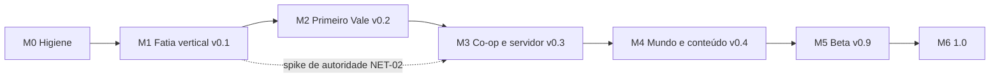

# Dino Vale: planejamento de desenvolvimento

Versão 2.0 do plano, 06/11/2026 (revisão pós-GDD). Autor: `SHIKAMARU`. Documento vivo: atualize ao fechar cada marco. A versão 1.0 (05/11) foi feita antes do GDD; esta incorpora `docs/design/GDD.md`, `docs/design/racao.md` e `docs/design/arte/ESTILO.md`.

**Como ler.** Fato = veio do brief, do `game/README.md`, do repositório ou de decisão registrada do dono. Tudo marcado **[premissa]** é suposição minha e deve ser confirmada ou corrigida pelo dono.

**Já decidido pelo dono (fora de discussão):** código em **MIT**; repositório **rotteny/dinovale**, **público** (push ainda não confirmado); Godot 4.7 + GDScript; lógica separada da apresentação, composição, saves em Dictionary/JSON.
**Decidido em 05/11 (seção 9):** D1 (assets em CC-BY 4.0), D3 (arte de IA só como placeholder identificado, trocada antes do lançamento público), D8 (servidor autoritativo, single-player como host local). D2 foi **revisto pela decisão de arte**: base Ninja Adventure (CC0), tile 16 px, **4 direções**, adulto 32x32, filhote 16x16 (`ESTILO.md`).
**Decidido em 06/11:** todas as recomendações V1 a V18 do GDD; propostas de domesticação 1, 3 e 10 na 0.2, 6, 7 e 9 no M4, 8 adiada, 2 e 5 rejeitadas, 4 como opção de servidor desligada; Ração na **bancada comum**; Lança na 0.2 (cortável); morte permanente de dino só como opção de servidor; elenco do MVP (ver abaixo); artrópodes só em cavernas, depois do MVP; **D15** (pontos de nível e XP na versão enxuta na 0.2) e **D16** (corte de camada 1, tarefas movidas para depois da 0.2, nada apagado); Peso, Parassaurolofo, batismo do dino e barra de atalhos mantidos. **Também decidido em 06/11 (GDD 5.1 a 5.7):** dardo com torpor contínuo, fruta-do-sono que força o dino (e preparado com carne podre vinda de Carniça ou de carcaça velha), carcaça e sacolinha, armas de fogo e pólvora fora até da 1.0, sem sede, HUD com vida, XP e fome e sem barra de stamina, número de dano também no jogador. A pausa de torpor da faixa 3 já está implementada (feita, sem custo novo).
**Elenco do MVP (mudança de 06/11):** M1 Paquicéfalo e **Utahraptor** (no lugar do carnívoro anterior, mesmo papel); M2 Triceratops, **Parassaurolofo** (Conduta Medroso provável, antecipada do M4) e Gallimimus (cortável); M4 Oviraptor e Listro.
**Usadas como premissa, ainda sem decisão do dono (V37 a V41):** Saber como moeda separada, 19 receitas na 0.2, armadura no M4, mobílias com função e pergaminho que ensina sem Saber.
**Ainda em aberto (não são decisão deste plano):** artista para os dinos (D12), horas por semana (D7), e-mail do histórico do git (D13), consulta de marca no INPI e USPTO (D6) e publicação (D14). Por isso as estimativas são em **horas de trabalho, sem datas**.

Estado de partida (fato): testes headless passando (Health, Torpor, Stamina, Hunger, Taming, Inventory, máquina de estados, Player; 635 linhas de teste de nível e Eficiência já existem); cerca de 3,5 mil linhas de GDScript incluindo testes; ciclo de domar jogável com HUD e inventário compartilhado; landing em `html/`; pacote Ninja Adventure já importado em `game/assets/third_party/`. **Em andamento com o `SORA`, sem commit (não conto como entregue):** nível, Eficiência, dano no dino, faixas de torpor, Bastão-de-sono e barras do dino (CRI-01, CRI-09, CRI-11, CRI-16, UIX-02, UIX-07). Sem CI e `tools/check.sh` ainda em criação.

---

## 1. Visão, pilares e o que o jogo não será

**Visão.** Um vale pré-histórico para sobreviver, construir uma base e criar um rebanho de dinossauros que você aprendeu a domar. Gratuito, aberto, e que qualquer pessoa consiga hospedar para os amigos com um comando.

**Pilares** (cada um serve de filtro para cortar escopo):

1. **O vínculo é o centro.** Domar não é só desbloquear estatística: o dino domado tem papel e precisa de cuidado. Se uma feature não reforça o laço jogador-dino, base ou sobrevivência, ela é candidata a corte.
2. **Risco legível e justo.** O perigo se anuncia (som, sombra, barra) e a morte custa algo, mas não destrói horas de jogo (itens recuperáveis).
3. **Base com propósito.** Construir protege, guarda e produz. Nada de construção só estética no começo.
4. **Fácil de hospedar.** Uma imagem Docker, um volume, uma porta UDP. Servidor pequeno, sem conta, sem telemetria.
5. **Aberto e moddável por dados.** Espécies, itens e receitas são dados, não código espalhado.

**O jogo não será** (decisão de escopo, vale até a 1.0):

- MMO, servidor persistente oficial 24/7 ou PvP competitivo/raid. [premissa: sem servidor oficial até depois da 1.0]
- Jogo com monetização, loja ou pay-to-win. (Coerente com "gratuito".)
- 3D, mobile ou web. [premissa]
- Grind pesado de estatísticas ao estilo RPG. A progressão é por tecnologia (receitas), relacionamento com os dinos e, **por decisão D15 (06/11), uma camada enxuta de pontos de nível**: XP de poucas fontes (domar e coletar), 3 atributos por entidade (jogador e dino), sem reiniciar pontos, sem árvore de talentos. O nível do dino segue por fórmula (nível selvagem e Eficiência); os pontos não alteram o nível final nem a Eficiência [premissa a confirmar com a `SHIRO`]. O GDD seção 9 ("sem nível de personagem") precisa ser atualizado pela `SHIRO`.
- Reprodução do conteúdo, nomes, arte ou som de qualquer jogo existente. Mecânicas de gênero são livres; vocabulário e identidade visual são nossos (ver R12).

---

## 2. Core loop e o primeiro lançamento público

- **Minuto a minuto (2 a 5 min):** coletar, craftar, enfrentar ou fugir.
- **Sessão (30 a 60 min) [premissa]:** sobreviver ao dia, domar um dino, ter um abrigo e voltar ao jogo com o save.
- **Longo prazo:** base e rebanho crescem; regiões perigosas pedem dinos melhores.

**Hipóteses de diversão a validar** (o playtest existe para derrubá-las):

- H1: a janela de domar (vigiar o nocauteado alimentando-o enquanto algo ameaça) gera tensão, não espera chata.
- H2: o dino domado dá retorno perceptível em minutos (segue, carrega, defende).
- H3: construir um abrigo tem motivo claro (noite, predador, armazenar).

**Crítica ao design atual.** O loop "nocautear, alimentar, domar" é a mecânica de gênero mais reconhecível. É legal reutilizar, mas sozinha não dá identidade ao jogo. Ver decisão D5 (diferencial do vínculo).

### Primeiro lançamento público: v0.2 "Primeiro Vale"

Um jogador, mundo fixo e pequeno, loop completo de ponta a ponta com a **domesticação como experiência central** (nocautear, alimentar vigiando, proteger o dino, ver o nível final, criar vínculo). **Co-op não é Must da 0.2**, mas a arquitetura nasce preparada e é validada pelo spike S0 no fim do M1.

| MoSCoW | Escopo da 0.2 |
|---|---|
| **Must** | Mundo fixo de 128x128 tiles com 3 biomas (Campina, Mata-baixa, Pedreira), colisão, limites e **navegação dos dinos**. Coleta, inventário, HUD. Crafting na **bancada comum** com 12 a 15 receitas em 2 tiers (a Ração é um template por perfil e nível). **Ração C, B, A** (perfis Verde e Rubra), Dardo, comida crua; exigência de Ração mínima por espécie e regressão sem comida. **Domesticação completa:** Bastão-de-sono, torpor com faixas legíveis, nível e vida do dino, Eficiência e nível final, painel de 3 barras com nível previsto, ação Observar com prévia (tabelas em JSON de leitura). **Barra de atalhos 1 a 9 e batismo do dino (M1).** **4 espécies:** Paquicéfalo (Passivo), Utahraptor (Agressivo), Triceratops (Semi-agressivo), Parassaurolofo (Medroso, provisório). Carnívoro ataca o dino dormindo; curral; grupo chama grupo. Dino domado: Afeto e obediência, seguir, ficar, guardar base, atacar alvo; ofícios **Carregar** e **Defender**; ferido (some 5 min). Construção: fundação, parede, porta, baú, estaca. **Peso** (capacidade de carga de jogador e dinos, atributos simples; definido pela `SHIRO` no GDD, ver PRO-09) e **XP, nível do jogador e pontos de nível na versão enxuta** (D15; ver 4.6). Fome a 0,1/s. Morte do jogador com corpo recuperável. Save/load com versão, `map_id` reservado. Menu, pausa, tutorial contextual. Arte coesa (Ninja Adventure + dinos de artista, gate C), SFX. **Armas e torpor:** Soco e Bastão (M1); dardo de sono com torpor contínuo (teto de 3 efeitos); fruta-do-sono que força o dino dormindo, com sinais de torpor no jogador. **Carcaça e sacolinha** (recorte mínimo: só carne, couro como dado). **Saber e 19 receitas** (premissa V37 a V41) com a tela do Personagem (tecla P). **HUD:** vida, fome, XP e atalhos, sem barra de stamina (o fôlego aparece por comportamento) e sem sede; número de dano também no jogador. Builds Linux e Windows. |
| **Movido para depois da 0.2 (D16, camada 1; nada apagado, ver 4.3a)** | Lança-de-pedra, Gallimimus (Covarde), Ração S com Mel-de-cipó, Temperamento do carnívoro domado, ciclo dia/noite, configurações, música em loop, teste de rede NET-03 (M3), vocalizações por limiar. |
| **Cortável (novos desta rodada)** | Carniça e preparado de sono, Bastão reforçado, Cama e Cocho (4.5b). |
| **Could** | Fogueira e cozinhar (independente da Ração). Montaria. Sede. Build macOS não assinado. Página no itch.io. |
| **Won't (0.2)** | Itens movidos pela D16 (linha acima). Multiplayer. Mundo procedural e chunking. Mods. Web e mobile. Localização. Boss. Criação de filhote, domar sem nocaute, Ração S+ e Orvalho (M4). Conduta Curioso (M4). Artrópodes e cavernas (pós-MVP). Isca. Armas de fogo e pólvora (fora até a 1.0), sede, armadura, Arco, flechas e Espada e sono do jogador (M4). |

**Critério de "realmente divertido" (testável, 0.2):** playtest observado com 5 pessoas fora do círculo do dono [premissa de tamanho e metas abaixo]:

- pelo menos 4 domam um dino sem ajuda;
- pelo menos 3 constroem um abrigo sem ajuda;
- pelo menos 3 explicam, sem ajuda, o que o "nível previsto" e a Eficiência significam (GDD 19);
- a sessão observada dura em média 30 min ou mais sem o facilitador pedir para continuar;
- pelo menos 3 respondem "sim" a "jogaria de novo amanhã?";
- zero perda de save e zero erro de script no log.

**H1 (a vigília gera tensão) só é testável depois do CRI-12** (carnívoro ataca o dormindo, decisão V12), por isso há um playtest curto de H1 no meio do M2 (QA-01a), antes de gastar horas em construção e ofícios. Se H1 ou H2 falharem, o próximo ciclo ajusta o loop antes de qualquer conteúdo novo.

---

## 3. Fases e marcos até a 1.0

### Onde discordo do roadmap do README

| # | README | Problema | Proposta |
|---|---|---|---|
| 1 | Multiplayer só na Fase 3 | Retrofit de autoridade em inventário, crafting, construção e domar custa mais do que o resto do jogo junto | Regras "pronto para rede" desde o M0, camada de autoridade no M1, **spike de rede no fim do M1**, co-op no M3 (antes de chunking e conteúdo) |
| 2 | Grid de construção antes de save | Save é barato agora e disciplina todo `to_dict`; construção sem save não é testável | Ordem: inventário, HUD, **save**, depois construção |
| 3 | Chunking e geração na Fase 2, antes de rede | Depende de como a rede replica (interesse por chunk). Para a fatia basta mapa fixo | Mapa fixo até o M3; chunking no M4. Mas o grid de construção já usa `Vector2i` global em Dictionary, que é amigável a chunk |
| 4 | Morte e respawn na Fase 2 | Survival sem consequência não gera tensão (H1) | Mínimo no M1, completo no M2 |
| 5 | Ordens "seguir e ficar" na Fase 2 | Sem elas domar não tem retorno (H2) | Entram no M1 |
| 6 | Arte e som definitivos na Fase 2 | Arte é o maior gargalo e o mais demorado; decidir tarde trava tudo | Guia de arte no M1, kit v0 no M2, arte final no M5 |
| 7 | Sem CI, sem teste de cena, sem política de agentes | 235 checagens de lógica não pegam quebra de cena; agentes em paralelo sobrescrevem trabalho | M0 inteiro: commit, `check.sh`, testes de arquitetura, `AGENTS.md` |
| 8 | Licença "a definir" | Já decidida (MIT); assets em CC-BY 4.0 | D1 (decidido) |

### M0: Higiene do repositório
- **Objetivo:** ninguém perde trabalho e toda mudança é verificada do mesmo jeito.
- **Entregáveis:** primeiro commit e push para rotteny/dinovale; `tools/check.sh`; testes de arquitetura; ADR-001 a 003; `AGENTS.md`; SPDX e `CREDITS.md`.
- **Saída verificável:** `tools/check.sh` verde local e no CI; testes de arquitetura falham quando uma violação é introduzida de propósito; varredura de segredos limpa antes do push; LICENSE e `assets/CREDITS.md` presentes; ADRs aprovados pelo dono.

### M1: Fatia vertical, v0.1 "pré-alpha"
- **Objetivo:** provar o loop em um build exportado: coletar, craftar o Bastão, nocautear, domar com baga crua, o dino segue, salvar, fechar, carregar.
- **Entregáveis:** barra de atalhos 1 a 9 e batismo do dino (4.5a); o que está em andamento com o `SORA` (Bastão, nível, Eficiência, dano no dino, faixas de torpor, barras; fechados aqui por já estarem no forno, o GDD os previa no M2), mapa fixo da Campina, recursos, itens e espécies como dados, **Conduta orientada a dados** com Passivo e Agressivo, ordens seguir/ficar, morte mínima, fome a 0,1/s, save v1, menu, smoke test de cena, export, CI, spike S0, ADR-004, integração do Ninja Adventure e dinos placeholder.
- **Fora do M1 (decisão V12):** carnívoro atacando o dormindo; Ração com receita (M1 usa baga crua, 10 refeições de 6 s); construção.
- **Saída verificável:**
  1. Build Linux e Windows executa o roteiro: novo jogo, coletar, craftar o Bastão, nocautear Paquicéfalo (4 golpes em L10), alimentar com baga, ver o painel de 3 barras, domar, ele segue, salvar, sair, continuar, e o dino volta com estado idêntico (nível e Eficiência incluídos).
  2. O mesmo roteiro roda como smoke test headless no CI.
  3. S0: servidor headless e 1 cliente; jogador e dino sincronizam; o servidor rejeita 3 intents inválidas e **nunca replica o valor do torpor nem da Eficiência** (só a faixa 0 a 3).
  4. 3 de 5 testadores externos completam o fluxo em até 20 min sem ajuda [premissa de meta], e o facilitador anota se entenderam o nível previsto.
  5. Zero erro de script no log; CI verde.
- **Se S0 falhar:** parar e reavaliar o modelo (ver R1) antes de começar o M2.

### M2: Primeiro Vale, v0.2 (primeiro lançamento público)
- **Objetivo:** loop completo e divertido para uma pessoa (seção 2), com a domesticação como centro.
- **Entregáveis:** escopo Must e Should da seção 2 (inclui Peso, pontos de nível enxutos e batismo e atalhos do M1; tudo Must depois da D16); sequência interna **ameaça primeiro** (CRI-12, QA-01a), depois construção, Ração e vínculo.
- **Saída verificável:** critérios de diversão da seção 2; 100 ciclos automatizados de save/load sem divergência; fixture de save v1 migra para v2; release no GitHub com binários e checksums gerados por tag; nenhum bug P0 aberto; 60 fps estáveis em máquina de referência [premissa: notebook com gráficos integrados de 2020] com 8 dinos e percepção a cada 0,5 s (INF-09); **nenhum placeholder de IA e nenhum bicho do pacote usado como dino final** (gate C, depende do artista, R18).

### M3: Co-op e servidor dedicado, v0.3
- **Objetivo:** 2 a 8 jogadores [premissa] num servidor que qualquer um sobe com Docker.
- **Entregáveis:** configurações (UIX-06) e NET-03 vindos da 0.2; rede (lobby, spawn, replicação de jogadores, dinos, inventário, construção), replicação de Conduta (id do estado e alvo), faixa de torpor e nível; **vínculo compartilhado com ordem de grupo (V7)**; replicação e validação de XP, pontos e atributos; arquivo de regras do servidor com as chaves do GDD 13; servidor headless configurável, validação de entrada, imagem Docker e guia de auto-hospedagem, testes de rede no CI.
- **Saída verificável:** `docker run` sobe o servidor; 4 clientes jogam 30 min sem desync; soak de 2 h sem crescimento de memória [premissa]; `kill -9` perde no máximo o intervalo de autosave; suíte de entrada inválida passa (inclui dano e Eficiência forjados); revisão de `NEZUKO` sem achado Alto ou Crítico aberto; guia executado com sucesso por pessoa de fora; handshake recusa protocolo incompatível; vários jogadores no mesmo dino: o último golpe não zera o progresso de domar.

### M4: Mundo e conteúdo, v0.4
- **Objetivo:** mundo grande, variado, com progressão e a identidade do vínculo (Criação).
- **Entregáveis:** itens vindos da 0.2 (Gallimimus, Lança, Ração S, Temperamento, dia/noite); ADR do mapa interior (`map_id`), chunking e streaming, geração por seed, persistência por chunk, interesse por chunk, **6 espécies no total** (Oviraptor e Listro entram; a lista de "8 espécies" do plano 1.0 cai), Conduta Curioso, **Criação** (ninho, filhote), **domar sem nocaute** (Curioso e Medroso), **Ração S+ com Orvalho-de-casco** produzido por dino, ameaças e dificuldade, 3 a 5 tiers, clima.
- **Saída verificável:** mesmo seed gera o mesmo mapa (hash igual); mundo de pelo menos 512x512 tiles [premissa]; sem queda abaixo de 60 fps ao cruzar chunks; servidor com 8 jogadores dentro do orçamento de CPU; saves 0.3 migram; filhote criado chega a adulto com Afeto `round(E/5)` e ofício escolhido.

### M5: Beta, v0.9
- **Objetivo:** cara e som finais, polimento, beta público.
- **Entregáveis:** música em loop e vocalizações por limiar (vindas da 0.2); arte final do conteúdo Must (6 espécies adulto e filhote), som e música, tutorial completo, localização en e pt-BR, acessibilidade básica, documentação final.
- **Saída verificável:** script confirma que todo arquivo em `assets/` está coberto por `CREDITS.md` com licença compatível; beta público de pelo menos 2 semanas com relatos triados [premissa]; todos os saves das versões 0.x migram nas fixtures.

### M6: 1.0
- **Objetivo:** estabilidade, não features.
- **Saída verificável:** zero bug de perda de dados aberto; 2 semanas seguidas de release candidate sem P0 ou P1 [premissa]; docs completas; roadmap pós-1.0 publicado (artrópodes e cavernas, receitas achadas no mundo).

---

## 4. Backlog por épico

**Épicos:** MUN mundo e mapa, SOB sobrevivência, CRI criaturas, CON construção, PRO progressão e crafting, SAV save, NET multiplayer e servidor, UIX UI/UX, ART arte e som, INF infra e CI, COM comunidade e open source, ARQ arquitetura, QA testes e balanceamento.

**Colunas.** Estimativa em *horas de trabalho* (O/R/P = otimista/realista/pessimista; definição na seção 5). Pri: **Must**, **Should** ou **Cortável** (o GDD o marca Essencial, mas é o primeiro a sair se o escopo apertar; ver 4.7). "Quem" é o agente sugerido; o dono integra tudo. **Regra para toda tarefa de gameplay:** só vale pronta se passa pela camada de autoridade (NET-01), tem `to_dict`/`from_dict` com roundtrip testado, valores de balanceamento em dados e a revisão do `LEVI`. As estimativas são do trabalho total da tarefa, não do que resta: o crédito esperado pelo que o `SORA` já fez está na seção 5.

### 4.0 Conflitos da seção 17 do GDD, resolvidos

| # | Conflito | Resolução no plano |
|---|---|---|
| 1 | D5 | **Decidido:** Afeto e obediência e dois ofícios na 0.2 (CRI-07, CRI-08); Temperamento cortável (CRI-17); Criação no M4 (CRI-20). D5 na seção 9 atualizado. CRI-07 deixa de ser "fome e negligência" e vira Afeto (3/4/6 passa a 5/8/12). |
| 2 | Fome 0,5/s | Ajuste de dado para 0,1/s, mais aviso de fome no HUD: SOB-04 (M1). |
| 3 | Landing x tom | Tarefa COM-04 (`BULMA`, M2, Must): trocar "parceiro" por promessa honesta antes do gate C. Não editei `html/`. |
| 4 | Crafting é M2 | Mantido. M1 usa baga crua (10 refeições de 6 s) sem receita; Ração só no M2 (PRO-07). |
| 5 | Espécies | A 0.2 tem 4 espécies Must (Paquicéfalo, Utahraptor, Triceratops, Parassaurolofo) e o Gallimimus, **movido para depois da 0.2 (D16)**. CRI-03 passa a 2 espécies do M1; CRI-06 é só o Triceratops; Parassaurolofo em CRI-26; Gallimimus em CRI-06b (M4). |
| 6 | Cozinhar Could | Resolvido: a Ração usa a **bancada comum** (PRO-04); não há estação extra. Fogueira e cozinhar seguem Could, sem relação com a Ração. |
| 7 | Golpe no dormindo | CRI-11: golpe debita Eficiência e vida; o dardo é a manutenção barata de torpor. Muda `Dino.apply_torpor` e `Player`. |
| 8 | Criação | Novo escopo no M4: CRI-20. |
| 9 | Nível, Eficiência, vida | Novas tarefas CRI-09 (nível, vida, Eficiência), UIX-02 (painel de 3 barras), UIX-07 (barra de vida), CRI-03 maior (SpeciesDef com os campos novos). Reestimado. |
| 10 | Combate com dano | CRI-01 (Bastão por `WeaponDef`), CRI-11 (dano no dino) e CRI-13 (Lança, movida para o M4; ver R24). |
| 11 | Carnívoro ataca o dormindo | CRI-12 (M2, depois do CRI-04, que no M1 só persegue o jogador). |
| 12 | Morte do dino | Dino em domesticação com vida 0 morre e a domesticação falha (CRI-11). Dino domado fica ferido e some 5 min (SOB-05). Morte permanente só por `dino_ferido_minutos = -1` no `ServerRules` (ARQ-05); SOB-02 passa a tratar só o jogador. |
| 13 | CRI-04 e seis Condutas | CRI-04 vira máquina de estados genérica orientada a dados (`ConductDef` e tabela de transições por tipo); M1 entrega Passivo e Agressivo; Semi-agressivo no CRI-06; Medroso no CRI-26; Covarde no CRI-06b (M4); Curioso no M4. Reestimado de 3/5/8 para 7/11/17. |
| 14 | Seis tipos x poucas espécies | A 0.2 mostra 4 tipos (Passivo, Agressivo, Semi-agressivo, Medroso); Curioso no M4. Variantes por indivíduo (`pesos_conduta`) ficam como contingência CRI-25, **fora das horas**, só se o playtest acusar falta de variedade. |
| 15 | Isca | **Retirada do plano e do core loop.** Não há tarefa: a Ração, o dardo, o curral e a corrida cobrem a vigília. Gatilho para reabrir (CRI-24, contingência de 3/4/6 h, fora do total): menos de 3 de 5 testadores nocautearem o Parassaurolofo sem ajuda. |
| 16 | Grupo e percepção por raio | CRI-18 (M2). Orçamento de CPU medido em INF-09 (M2) e repassado ao M3: percepção a cada 0,5 s, replica só o id do estado e o alvo (ADR-004). NET-10 +3/4/6 e NET-12 +1/2/3. |
| 17 | Domesticar quem corre | MUN-04 (navegação com obstáculos do `BuildGrid`) e INF-09 (teste de cena determinístico de perseguição, caso Covarde 85 px/s e curral). Sem isso só o playtest pegaria. |

### 4.0a Conflitos 18 a 25 do GDD, resolvidos

| # | Conflito | Resolução no plano |
|---|---|---|
| 18 | Carne podre pede estragar, e `racao.md` cortou a validade | Carniça como nó de mundo, sem apodrecer (V31): CRI-30, cortável. Carne que apodrece no inventário fica no M4, sem horas. |
| 19 | V6 revisto: fruta e preparado mantêm o dormindo; o dardo é de dino acordado | CRI-28 (dardo) e CRI-29 (fruta). O `use_dart` instantâneo do CRI-11 é substituído pelo CRI-28. |
| 20 | Torpor do jogador | Sinais (faixas 1 a 3) dentro do CRI-29; o sono do jogador vai ao M4 (CRI-32, cortável). |
| 21 | Dose do dardo: 50 em 5 s | CRI-28. |
| 22 | Carcaça e sacolinha | SOB-06 (recorte mínimo). O alforje do dino morto vai para a sacolinha. SOB-02 fica só com o corpo do jogador. Ver R25 (fonte de Carne). |
| 23 | Receitas por Saber | PRO-13 (Saber, aprender, tela de receitas); PRO-05 vira 19 receitas por dados e o gate "por ter feito" é substituído. PRO-10 (M4) usa o mesmo Saber. V37 a V41 são premissa. |
| 24 | HUD sem barra de stamina, com XP e aviso de ponto | UIX-13 (ofegante, M1), UIX-12 (XP e selo, M2); UIX-01 perde a barra de stamina. |
| 25 | Durabilidade | Sem conflito: `ItemDef` não ganha campo de durabilidade. |

### 4.1 M0 (restante)

Feitos em 05/11: ARQ-01 (ADR-001 a 003) e INF-04 (`AGENTS.md`).

| ID | Tarefa | Dep | O/R/P | Pri | Quem | Aceite |
|---|---|---|---|---|---|---|
| INF-01 | Commit inicial separado por pasta, `.gitignore` revisado, push, 1 branch ou worktree por agente. Inclui o pacote Ninja Adventure | D13, D14, rodada do `SORA` fechar | 1/1/2 | Must | dono + `SAITAMA` | varredura de segredos limpa em todo o histórico; push só após D6 e D13 |
| COM-01 | SPDX nos `.gd`, `CREDITS.md` cobrindo o pacote importado (autor, licença CC0, URL, data), `ASSETS-LICENSE`, marcar a arte antiga (`gerar_arte.gd`, mocks) como histórico | D1, D6 | 1/1/2 | Must | `SAITAMA` | todo arquivo de `game/assets/` tem linha no `CREDITS.md` |
| INF-02 | `tools/check.sh`: import, testes, lint, arquitetura; igual local e no CI | INF-01 | 1/2/3 | Must | `SAITAMA` + `SORA` | falha ao introduzir violação de propósito |
| INF-03 | Testes de arquitetura (componentes sem `CanvasItem`, `Input` só no corpo e na UI, roundtrip de saveable) | INF-02 | 1/2/3 | Must | `LEVI` | teste quebra com a violação |
| | **Restante M0** | | **4/6/10** | | | total do marco 7/10/17 |

### 4.2 M1 (nível de tarefa)

| ID | Tarefa | Dep | O/R/P | Pri | Quem | Aceite |
|---|---|---|---|---|---|---|
| PRO-01 | InventoryComponent (em andamento) | | 1/2/3 | Must | `SORA` | empilha, respeita limite, roundtrip |
| PRO-02 | InteractableArea (em andamento) | | 1/1/2 | Must | `SORA` | interage só no alcance |
| CRI-01 | Soco (sem item: dano 1, torpor 10, 0,6 s) e Bastão-de-sono por `WeaponDef`: 30 de torpor, dano 2, 0,7 s (em andamento; troca os 3 golpes de 40) | ARQ-01 | 2/3/5 | Must | `SORA` | 4 golpes nocauteiam o Paquicéfalo L10; valores só em `.tres` |
| UIX-01 | HUD (em andamento): vida e fome; **sem barra de stamina** (decisão do dono) | PRO-01 | 2/3/5 | Must | `SORA` | HUD mostra vida e fome |
| CRI-02 | Inventário compartilhado com dino inconsciente (em andamento) | PRO-01 | 1/2/4 | Must | `SORA` | troca de itens com o dormindo, roundtrip |
| NET-01 | **Camada de autoridade**: todo ato (coletar, atacar, dardo, alimentar, ordenar) é `request_*` validado; single-player usa o mesmo caminho | ARQ-01, bloco em andamento | 4/6/10 | Must | `KURAMA` desenha, `SORA` implementa | 3 intents inválidas rejeitadas em teste |
| ARQ-04 | **ADR-004**: Conduta e domesticação em dados; o que replica (id do estado, alvo, faixa de torpor) e o que nunca replica (valor do torpor, Eficiência); percepção a cada 0,5 s | ARQ-01 | 2/3/5 | Must | `KURAMA` | ADR aceito pelo dono |
| MUN-01 | Mapa fixo v0 (Campina): TileMapLayer com tileset do pacote, colisão, limites; hitbox por dado | ART-04 | 3/4/6 | Must | `SORA` | jogador e dino não atravessam colisão nem saem do mapa |
| MUN-02 | Nós de recurso (árvore, pedra, baga, fibra) com respawn | PRO-01, PRO-02, MUN-01 | 2/3/5 | Must | `SORA` | coleta e respawn por dado |
| PRO-03 | Registro de itens por dados (`ItemDef`): baga, madeira, pedra, fibra, carne, Bastão e `dardo_sono` | ARQ-01 | 2/3/4 | Must | `SORA` | nenhum item hardcoded; IDs estáveis |
| CRI-03 | Espécies por dados (`SpeciesDef`): Paquicéfalo e Utahraptor com vida, dano, dificuldade, torpor máximo, queda, `aceita_crua`, tamanho e âncora (placeholder 16x16 hoje, adulto 32x32 depois); refatora `Dino`. **Valores do Utahraptor vêm da `SHIRO`** | ARQ-01, ARQ-04 | 5/7/11 | Must | `SORA` | trocar sprite e tamanho só muda o dado; spawn por id |
| CRI-04 | **Conduta orientada a dados**: `ConductDef`, máquina de estados genérica por eventos, tabela de transições; Passivo (Paquicéfalo revida) e Agressivo (Utahraptor persegue e ataca o jogador; no M1 só o jogador é alvo) | CRI-03, ARQ-04 | 7/11/17 | Must | `SORA` | cada linha da tabela 6.7 do GDD para os 2 tipos é um teste; sem `if especie ==` |
| SOB-01 | Morte e respawn mínimos do jogador | CRI-04 | 2/3/5 | Must | `SORA` | vida 0 leva ao respawn |
| CRI-05 | Ordens seguir e ficar | CRI-03, NET-01 | 3/4/6 | Must | `SORA` | domado segue a até 3 tiles e fica por ordem; vai ao save |
| CRI-09 | **Nível, vida e Eficiência** (em andamento, antecipado do M2): `DinoLevelRules`, nível selvagem por bioma, E de 0 a 100, nível final, Afeto inicial `round(E/5)` | CRI-03 | 8/12/18 | Must | `SORA` | tabelas 10.2 e 10.4 do `racao.md` como casos fixos ((20,100)=30; (7,60)=9); roundtrip com nível e E |
| CRI-11 | **Dano no dino e Eficiência por ataque** (em andamento): `take_damage`, golpe no dormindo debita E e vida (4 jogador, 8 carnívoro), `use_dart` (+40 torpor, -2 E, sem dano), morte na domesticação falha, E 0% doma sem bônus; o golpe deixa de ser grátis | CRI-09, NET-01 | 5/8/12 | Must | `SORA` | ataques em sequência, dardo sem dano e morte que falha, todos testados |
| CRI-16 | **Faixas de torpor** 0 a 3 com histerese (em andamento): visual (bocejo, cambaleio, respiração) e regra de servidor (velocidade x0,85/x0,65, cooldown x1,5). **Pausa de 0,8 s da faixa 3 já implementada: registrada como feita, sem custo novo** | CRI-01 | 3/4/6 | Must | `SORA` | fronteiras testadas; só a faixa vai à rede |
| UIX-02 | Painel de domar com 3 barras (torpor, domesticação, Eficiência) e nível previsto; sem barra de torpor acordado (em andamento) | UIX-01, CRI-09 | 3/4/6 | Must | `SORA` | aparece só com o dino dormindo |
| UIX-07 | Barra de vida do dino só após dano, no máximo 3, some em 5 s (em andamento) | CRI-11 | 2/3/4 | Must | `SORA` | a quarta barra tira a mais antiga |
| UIX-11 | **Barra de atalhos 1 a 9** (custo em 4.5a): atalhos para comida, armas, ferramentas e dardos; a tecla é lida só no corpo do jogador e vira `request_use_item`; vínculo salvo | PRO-03, UIX-01, NET-01 | 3/4/6 | Must | `SORA` | tecla 1 a 9 usa o item (come, equipa o Bastão, atira o dardo) pelo caminho de autoridade; item gasto limpa o slot; roundtrip no save |
| UIX-13 | **Estado ofegante** no lugar da barra de stamina (custo em 4.5b): ofegar abaixo de 25%, para de correr ao zerar e anda até recuperar 20; som e partícula de suor; 1 bit replicado | UIX-01 | 2/2/4 | Must | `SORA` + `YATORA` | sem barra, o jogador percebe o fim do fôlego; teste do estado |
| UIX-14 | **Número de dano** flutuante no dino e no jogador (estimativa minha, 4.5b) | CRI-11 | 1/2/3 | Must | `SORA` | dano visível nos dois alvos |
| SOB-04 | Fome a 0,1/s e aviso no HUD | UIX-01 | 1/2/3 | Must | `SORA` | esvazia em cerca de 16,7 min; aviso antes do dano |
| SAV-01 | SaveManager v1: escrita atômica, `.bak`, `format_version`, roundtrip, fixture v1; já com nível, E e **`map_id` reservado** | ARQ-01 | 5/7/11 | Must | `SORA` | fixture v1 carrega; versão maior é recusada |
| UIX-03 | Menu principal e pausa | SAV-01 | 2/3/4 | Must | `SORA` | novo, continuar, sair |
| INF-05 | Smoke test de cena: roteiro de domar completo por script | CRI-05, SAV-01 | 3/4/6 | Must | `LEVI` | roda no CI |
| NET-02 | **Spike S0** (limite 10 h): servidor e cliente headless; jogador e dino replicados; 3 intents inválidas e dano forjado rejeitados; torpor e E nunca replicados; verificar `OfflineMultiplayerPeer` e SIGTERM | NET-01, ARQ-04 | 4/7/11 | Must | `SORA` + `KURAMA` | critério 3 do M1 |
| INF-06 | Export Linux e Windows por script | INF-02 | 1/2/4 | Must | `SAITAMA` | build executa o roteiro |
| INF-07 | CI remoto: import, testes, lint, smoke | INF-02 | 1/2/3 | Must | `SAITAMA` | verde em PR |
| ART-01 | Fechar o guia de arte: `ESTILO.md` é o guia; falta aprovar o tom do mundo e o Caveman e registrar a mudança de D2 | | 1/1/2 | Must | dono + `YATORA` (consultiva) | decisões abertas 1, 2 e 4 respondidas |
| ART-04 | Integrar o Ninja Adventure: tileset, Caveman, tema 9-slice, emotes; **ouvir os sons** (ninguém ouviu) e mapear | ART-01 | 3/4/7 | Must | `YATORA` | arquivos no `CREDITS.md`; lista de sons ouvidos |
| ART-05 | Dinos placeholder com os bichos do pacote (16x16), herbívoro e carnívoro distinguíveis; marcados no `CREDITS.md` | ART-04 | 2/3/5 | Must | `YATORA` | legível a olho nu no mapa |
| COM-02 | Playtest 0.1: roteiro, formulário, 3 a 5 pessoas; anota o entendimento do nível previsto | INF-06 | 1/2/3 | Must | dono | critérios 4 e 5 do M1 |
| | **Total M1** | | **88/131/206** | | | antes 48/74/119 |

### 4.3 M2 (nível de tarefa)

Ordem interna: (1) navegação e ameaça, (2) **QA-01a: playtest de H1**, (3) construção, Ração e crafting, (4) vínculo e ofícios, (5) conteúdo, arte, som, release.

| ID | Tarefa | Dep | O/R/P | Pri | Quem | Aceite |
|---|---|---|---|---|---|---|
| MUN-03 | Mapa v1: Campina, Mata-baixa, Pedreira com `faixas_de_nivel` (1 a 12, 5 a 25, 15 a 35), pontos de recurso e spawn por seed do mundo | MUN-01 | 5/7/11 | Must | `SORA` | níveis sorteados dentro da faixa (teste); cruzar o mapa em cerca de 29 s |
| MUN-04 | **Navegação dos dinos**: `AStarGrid2D` em 16 px, obstáculos vindos do `BuildGrid`, desistir após 5 s sem caminho | MUN-03 | 4/7/11 | Must | `SORA` | Agressivo e Semi não atravessam parede, porta fechada nem curral |
| CRI-12 | **Carnívoro ataca o dormindo**: ronco de 8 tiles (+4 Rubra), checagem de 0,5 s, "!" de 1,5 s, alvo mais próximo, provocar muda o alvo | CRI-04, CRI-11, ARQ-05 | 5/8/12 | Must | `SORA` | Utahraptor sobre o Paquicéfalo dormindo gera as perdas da tabela 11.1; Semi só a 4 tiles |
| QA-01a | **Playtest curto de H1** (3 pessoas) com Bastão, baga, carnívoro e dormindo | CRI-12 | 2/3/5 | Must | dono + `SHIRO` | decisão registrada: a vigília tem tensão ou o loop muda antes de seguir |
| CON-01 | `BuildGrid` em Dictionary por `Vector2i`, validação, `to_dict` | NET-01, SAV-01 | 5/7/11 | Must | `SORA` | roundtrip; validação no servidor |
| CON-02 | Peças: fundação, parede, porta, baú, **estaca**; remoção e drop | CON-01 | 4/5/7 | Must | `SORA` | anel de 8 peças bloqueia o carnívoro |
| CON-03 | UI e modo de construção | CON-01 | 4/6/9 | Must | `SORA` | ghost e menu de peças |
| PRO-04 | `RecipeDef` e **bancada comum** única, 4 s por craft, sem espera | PRO-03 | 4/6/9 | Must | `SORA` | craft por dados |
| PRO-05 | **19 receitas** em 2 tiers por dados (6 conhecidas e 22 Saber; premissa V38; Ração por template); gate por Saber, não "por ter feito" | PRO-04 | 3/5/8 | Must | `SORA` | todas por dados; ordem de aprendizado de `receitas.md` |
| PRO-06 | Container (baú) reutilizando o inventário | CON-02 | 2/3/4 | Must | `SORA` | guarda e devolve itens |
| PRO-07 | **Ração C, B, A** (Verde e Rubra) e crua: Tubérculo-lanoso e Sal-de-veio, qualidade por refeição (intervalo, progresso, agitação), `racao_minima` (abaixo rende 50%, crua isenta), perfil rejeitado | PRO-05, PRO-13, CRI-09, MUN-03 | 6/9/14 | Must | `SORA` | tabela 1.2 do `racao.md` como casos fixos |
| PRO-09 | **Peso** como atributo (GDD 5.1): `peso` no `ItemDef`, capacidade de 50 kg do jogador e por espécie, alforje do dino com o mesmo limite, **impedir pegar acima de 100%**, sem lentidão; slots só de exibição (era 8/12/20; ver 4.5) | PRO-03, CRI-08 | 6/9/16 | Must (mantido) | `SORA` | abrigo mínimo (38,05 kg) cabe em uma viagem; nó cheio mostra "peso máximo" sem gastar o nó |
| PRO-11 | **XP, nível do jogador e pontos, versão enxuta** (ver 4.6): curva, XP de coletar (+1), craftar (+2) e domar (`15 + 3 x nível final`), Saber por nível (1, mais 1 nos níveis 5, 10, 15 e 20), componente, pontos por nível, `to_dict`; regra da `SHIRO` | CRI-09, NET-01, PRO-09 | 4/6/10 | Must (D15) | `SORA` + `SHIRO` | ver 4.6 |
| PRO-12 | **Distribuição de pontos** no jogador e no dino por `request_spend_point` validado (saldo, teto, dono) e integração com `DinoLevelRules`; 3 atributos por entidade, sem reiniciar | PRO-11, CRI-07 | 3/4/7 | Must (D15) | `SORA` | ver 4.6 |
| UIX-09 | **Tela de atributos** única do jogador e do dino | PRO-12 | 2/3/5 | Must (D15) | `SORA` | ver 4.6 |
| SAV-03 | Acréscimo ao save v2: XP, nível, pontos gastos por jogador e por dino | PRO-11, SAV-02 | 1/1/2 | Must (D15) | `SORA` | fixture v1 migra com os campos novos |
| QA-02 | Validação e anti-abuso dos pontos, balanceamento da curva contra nível do dino e Eficiência, dica de tutorial | PRO-12 | 2/3/5 | Must (D15) | `LEVI` + `SHIRO` | pontos nunca excedem o saldo nem o teto em teste |
| ARQ-05 | `ServerRules` em dados com as chaves do GDD 13 (inclui `perde_estoque_ao_acordar` desligada e `dino_ferido_minutos`), lido pelo host local | NET-01 | 2/3/5 | Must | `KURAMA` desenha, `SORA` | nenhum número de regra em código; a opção testada nos dois estados |
| SOB-02 | Morte completa do jogador: corpo com itens recuperáveis | SOB-01 | 4/6/9 | Must | `SORA` | itens recuperados no corpo |
| CRI-27 | **Batismo do dino** (GDD V24, M2): nome de até 20 caracteres, filtro como opção de servidor (`ServerRules`), validado no servidor, exibido nas barras e no painel; vai ao save | CRI-05, SAV-02, ARQ-05 | 2/3/4 | Must | `SORA` | `request_rename_dino` rejeita nome vazio, longo ou inválido; só o dono renomeia; roundtrip |
| CRI-28 | **Dardo de sono com torpor contínuo** (4.5b): arremesso a 6 tiles, 0 de dano, 10 imediato mais 8/s por 5 s (dose de 50), teto compartilhado de 3 efeitos por alvo (o 4º renova o mais antigo), -2 de Eficiência só em dormindo, contínuo não conta como ataque; substitui o `use_dart` instantâneo | CRI-11, CRI-16, PRO-05 | 5/7/11 | Must | `SORA` | Paquicéfalo L12 nocauteia em cerca de 4,1 s com um dardo por segundo; um dardo isolado não nocauteia; efeitos salvos e restaurados |
| CRI-29 | **Fruta-do-sono** (4.5b): arbusto na Mata-baixa (3 frutas, 4 s, respawn de 6 a 8 min), item de 0,1 kg (6/s por 5 s, não é comida), **forçar o dino dormindo** (interação ou tecla a 3 tiles, 1,5 s de ação, 3 s de espera por dino, sem custo de Eficiência), sinais de torpor no jogador (faixas 1 a 3, sem sono) | CRI-28, CRI-16, UIX-11 | 5/8/12 | Must | `SORA` | respeita o teto de 3; 6 frutas levam o jogador à faixa 3 sem dormir; sem alvo a tecla pede segundo aperto em 1,5 s |
| CRI-30 | **Carniça** (nó de carne podre: 2 unidades, respawn de 10 min) e item; o preparado de sono (3 frutas e 1 carne podre rendem 3; 60 de torpor cada, só em dino) é receita do PRO-13 | CRI-29 | 1/1/2 | Cortável | `SORA` | preparado forçado no dormindo, sem efeito sem alvo |
| SOB-06 | **Carcaça e sacolinha, recorte mínimo** (4.5b): só carne (couro como dado, sem uso), coleta de uma vez em 1,5 s por carne, carcaça fresca por 10 min, sacolinha para excesso de Peso e para o alforje do dino morto (só do dono por 120 s), limites de 8 carcaças e 20 sacolinhas, `coletar_carcaca` e `pegar_sacolinha` validados | SOB-02, PRO-09, CRI-08 | 5/8/12 | Must | `SORA` | Triceratops L28 dá 22 de carne; o que não cabe no Peso fica na sacolinha; o servidor remove a unidade |
| SOB-06b | **Bastão reforçado** (1 Bastão e 2 couro; torpor 36) e uso do couro | SOB-06, PRO-13 | 1/1/2 | Cortável | `SORA` | Utahraptor L20 cai em 5 golpes |
| PRO-13 | **Saber e tela de receitas** (4.5b; premissa V37 e V38): ganho de Saber, `aprender_receita` validado, `craftar` com bancada a 2 tiles, bloqueio na bancada, tela do Personagem (tecla P) com aba Receitas, efeito de coleta de Machado e Picareta; save | PRO-04, PRO-11 | 6/8/13 | Must (premissa) | `SORA` | 23 Saber em L20 (teste); pré-requisitos sem ciclo; peça colocada qualquer um usa |
| PRO-14 | **Cama** (renascimento) e **Cocho** (guarda Ração, rebanho come com fome abaixo de 40): implementação, que a `SHIRO` não estimou (estimativa minha) | PRO-13, SOB-02, CRI-07 | 3/4/6 | Cortável | `SORA` | Cama liga ao respawn; Cocho alimenta o dino |
| UIX-12 | **HUD de nível** (4.5b): barra de XP fina com "Nv N", selo único de ponto ou Saber, linha de aviso de 3 s ao subir de nível | PRO-11 | 3/3/5 | Must | `SORA` | selo só aparece com algo a gastar; sem janela |
| UIX-15 | **Atalho em dino ao alcance** (Ração): alvo mais próximo a 3 tiles, razão do bloqueio, marcação visível (estimativa minha) | UIX-11, PRO-07 | 1/1/2 | Must | `SORA` | sem alvo a tecla não gasta item |
| SOB-05 | Dino domado ferido: some 5 min e volta à base; vida persiste; regenera | CRI-08, ARQ-05 | 3/4/6 | Must | `SORA` | timer persiste no save |
| CRI-06 | **Triceratops**: dados, Semi-agressivo (aviso 1,5 s, investida, desiste), estados Aviso e Fugindo; todo dino foge com menos de 25% de vida | CRI-04, CRI-09 | 5/8/12 | Must | `SORA` | linhas da tabela de Semi testadas |
| CRI-26 | **Parassaurolofo** (Medroso provisório): dados, conduta, arte e som (custo em 4.4) | CRI-06 | 8/13/20 | Must (mantido) | `SORA` + `YATORA` + dono | tabela de Medroso testada |
| CRI-18 | Grupo chama grupo (8 tiles, atraso de 0,5 s) | CRI-04 | 3/4/6 | Must | `SORA` | Passivo do grupo revida; Agressivo ataca |
| CRI-07 | **Afeto e obediência**: inicial `round(E/5)`; sobe +4 com Ração B ou melhor, +1 com simples; desce -1/min sem cuidado e -10 se ferido por você; obedece sempre acima de 25, falha 30% de 10 a 25, ignora abaixo de 10; fome do rebanho +1% por nível | CRI-09, CRI-05 | 5/8/12 | Must | `SORA` + `SHIRO` | limiares testados; `afeto_decai` no `ServerRules` |
| CRI-08 | **Ofícios Carregar e Defender** com fator de ofício; defensor protege o dormindo | CRI-07 | 5/7/11 | Must | `SORA` | carga e dano escalam com o nível |
| CRI-19 | Ordens atacar o alvo e guardar a base | CRI-08 | 3/4/6 | Must | `SORA` | executadas pelo dino acima do limiar de Afeto |
| UIX-08 | Lista de grupo no HUD (nível, vida, ordem) | CRI-07 | 2/3/4 | Must | `SORA` | atualiza por sinal |
| CRI-14 | **Observar** (2 s, 6 tiles) e prévia; tabelas de espécie e Ração em JSON de leitura versionado | CRI-09, PRO-07 | 3/5/8 | Must | `SORA` | números do painel iguais ao `TamingComponent`; JSON validado por schema |
| CRI-15 | Regressão sem comida (1%/s após 1 intervalo, configurável) | CRI-09 | 1/2/3 | Must | `SORA` | 10 s ausente perde 5% |
| UIX-04 | HUD v1 final e tooltips (a barra de atalhos saiu para o UIX-11 e o HUD de nível para o UIX-12; era 3/5/8) | UIX-01 | 1/2/3 | Must | `SORA` | |
| UIX-05 | Tutorial contextual (painel de 3 barras, nível previsto, dardo, ronco, curral, Observar) | PRO-05, CON-03 | 4/6/10 | Must | `SORA` | dicas por evento, sem tela de texto |
| ART-02 | Ícones e UI novos: barras de cor distinta (o pacote só tem vermelha; encomenda pequena), painel, ícones de Ração, dardo, ingredientes, curral, dormindo ferido, Saber, fruta, preparado, carcaça, sacolinha e selo de ponto (estimativa minha) | ART-04 | 6/9/15 | Must | `YATORA` | `CREDITS.md` atualizado |
| ART-06 | **Dinos finais** (Paquicéfalo, Utahraptor, Triceratops, Parassaurolofo; o Gallimimus saiu pela D16): adulto 32x32, 4 direções, andar/parado/dormir/ferido/ataque conforme `ESTILO.md`. **Horas do artista não estão aqui**; só briefing, orçamento, revisão e integração | D12 | 6/9/14 | Must | dono + `YATORA` (consultiva) + artista | teste de aceitação do item 7 do `ESTILO.md`; autor e licença no `CREDITS.md` |
| ART-03 | SFX de dino e de combate (rugido, ronco, mordida, farejar, gemido, bocejo, tique de E, fanfarra, ofegar, subir de nível, aprender e fabricar; vocalização por limiar movida para o M5 (ART-03b) | ART-04 | 4/7/11 | Must | `YATORA` | proveniência registrada |
| SAV-02 | Save v2 (estruturas, receitas, domados com nível, E, Afeto, ofício, timer de ferido) e migração v1 para v2 | CON-01 | 4/6/9 | Must | `SORA` | fixture v1 migra |
| INF-08 | Release por tag: binários, checksums, changelog | INF-06, INF-07 | 2/3/5 | Must | `SAITAMA` | |
| INF-09 | Teste de cena determinístico de perseguição (Medroso e curral) e **orçamento de CPU da percepção** (N dinos x raio a cada 0,5 s) | MUN-04, CRI-12 | 3/4/7 | Must | `LEVI` + `SORA` | 60 fps com 8 dinos |
| COM-03 | README do jogador, CHANGELOG, link de download | INF-08 | 1/2/3 | Must | `BULMA` + dono | |
| COM-04 | Landing honesta: trocar "parceiro" por "vale acolhedor, bicho perigoso" | | 1/2/3 | Must | `BULMA` | texto revisado pelo dono |
| COM-05 | Glossário próprio e varredura de nomes (R12) | | 1/2/3 | Must | dono + `SHIRO` | nenhum termo alheio nos arquivos |
| QA-01 | Balanceamento dos números [premissa] do GDD 19 e 2 rodadas de playtest | tudo acima | 7/10/16 | Must | dono + `LEVI` | critérios da seção 2 |
| | **Total M2** (Must 173/259/406; cortáveis 5/6/10) | | **178/265/416** | | | antes 69/104/165 |

### 4.3a Movido para depois da 0.2 (D16, camada 1)

Tarefas preservadas com a estimativa original e entram no marco indicado, somadas na seção 5. Nenhuma foi apagada. A pausa de torpor da faixa 3 não está aqui: já está implementada (feita, sem custo novo).

| ID | Tarefa | Marco novo | O/R/P | Observação |
|---|---|---|---|---|
| CRI-13 | Lança-de-pedra | M4 | 2/3/5 | **Aguarda a `SHIRO`** (R24): se a defesa contra o Utahraptor não funcionar sem a Lança, volta antes do QA-01a |
| CRI-06b | Gallimimus (Covarde) | M4 | 3/5/8 | entra com o Curioso; a arte do ART-06 não inclui o Gallimimus |
| PRO-08 | Ração S: Mel-de-cipó e marimbondos | M4 | 5/8/12 | junto da Ração S+ (CRI-22) |
| CRI-17 | Temperamento do carnívoro domado | M4 | 3/5/8 | junto da Criação (identidade do vínculo) |
| SOB-03 | Ciclo dia/noite | M4 | 3/4/6 | junto do clima (SOB-11) |
| UIX-06 | Configurações: volume, remap, tela cheia | M3 | 2/3/4 | antes do co-op |
| ART-07 | Música em loop | M5 | 1/2/3 | junto de ART-11 |
| NET-03 | Repetir o S0 com construção e crafting | M3 | 2/3/5 | natural no início do M3 |
| ART-03b | Vocalizações por limiar (75, 50 e 25% de vida), que saíram do ART-03 | M5 | 1/1/2 | junto de ART-11 |
| | **Total movido** | M3 4/6/9, M4 16/25/39, M5 2/3/5 | **22/34/53** | |

### 4.4 Quinta espécie: custo separado (CRI-26, já incluído no M2)

Inclui a troca do carnívoro por Utahraptor, que não tem custo de horas (é dado), mas exige recalibração da `SHIRO` (vida, mordida, dificuldade, `racao_minima`, bando) antes do CRI-03 e do PRO-07.

| Parte | O/R/P | Observação |
|---|---|---|
| Dados: `SpeciesDef`, perfil, `racao_minima`, faixa de nível por bioma, tamanho, grupo | 1/2/3 | valores a definir pela `SHIRO` |
| Conduta Medroso: susto de 0,8 s e fuga a 75 px/s, saída em 10 s ou 16 tiles | 2/3/4 | reusa a máquina do CRI-04; tipo ainda não confirmado |
| Teste de perseguição e nocaute (susto deixa os golpes caírem) | 1/1/2 | extensão do INF-09 |
| Arte: placeholder, briefing e integração do adulto 32x32 (horas do artista fora) | 2/3/5 | bloqueada por D12 para a versão final |
| Som: dor nos 3 limiares, bocejo, grito de susto | 1/2/3 | |
| Balanceamento e playtest | 1/2/3 | |
| **Total** | **8/13/20** | |

Efeito no M4: o Listro (Medroso) perde a estreia do tipo; CRI-10 cai 1/2/3. **O Listro e o Parassaurolofo repetem a Conduta**: a `SHIRO` precisa dizer se o Listro vira outro tipo ou sai.

### 4.5 Peso (PRO-09): custo separado (já incluído no M2)

Sistema novo do inventário: capacidade por peso em vez de por slots, para jogador e dinos. A regra exata (tabela de pesos, capacidade base e por nível, efeito de sobrecarga) está com a `SHIRO` no GDD; abaixo, a premissa de **atributos simples**: cada `ItemDef` tem `peso`, o jogador e cada espécie têm `capacidade`, o ofício Carregar escala por nível, e passar da capacidade reduz a velocidade em degraus.

| Parte | O/R/P | Observação |
|---|---|---|
| Dados: `peso` no `ItemDef`, capacidade no jogador e na `SpeciesDef`, regra de sobrecarga | 2/3/5 | tabela de pesos por item a calibrar |
| Refatorar `InventoryComponent`: de slots para peso, `to_dict`, roundtrip, inventário compartilhado com o dino, baú, validação em `request_*` | 3/4/7 | mexe em trabalho do `SORA` em andamento (PRO-01, CRI-02) |
| Integração com Carregar (carga por nível) e velocidade do jogador | 1/1/2 | |
| UI: barra de peso, tooltips e aviso de sobrecarga | 1/2/3 | |
| Balanceamento, testes e playtest | 1/2/3 | |
| **Total** | **8/12/20** | |

Premissa: o save v1 (SAV-01) é feito com slots; o salto para peso é migrado no SAV-02 (já contado). **Se o Peso entrasse no M1**, evitaria a migração e retrabalho do inventário (cerca de -2/-3/-4), mas incha o M1: não recomendo. Se a `SHIRO` mantiver o Peso mais complexo (por exemplo, peso por Ração ou efeito de lentidão por nível), o custo sobe para cerca de 12/18/28.

### 4.5a Barra de atalhos e batismo (UIX-11 no M1; CRI-27 no M2, GDD V24): custo separado

Duas tarefas pequenas pedidas depois do restante do plano. A barra de atalhos já existia no UIX-04 (M2); sobe para o M1 porque o roteiro do M1 usa comida, Bastão e dardo.

| Parte | ID | O/R/P |
|---|---|---|
| Barra de atalhos 1 a 9: slots ligados ao inventário, tecla lida só no corpo, `request_use_item` (comida, arma, ferramenta, dardo), UI e save | UIX-11 | 3/4/6 |
| Batismo do dino: campo de nome, diálogo após domar, `request_rename_dino` validado, exibição nas barras e painel, save | CRI-27 | 2/3/4 |
| **Total bruto** | | **5/7/10** |
| Menos a hotbar que saiu do UIX-04 no M2 | | -1/-2/-3 |
| **Efeito líquido na 0.2** | | **+4/+5/+7** |

Premissas: o inventário ainda é por slots no M1 (o Peso, se confirmado, mexe nele no M2, ver 4.5); o nome do dino é só texto livre curto [premissa: 20 caracteres], sem filtro de conteúdo além de caracteres inválidos; em servidor (M3) o nome entra na validação do NET-12 sem custo extra relevante. O Peso e os pontos de nível afetam a barra de atalhos (item pesado, tecla de gastar ponto): fora do escopo destas tarefas.

### 4.5b Conferência das estimativas da `SHIRO` (GDD 5.1 a 5.7 e `receitas.md`), sem contar em dobro

Os valores da `SHIRO` são pontuais; uso como realista e derivo O e P por 0,65 e 1,6 [premissa]. Correções por sobreposição com tarefas que já estavam no plano.

| Item | ID | `SHIRO` | Plano O/R/P | Correção |
|---|---|---|---|---|
| Dardo com torpor contínuo | CRI-28 | 8 h | 5/7/11 | -1: campos de `WeaponDef` já no CRI-01 |
| Fruta-do-sono (nó, forçar o dino, sinais no jogador) | CRI-29 | 7,5 h do recorte | 5/8/12 | confirmado; arredondei meia hora para cima |
| Carniça e preparado (cortáveis) | CRI-30 | 2 h | 1/1/2 | -1: a receita do preparado está nos dados do PRO-13 |
| Carcaça e sacolinha, recorte mínimo | SOB-06 | 9 h | 5/8/12 | -1: a entidade de corpo com itens é a mesma do SOB-02 |
| Bastão reforçado (cortável) | SOB-06b | 1 h | 1/1/2 | dentro das 14 h da versão completa |
| Saber e receitas | PRO-13 | 11 h, 9 além do PRO-04 | 6/8/13 | -1,5 (dados das 19 receitas já no PRO-05) -0,5 (moldura da tela do Personagem com o UIX-09) +1 (efeito de coleta de Machado e Picareta, fora das 11 h) |
| Cama e Cocho (cortáveis) | PRO-14 | não estimado | 3/4/6 | estimativa minha |
| HUD de nível e aviso | UIX-12 | parte de 5 h | 3/3/5 | confirmado |
| Estado ofegante | UIX-13 | parte de 5 h | 2/2/4 | confirmado; vai ao M1 porque a barra de stamina sai do HUD |
| HUD final | UIX-04 | | 1/2/3 | -1/-1/-2: sobreposição com UIX-12 |
| Atalho de Ração em dino | UIX-15 | não estimado | 1/1/2 | estimativa minha |
| Número de dano no dino e no jogador | UIX-14 | não estimado | 1/2/3 | estimativa minha |
| Pontos e XP, versão enxuta | PRO-11, PRO-12, UIX-09, SAV-03, QA-02 | 17 h | 12/17/29 | confirmado (17 h realistas) |
| Peso | PRO-09 | | 8/12/20 passa a 6/9/16 | -3: Peso virou atributo com ponto (PRO-12) e o limite é "impedir pegar", sem lentidão |
| Arte e som novos | ART-02, ART-03 | só lista | +2/3/5 e +1/2/3 | estimativa minha |
| Rede (M3): carcaça, sacolinha, torpor contínuo, Saber, pedidos novos | NET-10, NET-12, NET-13 | não estimado | +4/6/10 | estimativa minha |
| Armadura (M4) | CRI-31 | 5 h | 3/5/8 | confirmado |
| Sono do jogador (M4, cortável) | CRI-32 | 4 h | 3/4/6 | confirmado |

**Efeito líquido:** M1 +1/+1/+3 (batismo sai para o M2, entram ofegante e número de dano); M2 +32/+45/+71 (inclui o batismo que veio do M1 e 3/5/8 de arte e som); M3 +4/+6/+10; M4 +6/+9/+14. Arco, flechas e Espada (M4) ficam dentro do PRO-10 (receitas dos tiers 2 a 4), sem horas novas; se o PRO-10 estourar, é por aqui. Armas de fogo e pólvora saíram do jogo, sem custo.

### 4.6 Pontos de nível, XP e atributos, versão enxuta (D15): custo separado do Peso

**Decidido (D15, 06/11):** pontos de nível e XP entram na 0.2 na **versão enxuta**: 3 atributos por entidade (jogador e dino), XP só de domar e coletar, sem reiniciar pontos, tela única, validação no servidor. O pilar da seção 1 foi atualizado. As regras exatas estão com a `SHIRO`.

**Risco que permanece.** O dino já tem nível por fórmula (nível selvagem e Eficiência) e agora ganha pontos por cima: duas progressões sobre o mesmo número, e pontos de vida ou dano poderiam anular a proteção que a Eficiência dá. Premissa [a confirmar com a `SHIRO`]: o ponto altera o atributo, não o nível final nem a Eficiência. O GDD seção 9 ainda diz "sem nível de personagem" e precisa ser atualizado por ela.

| Parte | ID | Versão completa (descartada) | **Enxuta (valendo)** |
|---|---|---|---|
| Dados e regras mais XP, nível do jogador, componente | PRO-11 | 6/9/15 | **4/6/10** |
| Distribuição de pontos no jogador e no dino, `request_spend_point` validado (saldo, teto, dono) | PRO-12 | 4/6/10 | **3/4/7** |
| Tela de atributos | UIX-09 | 3/5/8 | **2/3/5** |
| Acréscimo ao save v2 | SAV-03 | 1/2/3 | **1/1/2** |
| Validação e anti-abuso, balanceamento da curva, dica de tutorial | QA-02 | 4/6/10 | **2/3/5** |
| **Total no M2** | | 18/28/46 | **12/17/29** |
| Efeito no M3 (NET-10, NET-12, NET-16) | | +3/5/8 | **+2/3/5** |

Economia da D15: **-6/-11/-17 h** no M2 e -1/-2/-3 no M3. **Sobreposição com o Peso:** se o Peso virar atributo distribuível, PRO-09 e PRO-12 dividem UI e validação, e o conjunto cai cerca de 2 a 3 h R. **Peso e pontos juntos: 20/29/49 h.** Se a `SHIRO` voltar com reinício de pontos, respec ou atributos de dino por ofício, a estimativa sobe para a faixa da versão completa.

### 4.7 Crescimento da v0.2 e cortes

| | O/R/P | vs plano 1.0 |
|---|---|---|
| Plano 1.0 (M0+M1+M2) | 124/188/301 | |
| Plano 2.1 (após D15 e D16) | 240/360/565 | +116/+172/+264 (+94%, +91%, +88%) |
| **Plano 2.2 (GDD 5.1 a 5.7, `receitas.md`, premissas V37 a V41)** | **273/406/639** | **+149/+218/+338 (+120%, +116%, +112%)** |
| dos quais Must | 268/400/629 | |
| novos desta rodada, líquido | +33/+46/+74 | |

**Leitura crítica.** Os itens novos (+46 h realistas) **consumiram por inteiro o corte da camada 1 e da D15 (-45 h)**: a 0.2 voltou a 406 h, igual ao plano de antes das duas decisões. O que pesou: Saber e receitas (+8), dardo (+7), fruta (+8), carcaça (+8), HUD, ofegante, número de dano e atalho de Ração (+7), arte e som (+5), cortáveis novos (+6), menos o Peso (-3); o batismo só mudou de marco. Cada item faz sentido isolado, mas o padrão é o mesmo da rodada anterior: sistema entra sem sair outro.

**Nova camada de corte sugerida (camada 5, 9 h R, não aplicada)**

| Corta | Horas R | Efeito |
|---|---|---|
| Os cortáveis já marcados: Carniça e preparado (CRI-30), Bastão reforçado (SOB-06b), Cama e Cocho (PRO-14) | 6 | o couro continua sem uso e fica a receita do preparado fora; a fruta basta para manter o dormindo |
| Saber em lista plana, sem pré-requisito nem linhas (a `SHIRO` estima 7 h contra 11) | 3 | perde a ordem de aprendizado, mantém o gate |

Com a camada 5 a 0.2 fica em 397 h R (+111% sobre o original); com a camada 2 antiga (D18: baú, ordem "atacar alvo", lista de grupo, 9 h) fica em 388 h R (+106%). **Não cortar:** carcaça (é a fonte de Carne, ver R25), fruta forçada (decisão V30), Afeto, Carregar e Defender, Observar, regressão sem comida, `racao_minima`, curral, QA-01a, ofegante (a barra de stamina saiu). **Candidatos se ainda apertar, em ordem de preço por valor:** sinais de torpor no jogador (2 h, já decidido V32), número de dano (2 h), atalho de Ração em dino (1 h).

### 4.8 Caminho crítico e o que bloqueia o M1

**Caminho crítico até a 0.2 (muda em dois pontos):** ARQ-04 -> CRI-03 -> CRI-04 -> CRI-09 -> CRI-11 -> NET-01 -> SAV-01 -> INF-05 -> NET-02 (S0) -> MUN-03 -> MUN-04 -> CRI-12 -> QA-01a (H1) -> **PRO-11 (XP e nível) -> PRO-13 (Saber)** -> PRO-05/07 -> CON-01/02 -> CRI-28 -> CRI-29 -> **SOB-06 (Carne)** -> CRI-07 -> CRI-08 -> UIX-05 -> QA-01 -> INF-08. Paralelo bloqueante do lançamento: ART-06 (artista, D12) até o gate C.
1. **Saber passou a gate de Ração.** A Ração B (pedida pelo Utahraptor) custa 2 Saber, o curral 2, o dardo 2. Sem PRO-11 e PRO-13 antes do PRO-07, o Utahraptor não é domável. Antes eu recomendava deixar PRO-11 depois do QA-01a como opcional; agora é predecessor obrigatório, embora o QA-01a ainda possa rodar antes (usa Bastão, baga e Ração C, todas conhecidas).
2. **A Carne é pré-requisito do Utahraptor** (aceita carne crua; Ração Rubra pede Carne) e a única fonte da 0.2 é a carcaça (SOB-06), que exige que algo morra. Ver R25.

**Bloqueia o M1:** (1) o `SORA` terminar e o dono revisar o bloco em andamento; (2) ADR-004; (3) INF-02 e INF-03; (4) ART-01 e ART-04; (5) valores do Utahraptor pela `SHIRO`; (6) a tirada da barra de stamina do HUD (UIX-01) junto com UIX-13. **Não bloqueiam o M1:** artista, D7, Parassaurolofo, Peso, pontos, Saber, dardo, fruta, carcaça e batismo (agora M2). **Bloqueiam o primeiro push público (gate A), não o código:** D6, D13 e D14.

### 4.9 M3 a M6 (nível de épico)

| ID | Item | Dep | O/R/P | Pri | Marco |
|---|---|---|---|---|---|
| NET-10 | Camada de rede: conexão, spawn, replicação de jogadores, dinos, inventários, **estado de Conduta, alvo e faixa de torpor** (era 15/22/35; +1/1/2 por XP e atributos, +2/3/5 por carcaça, sacolinha e torpor contínuo por alvo) | M2, S0 | 21/30/48 | Must | M3 |
| NET-11 | Servidor headless: export dedicado, CLI e config (lê `ServerRules`), autosave, shutdown limpo (era 6/9/14) | NET-10 | 7/10/16 | Must | M3 |
| NET-12 | Validação e anti-abuso: taxa, limites, schema do save, **dano, Eficiência, XP e pontos forjados**; revisão `NEZUKO` (era 6/9/14; +1/2/3 pelos pedidos novos: coletar carcaça, aprender receita, forçar dino) | NET-10 | 8/14/21 | Must | M3 |
| NET-16 | **Vínculo compartilhado com ordem de grupo (V7)** e domar em co-op (o último golpe não zera o progresso); pontos do dino compartilhado | NET-10, CRI-07, PRO-12 | 5/7/12 | Must | M3 |
| UIX-10 | UI de conectar e lobby | NET-10 | 4/6/10 | Must | M3 |
| INF-10 | Imagem Docker, compose, guia de auto-hospedagem | NET-11 | 4/6/9 | Must | M3 |
| INF-11 | Testes de rede multiprocesso no CI | NET-10 | 6/9/14 | Must | M3 |
| NET-13 | Replicar construção, crafting (receita é por personagem) e baús | NET-10 | 7/10/16 | Must | M3 |
| NET-14 | Desconexão, reconexão e dados de jogador | NET-10 | 4/6/10 | Must | M3 |
| NET-15 | Latência e perda de pacote induzidas | NET-10 | 2/3/5 | Should | M3 |
| UIX-06 | Configurações: volume, remap, tela cheia (vinda da 0.2, D16) | | 2/3/4 | Should | M3 |
| NET-03 | Repetir o S0 com construção e crafting (vindo da 0.2, D16) | CON-02, PRO-04 | 2/3/5 | Should | M3 |
| ARQ-02 | **ADR do mapa interior**: `map_id`, entrada no mundo, save e replicação (pré-requisito para artrópodes, pós-MVP) | SAV-01 | 2/3/5 | Must | M4 |
| MUN-10 | Chunking e streaming | M3, ARQ-02 | 8/12/20 | Must | M4 |
| MUN-11 | Geração por seed: biomas, rios, recursos | MUN-10 | 10/15/25 | Must | M4 |
| SAV-10 | Persistência por chunk e migração | MUN-10 | 5/8/12 | Must | M4 |
| CRI-10 | **Oviraptor** (Curioso, perfil Mista) e **Listro** (Covarde, V25; era 4 a 5 espécies, 15/22/35) | M2 | 9/14/22 | Must | M4 |
| CRI-20 | **Criação**: ninho (mãe agressiva), filhote 16x16, crescimento de 20 min, E própria, nível adulto `round((nível+8) x (1+0,5 E/100))`, Afeto `round(E/5)`, ofício à escolha | CRI-07, MUN-11 | 12/18/28 | Cortável | M4 |
| CRI-21 | **Domar sem nocaute** (Curioso e Medroso): 3 estágios, confiança, teto de E 70 | CRI-10, CRI-26 | 10/15/24 | Must | M4 |
| CRI-22 | **Ofício Produzir e Orvalho-de-casco** (1 a cada 10 min, acúmulo de até 5, timer no save); Ração S+ pede 1 por receita | CRI-08, PRO-07 | 7/10/16 | Must | M4 |
| CRI-23 | Ofícios Colher e Aviso | CRI-08 | 4/6/10 | Cortável | M4 |
| CRI-31 | **Armadura**: 2 slots (Traje e Escudo), redução fixa com teto de 50%, sem durabilidade, conta no Peso (premissa V39) | PRO-13, PRO-09 | 3/5/8 | Must (premissa) | M4 |
| CRI-32 | Sono do jogador (acordar com dano ou aliado, bloqueio de entrada) | CRI-29 | 3/4/6 | Cortável | M4 |
| SOB-10 | Ameaças, predadores e dificuldade | CRI-10 | 6/9/14 | Must | M4 |
| PRO-10 | Progressão em 3 a 5 tiers | PRO-05 | 8/12/20 | Must | M4 |
| SOB-11 | Clima e ambiente | MUN-11 | 5/8/12 | Should | M4 |
| CRI-06b | **Gallimimus** (Covarde), vindo da 0.2 (D16) | CRI-06 | 3/5/8 | Cortável | M4 |
| CRI-13 | **Lança-de-pedra** (vinda da 0.2, D16; ver R24) | CRI-11, PRO-05 | 2/3/5 | Cortável | M4 |
| PRO-08 | Ração S: Mel-de-cipó e marimbondos (vinda da 0.2, D16) | PRO-07 | 5/8/12 | Cortável | M4 |
| CRI-17 | Temperamento do carnívoro domado (vindo da 0.2, D16) | CRI-07 | 3/5/8 | Cortável | M4 |
| SOB-03 | Ciclo dia/noite (vindo da 0.2, D16) | MUN-03 | 3/4/6 | Should | M4 |
| NET-20 | Interesse por chunk (inclui replicar Conduta por interesse; era 6/9/15) | MUN-10, NET-10 | 7/10/17 | Must | M4 |
| INF-20 | Perfil e orçamento de desempenho | MUN-10 | 4/6/10 | Must | M4 |
| ART-10 | Arte final: 6 espécies adulto e filhote, coordenação e revisão (era 20/35/60) | D3, D12 | 22/38/65 | Must | M5 |
| ART-11 | Som e música finais | | 6/10/16 | Must | M5 |
| ART-07 | Música em loop (vinda da 0.2, D16) | ART-04 | 1/2/3 | Should | M5 |
| ART-03b | Vocalizações por limiar (vindas da 0.2, D16) | ART-03 | 1/1/2 | Cortável | M5 |
| UIX-20 | Polimento de UI e acessibilidade | | 8/12/18 | Must | M5 |
| UIX-21 | Tutorial completo | | 5/8/12 | Must | M5 |
| UIX-22 | Localização en e pt-BR | | 4/6/10 | Should | M5 |
| QA-10 | Balanceamento e beta | | 8/12/20 | Must | M5 |
| COM-10 | Docs finais | | 6/9/14 | Must | M5 |
| QA-20 | Estabilização e bug bash | M5 | 10/16/30 | Must | M6 |
| INF-30 | Engenharia de release 1.0 | | 4/6/10 | Must | M6 |
| COM-20 | Lançamento 1.0 | | 6/9/14 | Must | M6 |

Fora do plano (sem horas): proposta 8 (receitas achadas no mundo, adiada), artrópodes e cavernas (pós-MVP). **Clareira-brasa** perde a razão de existir com a troca da Seiva pelo Orvalho: a `SHIRO` decide se o bioma sai do M4 (se sair, MUN-11 e SOB-10 encolhem).

Cortes automáticos se o prazo apertar: SOB-11, UIX-22, NET-15, CRI-23, CRI-20 (só com decisão do dono: é a identidade), ART-11 música. O vínculo (Afeto e ofícios) e o servidor estável nunca saem.

---

## 5. Estimativas

**Premissas (todas [premissa]; corrija e o cálculo se refaz):**

- P1. **Unidade = hora de trabalho do dono**: uma tarefa delimitada entregue por agente, da especificação ao merge, custa cerca de 1 h de briefing, revisão e playtest (variação de 0,75 a 1,5 h). É a mesma unidade do plano 1.0, para a comparação valer.
- P2. **O gargalo é a atenção do dono, não a geração de código.** Agentes em paralelo não aceleram além do que o dono consegue revisar.
- P3. O pessimista embute retrabalho e rejeição de entrega de agente (cerca de 1,5 a 2x o realista).
- P4. Não inclui: horas e custo do artista externo, recrutar testadores, tarefas Could.
- P5. Capacidade desconhecida (D7): cenários de **5, 10 ou 20 h/semana**; as colunas de semanas são só conversão, não data.
- P6. Estimativas são do trabalho total da tarefa. **Crédito pelo que o `SORA` já fez** (CRI-01, CRI-09, CRI-11, CRI-16, UIX-02, UIX-07, parte do inventário) [premissa; não li o código além da lista de arquivos]: de 30% a 40% desses itens, cerca de 10 a 14 h R, **não descontado** até o dono revisar e aceitar a entrega.
- P7. Valores do GDD marcados [premissa] são hipóteses; o QA-01 pode mudar números, não o escopo.
- P10. Valores da `SHIRO` usados como realistas; O e P derivados por 0,65 e 1,6 (4.5b). V37 a V41 são premissa: se o dono recusar o Saber separado ou as 19 receitas, PRO-13 e PRO-05 mudam.
- P9. Estimativas de Peso e pontos valem a faixa atual até a `SHIRO` fechar as regras; a Lança fora da 0.2 é premissa não confirmada (R24).
- P8. Novas horas do `SHIRO` (calibrar Utahraptor, Parassaurolofo, Peso) não estão incluídas; são pontuais [premissa: 3 a 5 h].

| Marco | Antes O/R/P | **Depois O/R/P** | Semanas (R) a 5 h | a 10 h | a 20 h |
|---|---|---|---|---|---|
| M0 Higiene (restante 4/6/10) | 7 / 10 / 17 | 7 / 10 / 17 | 2,0 | 1,0 | 0,5 |
| M1 Fatia vertical | 48 / 74 / 119 | **88 / 131 / 206** | 26,2 | 13,1 | 6,6 |
| M2 Primeiro Vale | 69 / 104 / 165 | **178 / 265 / 416** | 53,0 | 26,5 | 13,3 |
| M3 Co-op e servidor | 53 / 79 / 125 | 72 / 107 / 170 | 21,4 | 10,7 | 5,4 |
| M4 Mundo e conteúdo | 67 / 101 / 163 | 114 / 172 / 275 | 34,4 | 17,2 | 8,6 |
| M5 Beta | 57 / 92 / 150 | 61 / 98 / 160 | 19,6 | 9,8 | 4,9 |
| M6 1.0 | 20 / 31 / 54 | 20 / 31 / 54 | 6,2 | 3,1 | 1,6 |
| **Acumulado até a 0.2** | **124 / 188 / 301** | **273 / 406 / 639** | 81 | 41 | 20 |
| **Acumulado até a 1.0** | **321 / 491 / 793** | **540 / 814 / 1298** | 163 | 81 | 41 |

**Crescimento.** A 0.2 cresce **+149 / +218 / +338 h (+120%, +116%, +112%)** sobre o plano original; a 1.0 cresce **+219 / +323 / +505 h (+68%, +66%, +64%)**. Depois das decisões D15 e D16 o plano estava em +94/+91/+88%; os itens do GDD 5.1 a 5.7 devolveram tudo (+33/+46/+74 h na 0.2).

**Leitura honesta.** Com 10 h/semana a 0.2 sai em cerca de 41 semanas no realista (faixa de 27 a 64), contra 19 no plano original. Com 5 h/semana são 81 semanas. A camada 5 sugerida (9 h) pouco muda o calendário: o que muda é decidir **não somar novo sistema antes do QA-01a**. Se D7 for 5 h, o plano precisa de corte maior, ou a 0.2 vira o produto inteiro. As horas do artista (D12) e da `SHIRO` somam a isso.

---

## 6. Riscos

### 6.1 Avaliação crítica dos pontos pedidos

**R1. Multiplayer na Fase 3 (retrofit).** Concordo que o jogo deve ser feito single-player primeiro, mas discordo de "rede depois" sem disciplina. O que encarece o retrofit não é o código de rede: é ter lógica que muda estado direto a partir de input local, sem IDs estáveis e sem ação validável. O repo já ajuda (`apply_input(direction, ...)` recebe a direção pronta; componentes sem `CanvasItem`). Proposta:
- Regras R-A a R-F no ADR-001: toda mudança de estado passa por `request_*` validável; entidades com ID estável; RNG com seed por mundo; simulação em passo fixo; componentes nunca leem `Input`; a UI só observa sinais.
- Single-player = host local pelo mesmo caminho (verificar `OfflineMultiplayerPeer` [premissa: existe na 4.x; confirmar no spike]).
- **Spike S0 no fim do M1** (limite de 10 sessões): é o ponto em que a autoridade é validada, quando ainda há pouco código para refazer. Repetir em NET-03 (M2) com construção e crafting. Co-op de verdade só no M3, mas antes de chunking e conteúdo, porque conteúdo novo nasce replicado.
- Gatilho de reavaliação: se o S0 estourar 15 sessões ou exigir reescrever mais de 30% de `Player`/`Dino`/componentes [premissa de limiar].

**R2. Escopo excessivo para dev solo.** O roadmap do README é "survival com domesticação, construção, mundo procedural, multiplayer, servidor Docker e arte própria". Cada item sozinho é um projeto de meses. Mitigações:
- 0.2 como primeiro lançamento e jogo completo em si; a 1.0 só avança se a 0.2 passar no teste de diversão.
- Corte por pilares; lista de cortes automáticos (seção 4); "Won't" explícito.
- Apetite fixo por marco (Shape Up): estourou o pessimista de um marco, corta escopo, não estende.
- Dado antes de código: espécies, itens e receitas por dados, para que conteúdo seja barato e a comunidade possa ajudar.

**R3. Gargalo de arte pixel.** Maior risco de calendário e de qualidade, e agora **bloqueia o gate C** (lançamento da 0.2), porque a D3 exige trocar placeholders antes do lançamento público. Decisão de 06/11: o pacote Ninja Adventure (CC0) cobre ambiente, interface e sons e já está importado; **os dinos não existem nesse estilo** e os bichos do pacote são placeholder 16x16 chibi, fora do tom (adulto neutro ou agressivo, 32x32). Especificação a entregar ao artista: `docs/design/arte/ESTILO.md`, seção "Dinos": por espécie, adulto 32x32 e filhote 16x16, 4 direções, andar (4 quadros), parado (2), dormir (1 a 2), ferido (1) e ataque (3 a 4), contorno `#141b1b`, 3 a 4 tons, só a paleta do pacote, PNG transparente com âncora na base mais arquivo de origem, licença CC0 ou CC BY 4.0 com autor, e teste de aceitação ao lado do jogador e de uma árvore. Espécies da 0.2: Paquicéfalo, Utahraptor, Triceratops, Parassaurolofo e, se ficar, Gallimimus; filhotes e Oviraptor e Listro só no M4 e M5 (cerca de 45 quadros por espécie adulta, de 180 a 225 na 0.2).
- **O que bloqueia:** ART-06 e, por ele, o gate C. **Não bloqueia** o M1 nem o playtest 0.1 (placeholder do pacote, ART-05).
- Mitigações: pedir orçamento a 2 ou 3 artistas já no M1 usando o `ESTILO.md` como briefing (decisão D12); começar pelo Paquicéfalo e pelo Utahraptor, que são os do M1 e dão o padrão de qualidade; **plano B** se não houver artista até o meio do M2: lançar a 0.2 com os bichos do pacote editados (CC0 permite derivados) e registrar a divergência de tom no changelog, o que o dono precisa aprovar.
- Sem artista, ART-06 e ART-10 dobram se a arte for do dono.

**R4. Autoria e licença dos assets.** A MIT do código não diz nada sobre arte e som. Riscos: pack CC0 que na verdade não é; "grátis para uso" sem licença; arte gerada por IA com status autoral incerto e rejeição na comunidade (por isso só como placeholder identificado, D3); contribuidor que submete arte copiada.
- Todo arquivo em `assets/` tem linha em `CREDITS.md` (origem, autor, licença, URL, data). Script no CI falha se faltar (ativo a partir do M2, obrigatório no M5).
- Só entram CC0, CC-BY e licenças próprias; nada "NC" nem "ND".
- Licença da arte própria: **decidido (D1)**, CC-BY 4.0, separada da MIT em `assets/LICENSE`.
- Arte gerada por IA (decisão D3): permitida **só como placeholder**, identificada como tal no `CREDITS.md` (ferramenta e data) e trocada por arte humana ou CC0 antes do lançamento público. Nunca como asset final. O gate de lançamento verifica que não resta placeholder de IA.
- Referência a jogos existentes só em conversa, nunca em arquivos de dados ou nomes.

**R5. Licença do código (MIT).** Decidida pelo dono; registro só as consequências para que seja uma escolha consciente. MIT permite que alguém pegue o jogo, feche e venda sem devolver nada, e permite operar servidor modificado fechado. Para um jogo "gratuito, comunitário" isso é um risco de apropriação, não técnico. Alternativas (GPL ou AGPL) estavam em aberto e foram descartadas pelo dono. Efeitos práticos:
- Mantém contribuição fácil e compatibilidade com assets CC.
- Relicenciar depois exige consentimento de todos os autores. Com MIT isso importa menos (já é permissivo), mas torna impossível endurecer para copyleft sem CLA. Se a intenção nunca é endurecer, não é problema.
- A proteção real vira marca e comunidade: registrar o nome, escrever uma política de marca simples (o código é livre, o nome "Dino Vale" é do projeto) [premissa]. D6.

**R6. Segurança de servidor público.** Servidor expõe UDP à internet e processa entrada de estranhos. Ameaças principais e controles (revisão obrigatória por `NEZUKO` no M3):
- Toda RPC do cliente é "intenção", nunca "fato". O servidor valida alcance, posse, custo, taxa e limites numéricos. O servidor nunca confia em posição, dano ou itens vindos do cliente.
- Nunca carregar `.tres`, `.res` ou `.pck` vindos da rede ou de pasta de save: recursos Godot podem embutir scripts e isso é execução remota de código. Dados externos só como JSON validado por schema; nunca `bytes_to_var_with_objects`.
- Limite de taxa por conexão e por tipo de mensagem; limite de jogadores; senha opcional; banimento por ID/IP; tamanho máximo de mensagem.
- Container sem root, sistema de arquivos somente leitura exceto `/data`, limites de CPU e memória, só a porta UDP exposta.
- Handshake com versão de protocolo; desconectar incompatíveis.
- `SECURITY.md` com canal privado de relato (GitHub Security Advisories).
- Sem servidor oficial público até a 1.0 [premissa]: cada anfitrião responde pelo seu.

**R7. Qualidade do código gerado por agentes.** Riscos: deriva de arquitetura, duplicação, testes que só confirmam o próprio código, conflitos entre agentes em paralelo, regressões silenciosas, e direitos autorais incertos de código 100% gerado [premissa: status jurídico incerto; vale conferir com advogado antes da 1.0, mas não bloqueia agora]. Mitigações:
- **Regras como testes executáveis** (INF-03): o CI quebra se um componente herdar `CanvasItem`, se `Input` vazar para fora do `PlayerController` e da UI ou se um saveable não fizer roundtrip.
- Tipagem estática com avisos de GDScript promovidos a erro; gdlint e gdformat no `check.sh`.
- Tarefas pequenas (diff de até cerca de 400 linhas [premissa]), com especificação, arquivos permitidos e critérios de aceite; um agente por conjunto de arquivos; branch ou worktree por agente.
- Revisão antes de merge por `LEVI` em Opus (conforme regra do squad) e ADRs por `KURAMA`; dono é o integrador e a única autoridade de merge.
- Smoke test de cena e fixtures de save: protegem o que o teste unitário de lógica não vê.
- Todo commit gerado por agente registra a ferramenta; contribuições externas com IA exigem divulgação.

### 6.2 Registro de riscos

| ID | Risco | Prob. | Impacto | Gatilho | Mitigação |
|---|---|---|---|---|---|
| R1 | Retrofit de rede caro | Alta | Alto | S0 estoura ou falha | 6.1 |
| R2 | Escopo | Alta | Alto | marco passa do pessimista | 6.1; cortes |
| R3 | Arte | Alta | Alto | sem artista até M2 | 6.1 |
| R4 | Licença de assets | Média | Alto | arquivo sem proveniência | 6.1 |
| R5 | Apropriação (MIT) | Baixa | Médio | fork fechado comercial | 6.1; política de marca |
| R6 | Segurança do servidor | Média | Alto | primeiro servidor público | 6.1 |
| R7 | Qualidade de código de agente | Alta | Médio | CI verde mas bugs em jogo | 6.1 |
| R8 | Capacidade do dono e abandono (vários projetos) | Alta | Alto | 2 semanas sem commit | apetite fixo; marcos pequenos; `docs/ESTADO.md` com próximo passo; abrir contribuição externa no M3 |
| R9 | O loop não é divertido | Média | Alto | playtest 0.2 reprova | testar H1 a H3 cedo (M1); ajustar loop antes de conteúdo |
| R10 | Falta de identidade (mecânica idêntica à de outro jogo) | Média | Médio | feedback "é cópia de X" | D5; vocabulário próprio; arte original |
| R11 | Perda ou corrupção de save | Média | Alto | relato de jogador | escrita atômica, `.bak`, fixtures, migrações testadas |
| R12 | Nome e marca (`Dino Vale`; termos do README como "torpor" e "taming" são palavras comuns mas associadas a um jogo específico) | Média | Médio | conflito de marca | busca de marca, domínio e repositórios antes do push público (D6); glossário próprio no M2 |
| R13 | Poucos testadores / comunidade não aparece | Média | Médio | menos de 5 testadores | recrutar no M1; divulgação só na 0.2 |
| R14 | Conflito entre agentes em paralelo e repo sem commit | Alta | Médio | sobrescrita | INF-01 agora; worktrees |
| R15 | Desempenho com muitos dinos e chunks em GDScript | Média | Médio | queda de fps | orçamento no M2, INF-20 no M4, otimizar com dados |
| R16 | Dependência de Godot 4.7 (versão nova) e do `Logger` nos testes | Baixa | Médio | regressão de engine | fixar versão no CI; atualizar por ADR |
| R17 | Crítica da comunidade a código ou arte de IA; placeholder de IA esquecido no lançamento | Média | Baixo | issues e comentários; placeholder de IA sem troca | política pública de IA (D3), transparência; placeholders marcados no `CREDITS.md` e checados no gate de lançamento |
| R18 | **Artista dos dinos** indefinido (D12); bloqueia o gate C | Alta | Alto | sem orçamento até o meio do M2 | R3: briefing do `ESTILO.md`, plano B com bichos do pacote editados |
| R19 | Navegação e perseguição dinâmicas (curral, desistir após 5 s sem caminho) são trabalho oculto; só o playtest pegaria | Média | Médio | dino preso ou atravessando parede | MUN-04 e INF-09 com teste de cena determinístico |
| R20 | **Escopo da 0.2 mais que dobrou** (+116% no realista) e continua crescendo a cada pedido novo | Alta | Alto | nova linha de escopo sem corte | seção 4.7: D16 camada 1 aplicada; congelar escopo depois do QA-01a |
| R21 | Números [premissa] do GDD sem playtest (Eficiência, fixos de 4 e 8, faixas de nível, Utahraptor e Parassaurolofo ainda sem calibração) | Alta | Médio | QA-01a ou QA-01 reprova | playtest cedo (QA-01a); tudo em dados |
| R22 | Duas progressões sobre o dino (nível por fórmula e pontos de nível) e Peso sem regra fechada; GDD seção 9 ainda desatualizado | Média | Médio | `SHIRO` define que ponto altera o nível final ou anula a Eficiência | D15 enxuta decidida; 4.6; não iniciar PRO-09, PRO-11 e PRO-12 antes de QA-01a e das regras fechadas |
| R24 | Defesa contra o Utahraptor sem a Lança | Baixa | Médio | o aviso de 3 s não é legível | **Respondido pela `SHIRO` (GDD 5.3, V26 decidido):** Utahraptor solitário na 0.2 e o primeiro golpe provoca o carnívoro; o ponto de Dano do jogador multiplica o torpor do golpe. Falta jogar: QA-01a mede se o aviso é legível. A Lança segue no M4 |
| R25 | **Fonte de Carne na 0.2 sem Lança**: o Utahraptor aceita carne crua e a Ração Rubra pede Carne, mas o jogador não abate (Bastão com dano 2) e a Carniça só dá carne podre, que não é comida. A única Carne seria carcaça de carnívoro ou de dino defensor, que o jogador ainda não tem | Alta | Alto | primeiro Utahraptor impossível de domar no playtest | pergunta aberta à `SHIRO` antes do CRI-12: nó de Carne, carcaça de herbívoro morto por carnívoro selvagem, ou a Lança de volta (CRI-13, 2/3/5 h) |
| R23 | Placeholder 16x16 trocado por adulto 32x32: colisão, âncora e interação quebram | Média | Baixo | quebra ao trocar o sprite | tamanho e hitbox por dado (CRI-03), teste na troca |

---

## 7. Estratégia técnica transversal

### 7.1 Testes e CI

- **Pirâmide:** (1) lógica headless (existe: 235 checagens em `tests/run_tests.gd`); (2) testes de arquitetura; (3) fixtures de save por versão; (4) smoke de cena (carrega `Main`, roda N segundos, executa o roteiro de domar); (5) a partir do M3, testes multiprocesso (1 servidor + N clientes headless); (6) playtest humano por marco.
- Quando o runner caseiro ficar pesado (guia: cerca de 500 checagens ou necessidade de mocks), avaliar GdUnit4 ou GUT [premissa]; decidir no M2. Até lá, dividir em `tests/unit/*.gd` com descoberta automática.
- Determinismo: `rng.seed` fixo e helper `simulate(seconds)` com passo fixo; nenhum teste depende de relógio real.
- **CI (GitHub Actions)**, em PR: importar o projeto com a versão de Godot fixada e verificada por checksum; testes; gdlint e gdformat; arquitetura; smoke. Em tag: exports e imagem Docker. Repo público tende a ter minutos gratuitos [premissa; no gtsystem do dono as Actions de repo privado ficaram sem minutos].
- **Definição de pronto (toda tarefa):** `tools/check.sh` verde; teste novo para a regra nova; passa pela camada de autoridade; `to_dict`/`from_dict` com roundtrip se persiste; sem `Input` fora do corpo; sem recurso de rede carregado como `.tres`; `CREDITS.md` atualizado se entrou asset; revisão de `LEVI` aprovada; changelog atualizado.

### 7.2 Versionamento de save

- Envelope: `{ "format_version": 1, "game_version": "0.1.0", "saved_at": ..., "world": {...}, "players": [...], "entities": [...] }`. Versão do formato e versão do jogo são coisas diferentes.
- Migrações como funções puras encadeadas (`v1_to_v2`, `v2_to_v3`), cada uma com fixture em `tests/fixtures/saves/vN.json` que **nunca é removida**.
- Escrita atômica (arquivo temporário, depois rename), `.bak` da versão anterior, recusa explícita de arquivo de versão maior que a do jogo.
- IDs de itens e espécies são strings estáveis; renomear exige alias de legado. Enums por nome (já é regra do README).
- Layout já pensado para chunk: `world.json` mais `chunks/x_y.json` a partir do M4; estruturas já endereçadas por célula global.
- Servidor: autosave em intervalo configurável com cópia do estado antes de gravar, para não travar o laço principal [premissa: suficiente para o tamanho de mundo planejado].

### 7.3 Versões, releases e exports

- Versão 0.x semântica; tag `vX.Y.Z`; versão do jogo em uma única fonte (setting do projeto); **versão de protocolo de rede** como inteiro separado, checada no handshake.
- Plataformas: **Must** Linux x86_64 e Windows x86_64; **Could** macOS sem assinatura (assinar exige conta paga e Mac [premissa]); **Won't** web e mobile.
- Artefatos: zip por plataforma e checksums SHA256 em GitHub Releases; presets de export versionados, sem segredos; `CHANGELOG.md` no formato Keep a Changelog.
- Itch.io: Could, depois da 0.2.

### 7.4 Imagem Docker do servidor (M3)

- Multi-stage: estágio 1 baixa Godot e templates com checksum e exporta o servidor dedicado (modo de export dedicado existe a partir da 4.4 [premissa; confirmar]); estágio 2 em imagem mínima.
- Usuário sem root, volume `/data` (saves e config), porta `7777/udp` [premissa], configuração por variáveis de ambiente e CLI (`--port`, `--max-players`, `--password`, `--world`, `--autosave`).
- Healthcheck por arquivo de heartbeat (UDP não se presta a sonda simples); encerramento limpo com gravação ao receber SIGTERM (verificar no S0).
- Publicar em `ghcr.io`; tags por versão; `latest` só em release estável; `docker-compose.yml` de exemplo no guia; arm64 é Could [premissa].
- Logs em stdout; métricas são Could.

### 7.5 Dados e extensibilidade

- `SpeciesDef`, `ItemDef`, `RecipeDef` como Resource em `res://` (conteúdo confiável do próprio jogo). Mods de terceiros, se vierem, serão JSON validado, nunca recurso executável.

### 7.6 Fluxo com agentes

- Modelo do squad: `SORA` implementa; `SHIRO` (game design) para loop, balanceamento e o diferencial D5 (CRI-07, CRI-08, QA-01); `YATORA` (arte e SFX) para ART-01 a ART-03, **sob a política D3**: o que ela gera por IA entra só como placeholder identificado no `CREDITS.md`, nunca como arte final; a substituição por arte humana ou CC0 é pré-requisito do lançamento público; `LEVI` revisa em Opus antes do merge; `KURAMA` para ADRs; `NEZUKO` no gate de segurança do M3; `SAITAMA` em CI, Docker e releases; `BULMA` só na landing (COM-03 e COM-04; não na UI do jogo).
- Cada briefing: contexto, arquivos permitidos, interfaces, critérios de aceite, testes exigidos, não-objetivos.

---

## 8. Plano de abertura do projeto

O repositório é público por decisão do dono. O plano ajusta o **que** se promete e **quando**, para a abertura não virar passivo.

| Gate | Quando | Condições (checklist) |
|---|---|---|
| A. Primeiro push (repo público) | Fim do M0 | LICENSE MIT presente; varredura de segredos (ex. gitleaks) limpa em todo o histórico; `CREDITS.md`; nenhum asset de origem desconhecida; README honesto sobre o estado ("pré-alpha, sem build jogável"); nome verificado (D6); `SECURITY.md` e `CODE_OF_CONDUCT.md` (Contributor Covenant 2.1) |
| B. Pré-alpha 0.1 | Fim do M1 | build em Releases; `CONTRIBUTING.md`, templates de issue e PR, roadmap público (GitHub Project espelhando este documento); rótulos `good first issue` e `rfc` |
| C. Lançamento 0.2 | Fim do M2 | landing com download, changelog público, Discussions ativas, divulgação (ex. comunidades de Godot e de jogos indie [premissa]) |
| D. Servidor 0.3 | Fim do M3 | guia de auto-hospedagem testado por terceiros |

- **Contribuição em duas fases.** 0.1 e 0.2: aceitar issues, relatos de playtest, correções de bug, docs e traduções; PR de feature só com issue aprovada antes. Motivo: a arquitetura ainda está em movimento (ADRs) e a capacidade de revisão é de uma pessoa. A partir da 0.3: aberto a features alinhadas ao roadmap.
- **Contribuições e direitos:** DCO (`Signed-off-by`) em vez de CLA. Com MIT já permissivo, o CLA agrega pouco e afasta contribuidores. Divulgação obrigatória de uso de IA e de proveniência de assets em PR.
- **Governança:** BDFL (o dono decide). `GOVERNANCE.md` de uma página; decisões estruturais por ADR e issues `rfc`; manutenção compartilhada por convite após contribuições consistentes (por exemplo, 5 PRs aceitos [premissa]).
- **Canais:** GitHub Issues e Discussions desde o gate A. **Discord só depois do gate C**, quando houver demanda (por exemplo, 20 pessoas pedindo [premissa]); moderação custa tempo e exige pelo menos 2 moderadores. Devlog e changelog na landing.
- **Servidores comunitários:** sem lista nem servidor oficial até a 1.0; docs de anfitrião e aviso de segurança bastam.

---

## 9. Decisões pendentes do dono

Já decidido e portanto fora desta lista: licença do código (MIT), repositório público rotteny/dinovale. Decisões do dono de 05/11 estão marcadas **DECIDIDO** na tabela.

| ID | Decisão | Recomendação | Bloqueia |
|---|---|---|---|
| **D1** | Licença dos assets (arte e som próprios) | **DECIDIDO:** CC-BY 4.0 em `assets/LICENSE`, separada da MIT; terceiros só CC0 ou CC-BY | COM-01, ART-02, gate A (desbloqueado) |
| **D2** | Formato visual: tamanho de tile, escala de sprites, direções | **DECIDIDO e REVISTO em 05/11:** base Ninja Adventure (CC0), tile 16 px, **4 direções** (a direita pode espelhar), jogador 16x16, dino adulto 32x32 e filhote 16x16 (`ESTILO.md`). Substitui a decisão anterior (3 direções, jogador 16x24, dinos de 24 a 48 px). Decisões abertas do `ESTILO.md`: tom do mundo e Caveman, barras de cor, artista, música | ART-01, MUN-01 |
| **D3** | Política de arte: quem produz e se IA entra | **DECIDIDO (difere da minha recomendação original, que vetava IA):** arte de IA permitida só como placeholder identificado no `CREDITS.md`, trocada por arte humana ou CC0 antes do lançamento público. Mantém: CC0 coeso no M1 e M2; artista pago ou voluntário para a arte final; orçamento definido até o meio do M2 | ART-02, ART-10, M5 |
| **D4** | Escopo do primeiro lançamento | 0.2 single-player; co-op na 0.3 (com S0 no M1) | M2 |
| **D5** | Diferencial do vínculo (identidade além do loop de domar) | **DECIDIDO (06/11):** Afeto e obediência e dois ofícios na 0.2; Temperamento cortável; Criação no M4 (V1) | CRI-07, CRI-08, CRI-20 (desbloqueados) |
| **D6** | Nome e marca: busca de marca, domínio e repositórios; política de marca | **PENDENTE, não é decisão deste plano.** Busca feita em 05/11: `dinovale.com`, `.com.br` e `.org` livres; sem repo ou organização homônima no GitHub. Alertas: há registro "DINO VALLEY" nos EUA com titular não verificado, e um jogo de dinossauros com nome muito parecido ocupa o mesmo nicho. Falta consulta no INPI e no USPTO. Depois, política de uma página (código livre, nome do projeto). Quanto mais tempo com repo público e landing, maior o risco de renomear | gate A, landing |
| **D7** | Capacidade em h/semana e meta de data | **PENDENTE, não é decisão deste plano.** Sem as horas, a seção 5 fica em horas e em cenários de 5, 10 e 20 h/semana. Com a 0.2 em 268 a 635 h, abaixo de 10 h por semana a 0.2 só cabe com as camadas de corte da 4.7 | calendário |
| **D8** | Modelo de autoridade (ADR-001): servidor autoritativo, single-player como host local | **DECIDIDO:** aprovado. ADR-001 a 003 aceitos em 05/11 | NET-01, tudo de gameplay (desbloqueado) |
| **D9** | Plataformas | Linux e Windows Must; macOS Could; web e mobile Won't | INF-06, INF-08 |
| **D10** | Discord | Só após a 0.2 e com demanda | comunidade |
| **D11** | Servidor oficial | Nenhum até a 1.0 | custo e segurança |
| **D12** | Artista para os dinos (orçamento, prazo, humano ou arte própria revisada) | **PENDENTE, não é decisão deste plano.** Recomendo pedir orçamento já no M1 com o `ESTILO.md` como briefing (R3, R18) | ART-06, gate C |
| **D13** | E-mail nos commits do histórico antes do push público | **PENDENTE:** conferir autor e e-mail dos 2 commits; reescrever histórico é barato agora, caro depois | INF-01, gate A |
| **D14** | Publicação: push, visibilidade e momento do gate A | **PENDENTE:** depende de D6, D13 e da varredura de segredos | INF-01 |
| **D15** | Pontos de nível e XP na 0.2 | **DECIDIDO (06/11):** versão enxuta (4.6); pilar da seção 1 atualizado | PRO-11, PRO-12, UIX-09 |
| **D16** | Corte da 0.2 | **DECIDIDO (06/11):** camada 1 aplicada, itens movidos para M3, M4 e M5 (4.3a); Peso, Parassaurolofo, batismo e barra de atalhos mantidos | M2 |
| **D18** | Camada 5 (9 h R: cortáveis novos e Saber em lista plana) e camada 2 antiga (9 h R: baú, ordem "atacar alvo", lista de grupo) | **Opcional, do dono** | M2 |
| **D19** | V37 a V41 (Saber separado, 19 receitas na 0.2, armadura no M4, mobílias com função, pergaminho sem Saber) | **PENDENTES; o plano usa a recomendação da `SHIRO` como premissa.** Se recusar o Saber separado, PRO-13 desaparece e PRO-05 volta a "por ter feito" | PRO-13, PRO-05, CRI-31 |
| **D17** | Clareira-brasa e Listro | **DECIDIDO (V25, 06/11):** Listro como Covarde e Clareira-brasa fora do M4; sem economia contada nas horas de MUN-11 e SOB-10 [premissa] | MUN-11, SOB-10, CRI-10 |

---

## 10. Próximos passos

1. **Dono:** responder V37 a V41 (D19) e decidir D18 (camada 5 e camada 2). Abrir D12 (artista). Pendentes que não são deste plano: D6, D7, D13 e D14.
2. **`SHIRO`:** responder R25 (fonte de Carne na 0.2 sem Lança) antes do CRI-12; fechar os valores do Utahraptor solitário e do Parassaurolofo; atualizar a seção 9 do GDD.
3. **`SORA`:** terminar o bloco em andamento (CRI-01, CRI-09, CRI-11, CRI-16, UIX-02, UIX-07), tirar a barra de stamina do HUD e fazer o UIX-13; depois NET-01, PRO-03 e CRI-03. Não iniciar PRO-09, CRI-28, CRI-29, SOB-06 nem PRO-13 antes do QA-01a, exceto PRO-11, que vira predecessor do Saber.
4. **`KURAMA`:** ARQ-04 (ADR-004) antes do CRI-04; incluir no ADR o torpor contínuo por alvo e o teto de 3 efeitos.
5. **`SAITAMA` e `LEVI`:** INF-02, INF-07 e INF-03; **`YATORA`:** ART-04 (ouvir os sons do pacote), ART-05 e os ícones e sons novos de ART-02 e ART-03.
6. **`BULMA`:** COM-04 (landing honesta) antes do gate C; não editei `html/`.
7. **INF-01:** varredura de segredos e D13 antes do push.
8. Recrutar de 3 a 5 testadores para o playtest 0.1 (COM-02) e 3 para o QA-01a.
9. Atualizar o README para apontar para este documento (não tocado).
